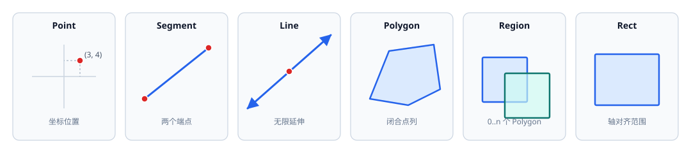
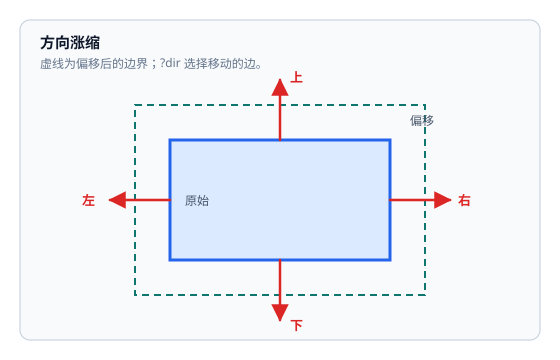
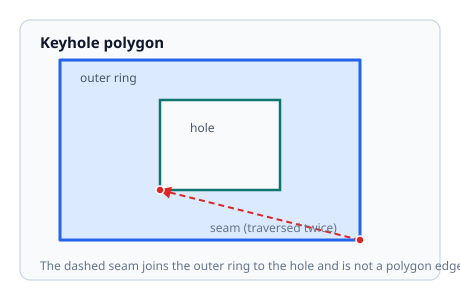
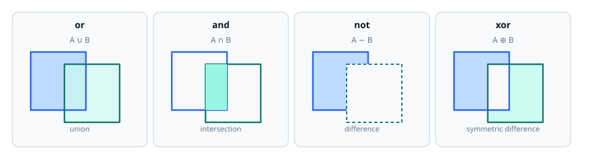

# ycGeom

[返回首页](../../README.md)

Cadence SKILL++ 的平面几何库：点、线段、直线、矩形、keyhole 多边形与区域布尔运算。

## 概要

- 所有坐标在构造时转为浮点数；整数输入不会产生舍入误差，`toSkill()` 始终输出浮点坐标。
- `Polygon` 只保存闭合点列；洞用水平或垂直切割线并入外环。
- `perimeter()` 默认扣除切割线，`?includeSeams t` 时按完整点列环计算。
- `Region` 表示 0..n 个多边形的并集，默认归一化为互不重叠的多边形集合。
- `?eps` 默认 `1e-9`；比较同时吸收坐标量级的机器精度相对误差；`?grid` 为正数或 nil；参数类型不符或取值非法时以 `error()` 中断。
- 对象按不可变值使用；运算返回新对象，不修改输入。
- `Polygon`、`Rect`、`Region` 可互相作为布尔运算的右操作数；结果统一为 `Region`。
- 非退化 `Rect` 与 `Polygon` 可通过 `toPolygon()`/`toRect()` 互转；退化 `Rect` 无对应 `Polygon`。
- `Polygon->removeCollinear()` 可显式获取去除共线点后的多边形。
- 例程中 `; =>` 表示返回值；六类对象都提供 `toSkill()`，输出只含 list 与 float 的原生数据。



*点、线段、直线、矩形、多边形与区域。*

## 快速上手

```lisp
; 点与线段
g_p = ycGeom::Point(3 4)
g_q = ycGeom::Point(0 0)
g_p->distanceTo(g_q)
; => 5.0

g_s = ycGeom::Segment(ycGeom::Point(0 0) ycGeom::Point(10 0))
g_s->midpoint()->toSkill()
; => (5.0 0.0)
g_s->contains(ycGeom::Point(5 0))
; => t

; 无限直线
g_l = ycGeom::Line(ycGeom::Point(0 0) ycGeom::Point(0 10))
g_l->distanceTo(ycGeom::Point(5 3))
; => 5.0

; 轴对齐矩形
g_rect = ycGeom::Rect(ycGeom::Point(10 4) ycGeom::Point(2 0))
g_rect->toSkill()
; => ((2.0 0.0) (10.0 4.0))

; 正方形多边形
g_sq = ycGeom::Polygon(list(
    ycGeom::Point(0 0)
    ycGeom::Point(10 0)
    ycGeom::Point(10 10)
    ycGeom::Point(0 10)
))
g_sq->area()
; => 100.0
g_sq->contains(ycGeom::Point(5 5))
; => t

; 区域并集
g_a = ycGeom::Region(list(g_sq))
g_b = ycGeom::Region(list(ycGeom::Polygon(list(
    ycGeom::Point(5 5)
    ycGeom::Point(15 5)
    ycGeom::Point(15 15)
    ycGeom::Point(5 15)
))))
g_a->or(g_b)->area()
; => 175.0
```

## API 参考

### ycGeom::Point <sub>`function`</sub> <sub>`class`</sub>

```text
ycGeom::Point(g_args ...)
=> Point
```

**描述**

构造不可变平面点。支持两个数值坐标或一个 `(x y)` 坐标对；非法参数以 `error()` 中断。

**参数**

| 名称 | 类型 | 默认值 | 说明 |
| --- | --- | --- | --- |
| g_args | any | | 两个数值坐标，或一个 `(x y)` 坐标对 |

**返回值**

`Point` — 坐标已转为浮点数的新点。

**例程**

```lisp
ycGeom::Point(1 2)->toSkill()
; => (1.0 2.0)
```

**方法**

> 必须使用 `->` 符号调用方法。

#### x <sub>`method`</sub>

```text
Point->x()
=> float
```

返回 x 坐标。

```lisp
ycGeom::Point(3 4)->x()
; => 3.0
```

#### y <sub>`method`</sub>

```text
Point->y()
=> float
```

返回 y 坐标。

```lisp
ycGeom::Point(3 4)->y()
; => 4.0
```

#### distanceTo <sub>`method`</sub>

```text
Point->distanceTo(g_other)
=> float
```

返回与另一点的欧氏距离。

| 参数 | 类型 | 默认值 | 说明 |
| --- | --- | --- | --- |
| g_other | Point | | 另一个 `Point` |

```lisp
ycGeom::Point(3 4)->distanceTo(ycGeom::Point(0 0))
; => 5.0
```

#### midpoint <sub>`method`</sub>

```text
Point->midpoint(g_other)
=> Point
```

返回与另一点的中点。

| 参数 | 类型 | 默认值 | 说明 |
| --- | --- | --- | --- |
| g_other | Point | | 另一个 `Point` |

```lisp
ycGeom::Point(0 0)->midpoint(ycGeom::Point(4 2))->toSkill()
; => (2.0 1.0)
```

#### translate <sub>`method`</sub>

```text
Point->translate(
    n_dx
    n_dy
)
=> Point
```

返回按给定位移平移后的新点。

| 参数 | 类型 | 默认值 | 说明 |
| --- | --- | --- | --- |
| n_dx | num | | x 位移 |
| n_dy | num | | y 位移 |

```lisp
ycGeom::Point(1 2)->translate(3 -1)->toSkill()
; => (4.0 1.0)
```

#### equals <sub>`method`</sub>

```text
Point->equals(
    g_other
    [ ?eps n_eps ]
)
=> t | nil
```

判断两个点的坐标是否都在绝对容差或机器精度相对容差内相等。

| 参数 | 类型 | 默认值 | 说明 |
| --- | --- | --- | --- |
| g_other | Point | | 另一个 `Point` |
| ?eps n_eps | num / nil | 1e-9 | 容差；默认 `1e-9` |

```lisp
ycGeom::Point(0 0)->equals(ycGeom::Point(1e-10 0) ?eps 1e-9)
; => t
```

#### toSkill <sub>`method`</sub>

```text
Point->toSkill()
=> list[float]
```

返回 `(x y)` 浮点坐标列表。

```lisp
ycGeom::Point(3 4)->toSkill()
; => (3.0 4.0)
```

### ycGeom::Segment <sub>`function`</sub> <sub>`class`</sub>

```text
ycGeom::Segment(g_args ...)
=> Segment
```

**描述**

构造不可变线段；支持两点、两点列表或四个坐标，零长度合法。传入非法参数以 `error()` 中断。

**参数**

| 名称 | 类型 | 默认值 | 说明 |
| --- | --- | --- | --- |
| g_args | any | | 两个 `Point`、两点坐标列表或四个端点坐标 |

**返回值**

`Segment` — 新线段。

**例程**

```lisp
ycGeom::Segment(ycGeom::Point(0 0) ycGeom::Point(3 4))->length()
; => 5.0
```

**方法**

> 必须使用 `->` 符号调用方法。

#### start <sub>`method`</sub>

```text
Segment->start()
=> Point
```

返回起点。

```lisp
ycGeom::Segment(0 0 10 0)->start()->toSkill()
; => (0.0 0.0)
```

#### end <sub>`method`</sub>

```text
Segment->end()
=> Point
```

返回终点。

```lisp
ycGeom::Segment(0 0 10 0)->end()->toSkill()
; => (10.0 0.0)
```

#### length <sub>`method`</sub>

```text
Segment->length()
=> float
```

返回线段长度。

```lisp
ycGeom::Segment(0 0 10 0)->length()
; => 10.0
```

#### midpoint <sub>`method`</sub>

```text
Segment->midpoint()
=> Point
```

返回线段中点。

```lisp
ycGeom::Segment(0 0 10 0)->midpoint()->toSkill()
; => (5.0 0.0)
```

#### direction <sub>`method`</sub>

```text
Segment->direction()
=> list[float] | nil
```

返回单位方向向量；零长度线段返回 nil。

```lisp
ycGeom::Segment(0 0 10 0)->direction()
; => (1.0 0.0)
```

#### project <sub>`method`</sub>

```text
Segment->project(g_point)
=> Point | nil
```

返回线段上的正交投影点；垂足落在线段外返回 nil，零长度线段返回起点。

| 参数 | 类型 | 默认值 | 说明 |
| --- | --- | --- | --- |
| g_point | Point | | 待投影的 `Point` |

```lisp
ycGeom::Segment(0 0 10 0)->project(ycGeom::Point(3 5))->toSkill()
; => (3.0 0.0)
```

#### nearestPoint <sub>`method`</sub>

```text
Segment->nearestPoint(g_point)
=> Point
```

返回线段上距离查询点最近的点；零长度线段返回起点。

| 参数 | 类型 | 默认值 | 说明 |
| --- | --- | --- | --- |
| g_point | Point | | 查询点 |

```lisp
ycGeom::Segment(0 0 10 0)->nearestPoint(ycGeom::Point(15 5))->toSkill()
; => (10.0 0.0)
```

#### distanceTo <sub>`method`</sub>

```text
Segment->distanceTo(g_point)
=> float
```

返回到线段的距离。

| 参数 | 类型 | 默认值 | 说明 |
| --- | --- | --- | --- |
| g_point | Point | | 查询点 |

```lisp
ycGeom::Segment(0 0 10 0)->distanceTo(ycGeom::Point(15 0))
; => 5.0
```

#### contains <sub>`method`</sub>

```text
Segment->contains(
    g_point
    [ ?eps n_eps ]
)
=> t | nil
```

判断点是否落在线段上（含端点）。

| 参数 | 类型 | 默认值 | 说明 |
| --- | --- | --- | --- |
| g_point | Point | | 查询点 |
| ?eps n_eps | num / nil | 1e-9 | 容差；默认 `1e-9` |

```lisp
ycGeom::Segment(0 0 10 0)->contains(ycGeom::Point(5 0))
; => t
```

#### bBox <sub>`method`</sub>

```text
Segment->bBox()
=> list[list[float]]
```

返回 `((xmin ymin) (xmax ymax))`。

```lisp
ycGeom::Segment(0 0 10 0)->bBox()
; => ((0.0 0.0) (10.0 0.0))
```

#### toRect <sub>`method`</sub>

```text
Segment->toRect()
=> Rect
```

返回以该线段包围盒为范围的轴对齐矩形；水平、垂直或零长度线段得到退化矩形（宽或高为 0）。

```lisp
ycGeom::Segment(0 0 10 0)->toRect()->toSkill()
; => ((0.0 0.0) (10.0 0.0))
```

#### intersection <sub>`method`</sub>

```text
Segment->intersection(
    g_other
    [ ?eps n_eps ]
)
=> Point | Segment | nil
```

计算与 `Line` 或 `Segment` 的交点：唯一交点返回 `Point`；共线重叠返回重叠部分 `Segment`；零长度线段按点处理；平行或无交返回 nil；其他对象类型以 `error()` 中断。

| 参数 | 类型 | 默认值 | 说明 |
| --- | --- | --- | --- |
| g_other | Line / Segment | | `Line` 或 `Segment` |
| ?eps n_eps | num / nil | 1e-9 | 容差；默认 `1e-9` |

```lisp
ycGeom::Segment(0 0 10 0)->intersection(ycGeom::Segment(5 -5 5 5))->toSkill()
; => (5.0 0.0)
```

#### toLine <sub>`method`</sub>

```text
Segment->toLine()
=> Line | nil
```

返回经过起终点的无限直线；零长度线段无对应直线，返回 nil。

```lisp
ycGeom::Segment(0 0 10 0)->toLine()->contains(ycGeom::Point(-5 0))
; => t
```

#### toSkill <sub>`method`</sub>

```text
Segment->toSkill()
=> list[list[float]]
```

返回 `((sx sy) (ex ey))` 浮点坐标列表。

```lisp
ycGeom::Segment(0 0 10 0)->toSkill()
; => ((0.0 0.0) (10.0 0.0))
```

### ycGeom::Line <sub>`function`</sub> <sub>`class`</sub>

```text
ycGeom::Line(g_args ...)
=> Line
```

**描述**

构造不可变无限直线；支持两点、两点列表或四个坐标。两点重合或非法参数以 `error()` 中断。

**参数**

| 名称 | 类型 | 默认值 | 说明 |
| --- | --- | --- | --- |
| g_args | any | | 两个 `Point`、两点坐标列表或四个坐标；两点重合时以 `error()` 中断 |

**返回值**

`Line` — 新直线；构造点重合时以 `error()` 中断。

**例程**

```lisp
g_l = ycGeom::Line(ycGeom::Point(0 0) ycGeom::Point(10 0))
g_l->contains(ycGeom::Point(4 0))
; => t
```

**方法**

> 必须使用 `->` 符号调用方法。

#### a <sub>`method`</sub>

```text
Line->a()
=> float
```

返回规范化方程 `a*x+b*y+c=0` 的 `a`。

```lisp
ycGeom::Line(0 0 10 0)->a()
; => 0.0
```

#### b <sub>`method`</sub>

```text
Line->b()
=> float
```

返回方程系数 `b`。

```lisp
ycGeom::Line(0 0 10 0)->b()
; => -1.0
```

#### c <sub>`method`</sub>

```text
Line->c()
=> float
```

返回方程系数 `c`。

```lisp
ycGeom::Line(0 0 10 0)->c()
; => 0.0
```

#### anchor <sub>`method`</sub>

```text
Line->anchor()
=> Point
```

返回直线上离原点最近的点。

```lisp
ycGeom::Line(0 0 10 0)->anchor()->toSkill()
; => (0.0 0.0)
```

#### direction <sub>`method`</sub>

```text
Line->direction()
=> list[float]
```

返回单位方向向量。

```lisp
ycGeom::Line(0 0 10 0)->direction()
; => (1.0 0.0)
```

#### normal <sub>`method`</sub>

```text
Line->normal()
=> list[float]
```

返回单位法向量。

```lisp
ycGeom::Line(0 0 10 0)->normal()
; => (0.0 -1.0)
```

#### project <sub>`method`</sub>

```text
Line->project(g_point)
=> Point
```

返回到直线的投影点。

| 参数 | 类型 | 默认值 | 说明 |
| --- | --- | --- | --- |
| g_point | Point | | 待投影点 |

```lisp
ycGeom::Line(0 0 10 0)->project(ycGeom::Point(3 5))->toSkill()
; => (3.0 0.0)
```

#### distanceTo <sub>`method`</sub>

```text
Line->distanceTo(g_point)
=> float
```

返回到直线的距离。

| 参数 | 类型 | 默认值 | 说明 |
| --- | --- | --- | --- |
| g_point | Point | | 查询点 |

```lisp
ycGeom::Line(0 0 10 0)->distanceTo(ycGeom::Point(3 5))
; => 5.0
```

#### contains <sub>`method`</sub>

```text
Line->contains(
    g_point
    [ ?eps n_eps ]
)
=> t | nil
```

判断点是否在直线上。

| 参数 | 类型 | 默认值 | 说明 |
| --- | --- | --- | --- |
| g_point | Point | | 查询点 |
| ?eps n_eps | num / nil | 1e-9 | 容差；默认 `1e-9` |

```lisp
ycGeom::Line(0 0 10 0)->contains(ycGeom::Point(4 0))
; => t
```

#### isParallel <sub>`method`</sub>

```text
Line->isParallel(
    g_line
    [ ?eps n_eps ]
)
=> t | nil
```

判断两条直线是否平行或重合。

| 参数 | 类型 | 默认值 | 说明 |
| --- | --- | --- | --- |
| g_line | Line | | 另一条 `Line` |
| ?eps n_eps | num / nil | 1e-9 | 容差；默认 `1e-9` |

```lisp
ycGeom::Line(0 0 10 0)->isParallel(ycGeom::Line(0 1 10 1))
; => t
```

#### intersection <sub>`method`</sub>

```text
Line->intersection(
    g_other
    [ ?eps n_eps ]
)
=> Point | Segment | nil
```

计算与 `Line` 或 `Segment` 的交点：唯一交点返回 `Point`；与线段共线时返回重叠 `Segment`；两条直线平行或重合返回 nil；其他对象类型以 `error()` 中断。

| 参数 | 类型 | 默认值 | 说明 |
| --- | --- | --- | --- |
| g_other | Line / Segment | | `Line` 或 `Segment` |
| ?eps n_eps | num / nil | 1e-9 | 容差；默认 `1e-9` |

```lisp
ycGeom::Line(0 0 10 0)->intersection(ycGeom::Line(5 -5 5 5))->toSkill()
; => (5.0 0.0)
```

#### toSkill <sub>`method`</sub>

```text
Line->toSkill()
=> list[list[float]]
```

返回 `((ax ay) (bx by))`，两点为 anchor 与 anchor 加单位方向。

```lisp
ycGeom::Line(0 0 10 0)->toSkill()
; => ((0.0 0.0) (1.0 0.0))
```

### ycGeom::Rect <sub>`function`</sub> <sub>`class`</sub>

```text
ycGeom::Rect(g_args ...)
=> Rect
```

**描述**

构造不可变轴对齐矩形；接受两个对角点、两点列表或四个坐标，并自动规范化为 `xmin`/`ymin`/`xmax`/`ymax`。零宽或零高合法；非法参数以 `error()` 中断。

**参数**

| 名称 | 类型 | 默认值 | 说明 |
| --- | --- | --- | --- |
| g_args | any | | 两个 `Point`、两点坐标列表或四个坐标 |

**返回值**

`Rect` — 新矩形；对角点顺序任意。

**例程**

```lisp
g_rect = ycGeom::Rect(ycGeom::Point(10 4) ycGeom::Point(2 0))
g_rect->width()
; => 8.0
g_rect->toSkill()
; => ((2.0 0.0) (10.0 4.0))
```

**方法**

> 必须使用 `->` 符号调用方法。

#### xmin <sub>`method`</sub>

```text
Rect->xmin()
=> float
```

返回左边界 `xmin`。

```lisp
ycGeom::Rect(0 0 10 4)->xmin()
; => 0.0
```

#### ymin <sub>`method`</sub>

```text
Rect->ymin()
=> float
```

返回下边界 `ymin`。

```lisp
ycGeom::Rect(0 0 10 4)->ymin()
; => 0.0
```

#### xmax <sub>`method`</sub>

```text
Rect->xmax()
=> float
```

返回右边界 `xmax`。

```lisp
ycGeom::Rect(0 0 10 4)->xmax()
; => 10.0
```

#### ymax <sub>`method`</sub>

```text
Rect->ymax()
=> float
```

返回上边界 `ymax`。

```lisp
ycGeom::Rect(0 0 10 4)->ymax()
; => 4.0
```

#### width <sub>`method`</sub>

```text
Rect->width()
=> float
```

返回宽度 `xmax - xmin`。

```lisp
ycGeom::Rect(0 0 10 4)->width()
; => 10.0
```

#### height <sub>`method`</sub>

```text
Rect->height()
=> float
```

返回高度 `ymax - ymin`。

```lisp
ycGeom::Rect(0 0 10 4)->height()
; => 4.0
```

#### area <sub>`method`</sub>

```text
Rect->area()
=> float
```

返回面积 `width * height`；退化矩形为 0。

```lisp
ycGeom::Rect(0 0 10 4)->area()
; => 40.0
```

#### size <sub>`method`</sub>

```text
Rect->size(
    n_value
    [ ?dir g_dir ]
    [ ?ratio g_ratio ]
    [ ?corner g_corner ]
    [ ?miterLimit n_miterLimit ]
    [ ?roundSegments n_roundSegments ]
)
=> Region
```

按真实边界做方向涨缩，返回 Region；参数语义与 `Polygon->size` 相同。退化矩形返回空 Region，结果多边形已去除共线点。

| 参数 | 类型 | 默认值 | 说明 |
| --- | --- | --- | --- |
| n_value | num | | 距离或倍率 |
| ?dir g_dir | sym / list[sym] | 'all | `'all`、`'left`、`'right`、`'up`、`'down` 或方向列表；默认 `'all` |
| ?ratio g_ratio | t / nil | nil | nil 时按绝对距离，t 时按 bBox 范围的倍率；1.0 无变化 |
| ?corner g_corner | sym | 'miter | `'miter`、`'round`、`'bevel`、`'none`；默认 `'miter` |
| ?miterLimit n_miterLimit | num / nil | 4 | miter 长度限制；默认 4 |
| ?roundSegments n_roundSegments | int / nil | 8 | 每 90 度圆角线段数；默认 8 |

`?dir` 的有效值：

| 有效值 | 结果 |
| --- | --- |
| `'left` | 选择左侧（x 最小）方向的边 |
| `'right` | 选择右侧（x 最大）方向的边 |
| `'up` | 选择上方（y 最大）方向的边 |
| `'down` | 选择下方（y 最小）方向的边 |
| `'all` | 四个方向全部选择 |

`?dir` 可传方向列表组合选择，但不能与 `'all` 混用；空列表、未知符号或非法类型以 `error()` 中断。

`?corner` 的有效值：

| 有效值 | 结果 |
| --- | --- |
| `'miter` | 尖角帽；超过 `?miterLimit` 时退回 bevel |
| `'round` | 圆弧帽，段数由 `?roundSegments` 控制 |
| `'bevel` | 斜切帽 |
| `'none` | 不补帽，只保留边带 |

其他值以 `error()` 中断。

```lisp
g_rect = ycGeom::Rect(0 0 10 10)
g_rect->size(1)->area()
; => 144.0
g_rect->size(1 ?dir 'right)->area()
; => 110.0
```

#### center <sub>`method`</sub>

```text
Rect->center()
=> Point
```

返回矩形中心点。

```lisp
ycGeom::Rect(0 0 10 4)->center()->toSkill()
; => (5.0 2.0)
```

#### contains <sub>`method`</sub>

```text
Rect->contains(g_point)
=> t | nil
```

判断点是否在矩形内（含边界）。

| 参数 | 类型 | 默认值 | 说明 |
| --- | --- | --- | --- |
| g_point | Point | | 查询点 |

```lisp
ycGeom::Rect(0 0 10 4)->contains(ycGeom::Point(5 2))
; => t
```

#### bBox <sub>`method`</sub>

```text
Rect->bBox()
=> list[list[float]]
```

返回 `((xmin ymin) (xmax ymax))`。

```lisp
ycGeom::Rect(0 0 10 4)->bBox()
; => ((0.0 0.0) (10.0 4.0))
```

#### or <sub>`method`</sub>

```text
Rect->or(
    g_other
    [ ?grid n_grid ]
    [ ?eps n_eps ]
)
=> Region
```

返回与另一二维图形的并集 Region。

| 参数 | 类型 | 默认值 | 说明 |
| --- | --- | --- | --- |
| g_other | Polygon / Rect / Region / list | | 另一二维图形或点列 |
| ?grid n_grid | num / nil | nil | 布尔网格；默认 nil |
| ?eps n_eps | num / nil | 1e-9 | 容差；默认 `1e-9` |

```lisp
ycGeom::Rect(0 0 4 4)->or(ycGeom::Rect(2 2 6 6))->area()
; => 28.0
```

#### and <sub>`method`</sub>

```text
Rect->and(
    g_other
    [ ?grid n_grid ]
    [ ?eps n_eps ]
)
=> Region
```

返回与另一二维图形的交集 Region；无公共部分时返回空 Region。

| 参数 | 类型 | 默认值 | 说明 |
| --- | --- | --- | --- |
| g_other | Polygon / Rect / Region / list | | 另一二维图形或点列 |
| ?grid n_grid | num / nil | nil | 布尔网格；默认 nil |
| ?eps n_eps | num / nil | 1e-9 | 容差；默认 `1e-9` |

```lisp
ycGeom::Rect(0 0 4 4)->and(ycGeom::Rect(2 2 6 6))->area()
; => 4.0
```

#### not <sub>`method`</sub>

```text
Rect->not(
    g_other
    [ ?grid n_grid ]
    [ ?eps n_eps ]
)
=> Region
```

返回二元差集 `A - B` 的 Region；`not` 不是一元补集。

| 参数 | 类型 | 默认值 | 说明 |
| --- | --- | --- | --- |
| g_other | Polygon / Rect / Region / list | | 另一二维图形或点列 |
| ?grid n_grid | num / nil | nil | 布尔网格；默认 nil |
| ?eps n_eps | num / nil | 1e-9 | 容差；默认 `1e-9` |

```lisp
ycGeom::Rect(0 0 4 4)->not(ycGeom::Rect(2 2 6 6))->area()
; => 12.0
```

#### xor <sub>`method`</sub>

```text
Rect->xor(
    g_other
    [ ?grid n_grid ]
    [ ?eps n_eps ]
)
=> Region
```

返回与另一二维图形的对称差 Region。

| 参数 | 类型 | 默认值 | 说明 |
| --- | --- | --- | --- |
| g_other | Polygon / Rect / Region / list | | 另一二维图形或点列 |
| ?grid n_grid | num / nil | nil | 布尔网格；默认 nil |
| ?eps n_eps | num / nil | 1e-9 | 容差；默认 `1e-9` |

```lisp
ycGeom::Rect(0 0 4 4)->xor(ycGeom::Rect(2 2 6 6))->area()
; => 24.0
```

#### toPolygon <sub>`method`</sub>

```text
Rect->toPolygon()
=> Polygon | nil
```

返回逆时针四角 Polygon；宽/高为 0 或面积低于按尺度计算的退化阈值的矩形返回 nil。

```lisp
ycGeom::Rect(0 0 4 4)->toPolygon()->toSkill()
; => ((0.0 0.0) (4.0 0.0) (4.0 4.0) (0.0 4.0))
```

#### toSkill <sub>`method`</sub>

```text
Rect->toSkill()
=> list[list[float]]
```

返回 `((xmin ymin) (xmax ymax))` 浮点坐标列表。

```lisp
ycGeom::Rect(0 0 10 4)->toSkill()
; => ((0.0 0.0) (10.0 4.0))
```

### ycGeom::Polygon <sub>`function`</sub> <sub>`class`</sub>

```text
ycGeom::Polygon(l_points)
=> Polygon
```

**描述**

构造不可变 keyhole 多边形。`l_points` 接受 Point 列表、`(x y)` 列表或扁平数值坐标；切割边以同一无向边往返出现两次表示，且必须是水平或垂直方向；非法点列以 `error()` 中断。

**参数**

| 名称 | 类型 | 默认值 | 说明 |
| --- | --- | --- | --- |
| l_points | list | | Point 列表、(x y) 列表或扁平数值坐标 |

**返回值**

`Polygon` — 复制外层点列的新多边形；非法点列以 `error()` 中断。

**例程**

```lisp
g_p = ycGeom::Polygon('((0 0) (4 0) (4 4) (0 4)))
g_p->area()
; => 16.0

ycGeom::Polygon(list(0 0 4 0 4 4 0 4))->area()
; => 16.0
```

**方法**

> 必须使用 `->` 符号调用方法。

#### points <sub>`method`</sub>

```text
Polygon->points()
=> list[Point]
```

返回内部点列；调用方不得原地修改。

```lisp
car(ycGeom::Polygon('((0 0) (4 0) (4 4) (0 4)))->points())->toSkill()
; => (0.0 0.0)
```

#### edges <sub>`method`</sub>

```text
Polygon->edges()
=> list[Segment]
```

返回相邻点形成的所有边，包含切割边。

```lisp
length(ycGeom::Polygon('((0 0) (4 0) (4 4) (0 4)))->edges())
; => 4
```

#### area <sub>`method`</sub>

```text
Polygon->area()
=> float
```

返回绝对面积；切割线往返抵消。

```lisp
ycGeom::Polygon('((0 0) (4 0) (4 4) (0 4)))->area()
; => 16.0
```

#### perimeter <sub>`method`</sub>

```text
Polygon->perimeter(
    [ ?includeSeams g_includeSeams ]
    [ ?eps n_eps ]
)
=> float
```

返回周长；默认扣除切割线。

| 参数 | 类型 | 默认值 | 说明 |
| --- | --- | --- | --- |
| ?includeSeams g_includeSeams | t / nil | nil | t 时计入切割线；默认 nil |
| ?eps n_eps | num / nil | 1e-9 | 容差；默认 `1e-9` |

```lisp
ycGeom::Polygon('((0 0) (4 0) (4 4) (0 4)))->perimeter()
; => 16.0
```

#### centroid <sub>`method`</sub>

```text
Polygon->centroid()
=> Point
```

返回面积加权质心。

```lisp
ycGeom::Polygon('((0 0) (4 0) (4 4) (0 4)))->centroid()->toSkill()
; => (2.0 2.0)
```

#### contains <sub>`method`</sub>

```text
Polygon->contains(
    g_point
    [ ?boundary t_boundary ]
    [ ?eps n_eps ]
)
=> t | nil
```

判断点是否在多边形内或边界上。

| 参数 | 类型 | 默认值 | 说明 |
| --- | --- | --- | --- |
| g_point | Point | | 查询点 |
| ?boundary t_boundary | str | "inside" | `"inside"` 或 `"outside"`；默认 `"inside"` |
| ?eps n_eps | num / nil | 1e-9 | 容差；默认 `1e-9` |

`?boundary` 的有效值：

| 有效值 | 结果 |
| --- | --- |
| `"inside"` | 边界上的点视为在内部 |
| `"outside"` | 边界上的点视为在外部 |

其他值以 `error()` 中断。

```lisp
g_p = ycGeom::Polygon('((0 0) (4 0) (4 4) (0 4)))
g_p->contains(ycGeom::Point(0 0))
; => t
g_p->contains(ycGeom::Point(0 0) ?boundary "outside")
; => nil
```

#### onBoundary <sub>`method`</sub>

```text
Polygon->onBoundary(
    g_point
    [ ?includeSeams g_includeSeams ]
    [ ?eps n_eps ]
)
=> t | nil
```

判断点是否在真实边界上；默认不把切割线视为边界。

| 参数 | 类型 | 默认值 | 说明 |
| --- | --- | --- | --- |
| g_point | Point | | 查询点 |
| ?includeSeams g_includeSeams | t / nil | nil | t 时把切割线视为边界；默认 nil |
| ?eps n_eps | num / nil | 1e-9 | 容差；默认 `1e-9` |

```lisp
ycGeom::Polygon('((0 0) (4 0) (4 4) (0 4)))->onBoundary(ycGeom::Point(0 2))
; => t
```

#### bBox <sub>`method`</sub>

```text
Polygon->bBox()
=> list[list[float]]
```

返回 `((xmin ymin) (xmax ymax))`。

```lisp
ycGeom::Polygon('((0 0) (4 0) (4 4) (0 4)))->bBox()
; => ((0.0 0.0) (4.0 4.0))
```

#### toRect <sub>`method`</sub>

```text
Polygon->toRect()
=> Rect
```

返回以该多边形包围盒为范围的轴对齐矩形。

```lisp
ycGeom::Polygon('((0 0) (4 0) (4 4) (0 4)))->toRect()->toSkill()
; => ((0.0 0.0) (4.0 4.0))
```

#### isClockwise <sub>`method`</sub>

```text
Polygon->isClockwise([ ?eps n_eps ])
=> t | nil
```

按 signed shoelace 判断点列是否顺时针。

| 参数 | 类型 | 默认值 | 说明 |
| --- | --- | --- | --- |
| ?eps n_eps | num / nil | 1e-9 | 容差；默认 `1e-9` |

```lisp
ycGeom::Polygon('((0 0) (4 0) (4 4) (0 4)))->isClockwise()
; => nil
```

#### reverse <sub>`method`</sub>

```text
Polygon->reverse()
=> Polygon
```

返回反向绕行的新多边形。

```lisp
ycGeom::Polygon('((0 0) (4 0) (4 4) (0 4)))->reverse()->toSkill()
; => ((0.0 4.0) (4.0 4.0) (4.0 0.0) (0.0 0.0))
```

#### removeCollinear <sub>`method`</sub>

```text
Polygon->removeCollinear([ ?eps n_eps ])
=> Polygon
```

返回去除共线中间点后的新 Polygon；切割边端点保留。`?eps` 默认 `1e-9`。

| 参数 | 类型 | 默认值 | 说明 |
| --- | --- | --- | --- |
| ?eps n_eps | num / nil | 1e-9 | 共线判断容差；默认 `1e-9` |

```lisp
ycGeom::Polygon('((0 0) (2 0) (4 0) (4 4) (0 4)))->removeCollinear()->toSkill()
; => ((0.0 0.0) (4.0 0.0) (4.0 4.0) (0.0 4.0))
```

#### size <sub>`method`</sub>

```text
Polygon->size(
    n_value
    [ ?dir g_dir ]
    [ ?ratio g_ratio ]
    [ ?corner g_corner ]
    [ ?miterLimit n_miterLimit ]
    [ ?roundSegments n_roundSegments ]
)
=> Region
```

按真实边界做方向涨缩，返回 Region。正值外涨、负值内缩；`?ratio t` 时把 `n_value` 当作正倍率。结果多边形已去除共线点。

| 参数 | 类型 | 默认值 | 说明 |
| --- | --- | --- | --- |
| n_value | num | | 距离或倍率 |
| ?dir g_dir | sym / list[sym] | 'all | `'all`、`'left`、`'right`、`'up`、`'down` 或方向列表；默认 `'all` |
| ?ratio g_ratio | t / nil | nil | nil 时按绝对距离，t 时按 bBox 范围的倍率；1.0 无变化 |
| ?corner g_corner | sym | 'miter | `'miter`、`'round`、`'bevel`、`'none`；默认 `'miter` |
| ?miterLimit n_miterLimit | num / nil | 4 | miter 长度限制；默认 4 |
| ?roundSegments n_roundSegments | int / nil | 8 | 每 90 度圆角线段数；默认 8 |

`?dir` 的有效值：

| 有效值 | 结果 |
| --- | --- |
| `'left` | 选择左侧（x 最小）方向的边 |
| `'right` | 选择右侧（x 最大）方向的边 |
| `'up` | 选择上方（y 最大）方向的边 |
| `'down` | 选择下方（y 最小）方向的边 |
| `'all` | 四个方向全部选择 |

`?dir` 可传方向列表组合选择，但不能与 `'all` 混用；空列表、未知符号或非法类型以 `error()` 中断。

`?corner` 的有效值：

| 有效值 | 结果 |
| --- | --- |
| `'miter` | 尖角帽；超过 `?miterLimit` 时退回 bevel |
| `'round` | 圆弧帽，段数由 `?roundSegments` 控制 |
| `'bevel` | 斜切帽 |
| `'none` | 不补帽，只保留边带 |

其他值以 `error()` 中断。



*图：`?dir` 选择边，虚线为偏移后的边界。*

`?corner 'none` 只保留边带、不补拐角，可能产生十字/缺口轮廓。offset 可能拆分或合并图形，因此统一返回 Region。

```lisp
g_sq = ycGeom::Polygon('((0 0) (10 0) (10 10) (0 10)))
g_sq->size(1 ?corner 'miter)->bBox()
; => ((-1.0 -1.0) (11.0 11.0))
g_sq->size(1 ?dir 'right ?corner 'miter)->bBox()
; => ((0.0 0.0) (11.0 10.0))
g_sq->size(1.2 ?ratio t ?dir 'right)->bBox()
; => ((0.0 0.0) (12.0 10.0))
```

#### or <sub>`method`</sub>

```text
Polygon->or(
    g_other
    [ ?grid n_grid ]
    [ ?eps n_eps ]
)
=> Region
```

返回与另一二维图形的并集 Region。

| 参数 | 类型 | 默认值 | 说明 |
| --- | --- | --- | --- |
| g_other | Polygon / Rect / Region / list | | 另一二维图形或点列；非法类型以 `error()` 中断 |
| ?grid n_grid | num / nil | nil | 布尔网格；默认 nil |
| ?eps n_eps | num / nil | 1e-9 | 容差；默认 `1e-9` |

```lisp
ycGeom::Polygon('((0 0) (4 0) (4 4) (0 4)))->or(ycGeom::Polygon('((2 2) (6 2) (6 6) (2 6))))->area()
; => 28.0
```

#### and <sub>`method`</sub>

```text
Polygon->and(
    g_other
    [ ?grid n_grid ]
    [ ?eps n_eps ]
)
=> Region
```

返回与另一二维图形的交集 Region；无公共部分时返回空 Region。

| 参数 | 类型 | 默认值 | 说明 |
| --- | --- | --- | --- |
| g_other | Polygon / Rect / Region / list | | 另一二维图形或点列；其他类型以 `error()` 中断 |
| ?grid n_grid | num / nil | nil | 布尔网格；默认 nil |
| ?eps n_eps | num / nil | 1e-9 | 容差；默认 `1e-9` |

```lisp
ycGeom::Polygon('((0 0) (4 0) (4 4) (0 4)))->and(ycGeom::Polygon('((2 2) (6 2) (6 6) (2 6))))->area()
; => 4.0
```

#### not <sub>`method`</sub>

```text
Polygon->not(
    g_other
    [ ?grid n_grid ]
    [ ?eps n_eps ]
)
=> Region
```

返回与另一二维图形的二元差集 `A - B` 的 Region；`not` 不是一元补集。

| 参数 | 类型 | 默认值 | 说明 |
| --- | --- | --- | --- |
| g_other | Polygon / Rect / Region / list | | 另一二维图形或点列；其他类型以 `error()` 中断 |
| ?grid n_grid | num / nil | nil | 布尔网格；默认 nil |
| ?eps n_eps | num / nil | 1e-9 | 容差；默认 `1e-9` |

```lisp
ycGeom::Polygon('((0 0) (4 0) (4 4) (0 4)))->not(ycGeom::Polygon('((2 2) (6 2) (6 6) (2 6))))->area()
; => 12.0
```

#### xor <sub>`method`</sub>

```text
Polygon->xor(
    g_other
    [ ?grid n_grid ]
    [ ?eps n_eps ]
)
=> Region
```

返回与另一二维图形的对称差 Region。

| 参数 | 类型 | 默认值 | 说明 |
| --- | --- | --- | --- |
| g_other | Polygon / Rect / Region / list | | 另一二维图形或点列；其他类型以 `error()` 中断 |
| ?grid n_grid | num / nil | nil | 布尔网格；默认 nil |
| ?eps n_eps | num / nil | 1e-9 | 容差；默认 `1e-9` |

```lisp
g_a = ycGeom::Polygon('((0 0) (4 0) (4 4) (0 4)))
g_b = ycGeom::Polygon('((2 2) (6 2) (6 6) (2 6)))
g_a->or(g_b)->area()
; => 28.0
g_a->not(g_b)->area()
; => 12.0
```

#### toSkill <sub>`method`</sub>

```text
Polygon->toSkill()
=> list[list[float]]
```

返回 `((x1 y1) (x2 y2) ...)`，保留切割线与点序。

```lisp
ycGeom::Polygon('((0 0) (4 0) (4 4) (0 4)))->toSkill()
; => ((0.0 0.0) (4.0 0.0) (4.0 4.0) (0.0 4.0))
```

### ycGeom::Region <sub>`function`</sub> <sub>`class`</sub>

```text
ycGeom::Region(
    l_polygons
    [ ?normalize g_normalize ]
    [ ?grid n_grid ]
    [ ?eps n_eps ]
)
=> Region
```

**描述**

构造不可变区域，空区域合法。`l_polygons` 接受 Polygon 列表或点列列表；默认归一化为互不重叠的多边形集合；非法参数以 `error()` 中断。

**参数**

| 名称 | 类型 | 默认值 | 说明 |
| --- | --- | --- | --- |
| l_polygons | list | | Polygon 列表或点列列表；nil 表示空区域 |
| ?normalize g_normalize | t / nil | t | 是否归一化为互不重叠 |
| ?grid n_grid | num / nil | nil | 布尔网格；只影响归一化 |
| ?eps n_eps | num / nil | 1e-9 | 容差 |

**返回值**

`Region` — 新区域；非法参数以 `error()` 中断。

**例程**

```lisp
g_r = ycGeom::Region(nil)
g_r->isEmpty()
; => t
```

**方法**

> 必须使用 `->` 符号调用方法。

#### polygons <sub>`method`</sub>

```text
Region->polygons()
=> list[Polygon]
```

返回内部 Polygon 列表；调用方不得原地修改。

```lisp
length(ycGeom::Region(list(ycGeom::Polygon('((0 0) (4 0) (4 4) (0 4)))))->polygons())
; => 1
```

#### area <sub>`method`</sub>

```text
Region->area()
=> float
```

返回面积和；空区域为 `0.0`。

```lisp
ycGeom::Region(list(ycGeom::Polygon('((0 0) (4 0) (4 4) (0 4)))))->area()
; => 16.0
```

#### perimeter <sub>`method`</sub>

```text
Region->perimeter(
    [ ?includeSeams g_includeSeams ]
    [ ?eps n_eps ]
)
=> float
```

返回周长和；空区域为 `0.0`。

| 参数 | 类型 | 默认值 | 说明 |
| --- | --- | --- | --- |
| ?includeSeams g_includeSeams | t / nil | nil | t 时计入切割线；默认 nil |
| ?eps n_eps | num / nil | 1e-9 | 容差；默认 `1e-9` |

```lisp
ycGeom::Region(list(ycGeom::Polygon('((0 0) (4 0) (4 4) (0 4)))))->perimeter()
; => 16.0
```

#### centroid <sub>`method`</sub>

```text
Region->centroid()
=> Point | nil
```

返回面积加权质心；空区域返回 nil。

```lisp
ycGeom::Region(list(ycGeom::Polygon('((0 0) (4 0) (4 4) (0 4)))))->centroid()->toSkill()
; => (2.0 2.0)
```

#### contains <sub>`method`</sub>

```text
Region->contains(
    g_point
    [ ?boundary t_boundary ]
    [ ?eps n_eps ]
)
=> t | nil
```

判断点是否属于区域。

| 参数 | 类型 | 默认值 | 说明 |
| --- | --- | --- | --- |
| g_point | Point | | 查询点 |
| ?boundary t_boundary | str | "inside" | `"inside"` 或 `"outside"`；默认 `"inside"` |
| ?eps n_eps | num / nil | 1e-9 | 容差；默认 `1e-9` |

`?boundary` 的有效值：

| 有效值 | 结果 |
| --- | --- |
| `"inside"` | 边界上的点视为在内部 |
| `"outside"` | 边界上的点视为在外部 |

其他值以 `error()` 中断。

```lisp
ycGeom::Region(list(ycGeom::Polygon('((0 0) (4 0) (4 4) (0 4)))))->contains(ycGeom::Point(2 2))
; => t
```

#### onBoundary <sub>`method`</sub>

```text
Region->onBoundary(
    g_point
    [ ?includeSeams g_includeSeams ]
    [ ?eps n_eps ]
)
=> t | nil
```

判断点是否在区域边界上。

| 参数 | 类型 | 默认值 | 说明 |
| --- | --- | --- | --- |
| g_point | Point | | 查询点 |
| ?includeSeams g_includeSeams | t / nil | nil | t 时计入切割线；默认 nil |
| ?eps n_eps | num / nil | 1e-9 | 容差；默认 `1e-9` |

```lisp
ycGeom::Region(list(ycGeom::Polygon('((0 0) (4 0) (4 4) (0 4)))))->onBoundary(ycGeom::Point(0 0))
; => t
```

#### bBox <sub>`method`</sub>

```text
Region->bBox()
=> list[list[float]] | nil
```

返回 `((xmin ymin) (xmax ymax))`；空区域返回 nil。

```lisp
ycGeom::Region(list(ycGeom::Polygon('((0 0) (4 0) (4 4) (0 4)))))->bBox()
; => ((0.0 0.0) (4.0 4.0))
```

#### toRect <sub>`method`</sub>

```text
Region->toRect()
=> Rect | nil
```

返回区域包围盒对应的轴对齐矩形；空区域返回 nil。

```lisp
ycGeom::Region(list(ycGeom::Polygon('((0 0) (4 0) (4 4) (0 4)))))->toRect()->toSkill()
; => ((0.0 0.0) (4.0 4.0))
```

#### isEmpty <sub>`method`</sub>

```text
Region->isEmpty()
=> t | nil
```

空区域返回 t。

```lisp
ycGeom::Region(nil)->isEmpty()
; => t
```

#### size <sub>`method`</sub>

```text
Region->size(
    n_value
    [ ?dir g_dir ]
    [ ?ratio g_ratio ]
    [ ?corner g_corner ]
    [ ?miterLimit n_miterLimit ]
    [ ?roundSegments n_roundSegments ]
)
=> Region
```

对 Region 中的每个 Polygon 独立做真实边界涨缩，再归一化合并。参数语义与 `Polygon->size` 相同；结果多边形已去除共线点。

| 参数 | 类型 | 默认值 | 说明 |
| --- | --- | --- | --- |
| n_value | num | | 距离或倍率 |
| ?dir g_dir | sym / list[sym] | 'all | 方向或方向列表；默认 `'all` |
| ?ratio g_ratio | t / nil | nil | nil 时按绝对距离，t 时按 bBox 范围的倍率；1.0 无变化 |
| ?corner g_corner | sym | 'miter | 拐角风格；默认 `'miter` |
| ?miterLimit n_miterLimit | num / nil | 4 | miter 长度限制；默认 4 |
| ?roundSegments n_roundSegments | int / nil | 8 | 每 90 度圆角线段数；默认 8 |

`?dir` 的有效值：

| 有效值 | 结果 |
| --- | --- |
| `'left` | 选择左侧（x 最小）方向的边 |
| `'right` | 选择右侧（x 最大）方向的边 |
| `'up` | 选择上方（y 最大）方向的边 |
| `'down` | 选择下方（y 最小）方向的边 |
| `'all` | 四个方向全部选择 |

`?dir` 可传方向列表组合选择，但不能与 `'all` 混用；空列表、未知符号或非法类型以 `error()` 中断。

`?corner` 的有效值：

| 有效值 | 结果 |
| --- | --- |
| `'miter` | 尖角帽；超过 `?miterLimit` 时退回 bevel |
| `'round` | 圆弧帽，段数由 `?roundSegments` 控制 |
| `'bevel` | 斜切帽 |
| `'none` | 不补帽，只保留边带 |

其他值以 `error()` 中断。

```lisp
g_a = ycGeom::Polygon('((0 0) (10 0) (10 10) (0 10)))
g_r = ycGeom::Region(list(g_a))
g_r->size(1)->area()
; => 144.0
```

#### or <sub>`method`</sub>

```text
Region->or(
    g_other
    [ ?grid n_grid ]
    [ ?eps n_eps ]
)
=> Region
```

返回并集 `A ∪ B`。结果按 Region 的集合语义归一化；两区域都为空时结果为空 Region。

| 参数 | 类型 | 默认值 | 说明 |
| --- | --- | --- | --- |
| g_other | Region / Polygon / Rect / list | | 另一二维图形或点列；其他类型以 `error()` 中断 |
| ?grid n_grid | num / nil | nil | 布尔网格；默认 nil |
| ?eps n_eps | num / nil | 1e-9 | 容差；默认 `1e-9` |

```lisp
g_a = ycGeom::Region(list(ycGeom::Polygon('((0 0) (4 0) (4 4) (0 4)))))
g_b = ycGeom::Region(list(ycGeom::Polygon('((2 2) (6 2) (6 6) (2 6)))))
g_a->or(g_b)->area()
; => 28.0
```

#### and <sub>`method`</sub>

```text
Region->and(
    g_other
    [ ?grid n_grid ]
    [ ?eps n_eps ]
)
=> Region
```

返回交集 `A ∩ B`。两区域无公共部分时返回空 Region；空 Region 的 `isEmpty()` 为 t。

| 参数 | 类型 | 默认值 | 说明 |
| --- | --- | --- | --- |
| g_other | Region / Polygon / Rect / list | | 另一二维图形或点列；其他类型以 `error()` 中断 |
| ?grid n_grid | num / nil | nil | 布尔网格；默认 nil |
| ?eps n_eps | num / nil | 1e-9 | 容差；默认 `1e-9` |

```lisp
g_a = ycGeom::Region(list(ycGeom::Polygon('((0 0) (4 0) (4 4) (0 4)))))
g_b = ycGeom::Region(list(ycGeom::Polygon('((2 2) (6 2) (6 6) (2 6)))))
g_a->and(g_b)->area()
; => 4.0
```

#### not <sub>`method`</sub>

```text
Region->not(
    g_other
    [ ?grid n_grid ]
    [ ?eps n_eps ]
)
=> Region
```

返回二元差集 `A - B`：保留属于 A 且不属于 B 的部分。`not` 不是一元补集；B 为空时返回 A，A 为空时返回空 Region。

| 参数 | 类型 | 默认值 | 说明 |
| --- | --- | --- | --- |
| g_other | Region / Polygon / Rect / list | | 另一二维图形或点列；其他类型以 `error()` 中断 |
| ?grid n_grid | num / nil | nil | 布尔网格；默认 nil |
| ?eps n_eps | num / nil | 1e-9 | 容差；默认 `1e-9` |

```lisp
g_a = ycGeom::Region(list(ycGeom::Polygon('((0 0) (4 0) (4 4) (0 4)))))
g_b = ycGeom::Region(list(ycGeom::Polygon('((2 2) (6 2) (6 6) (2 6)))))
g_a->not(g_b)->area()
; => 12.0
```

#### xor <sub>`method`</sub>

```text
Region->xor(
    g_other
    [ ?grid n_grid ]
    [ ?eps n_eps ]
)
=> Region
```

返回对称差：只属于 A 或只属于 B 的部分，等价于 `(A->or(B))->not(A->and(B))`。

| 参数 | 类型 | 默认值 | 说明 |
| --- | --- | --- | --- |
| g_other | Region / Polygon / Rect / list | | 另一二维图形或点列；其他类型以 `error()` 中断 |
| ?grid n_grid | num / nil | nil | 布尔网格；默认 nil |
| ?eps n_eps | num / nil | 1e-9 | 容差；默认 `1e-9` |

```lisp
g_a = ycGeom::Region(list(ycGeom::Polygon('((0 0) (4 0) (4 4) (0 4)))))
g_b = ycGeom::Region(list(ycGeom::Polygon('((2 2) (6 2) (6 6) (2 6)))))
g_a->xor(g_b)->area()
; => 24.0
```

#### toSkill <sub>`method`</sub>

```text
Region->toSkill()
=> list[list[list[float]]] | nil
```

返回每个 Polygon 一个坐标点列；空区域返回 nil。

## 几何约定

```lisp
ycGeom::Region(list(ycGeom::Polygon('((0 0) (4 0) (4 4) (0 4)))))->toSkill()
; => (((0.0 0.0) (4.0 0.0) (4.0 4.0) (0.0 4.0)))
```

### keyhole 多边形

有洞多边形使用水平或垂直切割线把内环并入外环：

```text
外环若干点 -> 水平/垂直切割线进入内环 -> 内环一圈 -> 沿切割线返回 -> 外环剩余点
```

切割边通过同一无向边出现两次识别，不写入对象状态。切割线只能是水平或垂直方向，斜线切割以 `error()` 中断。外环与洞环应反向绕行；布尔运算输出保证这一点，并优先使用水平切割线。



*图：外环通过水平切割线连接内洞。*

```lisp
g_hole = ycGeom::Polygon(list(
    ycGeom::Point(0 0)
    ycGeom::Point(10 0)
    ycGeom::Point(10 7)
    ycGeom::Point(7 7)
    ycGeom::Point(7 3)
    ycGeom::Point(3 3)
    ycGeom::Point(3 7)
    ycGeom::Point(7 7)
    ycGeom::Point(10 7)
    ycGeom::Point(10 10)
    ycGeom::Point(0 10)
))
g_hole->area()
; => 84.0
g_hole->perimeter()
; => 56.0
```

### 区域归一化与布尔运算

- 默认 `?normalize t` 会把输入合并、裁剪为互不重叠的多边形集合。
- `?normalize nil` 信任输入已互不重叠，跳过归一化；此时面积按各块面积求和。
- `?grid` 把输入和输出顶点吸附到网格；吸附导致拓扑塌缩时以 `error()` 中断。
- `Polygon`、`Rect`、`Region` 可互相参与 `or`/`and`/`not`/`xor`；右操作数也接受点列，结果统一为 `Region`。退化 `Rect`（宽/高为 0 或面积低于按尺度计算的退化阈值）与空 `Region` 按空集处理。
- 默认归一化、布尔与 `size` 输出的多边形均已去除共线中间点；切割边端点保留。



*图：两个区域 A、B 的四种布尔结果。*

```lisp
g_a = ycGeom::Polygon(list(
    ycGeom::Point(0 0) ycGeom::Point(4 0)
    ycGeom::Point(4 4) ycGeom::Point(0 4)
))
g_b = ycGeom::Polygon(list(
    ycGeom::Point(2 2) ycGeom::Point(6 2)
    ycGeom::Point(6 6) ycGeom::Point(2 6)
))
ycGeom::Region(list(g_a))->and(ycGeom::Region(list(g_b)))->area()
; => 4.0
ycGeom::Rect(0 0 4 4)->or(g_b)->area()
; => 28.0
```

[返回首页](../../README.md)
