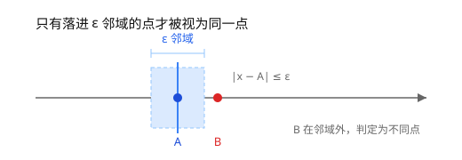
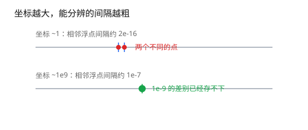
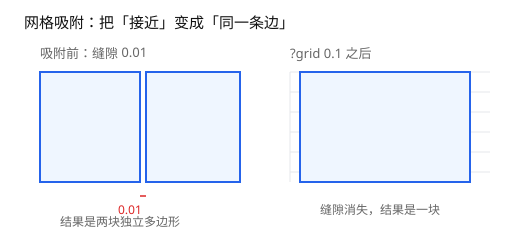

# 第 1 章 坐标、容差与网格

[返回目录](README.md) ｜ [下一章：直线、线段与方向判定](02-lines-and-orientation.md)



*图 1.1 容差带：只有落在 ε 邻域内的两点才被视为同一点。*

**本章目标**：弄清 `?eps` 与 `?grid` 的分工——一个管判断，一个管拓扑；学完能给比较选对容差、给布尔运算选对网格。

**这一章要用**：列表、`let`、`procedure` 与方法调用；不需要计算几何基础。

**教学函数与库接口**

| 教学函数 | 库里的等价接口 | 差别 |
| --- | --- | --- |
| `_NearTol` | 无公开的数值比较接口；点的比较用 `Point->equals` | 教学版只比较两个数；库版还处理对象类型与 `?eps` 默认值 |
| `_SnapToGrid` | 无公开吸附函数；`?grid` 在布尔与描边入口生效 | 教学版展示量化公式；库内还处理半格与表示误差 |

## 1.1 问题：浮点数不会「刚好相等」

几何程序的第一课不是公式，而是误差。坐标是浮点数，浮点数的加减乘除几乎每一步都会引入舍入：

```lisp
; 可运行
0.1 + 0.2 == 0.3                    ; => nil
abs((0.1 + 0.2) - 0.3) < 1e-12      ; => t
```

同一个数学点，从不同路径算出来可能差最后几位；两条本该重合的边可能错开 1e-16；一个点可能落在边的左边还是右边，取决于它离边有多近。误差主要来自三处：

1. **表示误差**：十进制小数大多不能用二进制精确表示，`0.1` 从一开始就带误差。
2. **累积误差**：求和、求交、缩放做得越多，误差越大。
3. **输入误差**：上游工具产出的坐标本身就带噪声（例如从版图提取的顶点）。

如果直接用 `==` 比较坐标，程序会变得「时好时坏」。几何库的第一件事，是把「距离足够近」定义成可复用的判断。

## 1.2 绝对容差

最直接的做法是给一个绝对阈值 ε：两个数的差不超过 ε 就视为相等。

形参列表末尾的 `"nnn"` 是类型串：三个实参都必须是数值，类型不符时调用直接被拒绝。

```lisp
; 可运行
procedure(_NearTol(n_a n_b n_eps "nnn")  ; -> t | nil
    let((fa fb rel)
        fa = float(n_a)
        fb = float(n_b)
        ; 相对容差兜底：坐标越大，能分辨的绝对误差越大
        rel = 1e-15 * max(abs(fa) abs(fb))
        abs(fa - fb) <= max(float(n_eps) rel)
    )
)

_NearTol(0.1 + 0.2 0.3 1e-12)   ; => t
_NearTol(10.0 10.001 1e-4)      ; => nil
_NearTol(10.0 10.0001 1e-4)     ; => t
```

注意第二个分支 `rel`：绝对容差之外还留了一条「机器精度相对容差」的底线。原因见下一节。

## 1.3 相对容差：大坐标下绝对容差会失效

双精度浮点数的有效数字约为 15～16 位。坐标越大，相邻两个可表示数之间的间隔（ulp）越大：

| 坐标量级 | 相邻浮点数的间隔约 |
| --- | --- |
| `1` | `2e-16` |
| `1e6` | `2e-10` |
| `1e9` | `1e-7` |

表中的间隔约等于 `2^-52 × 量级`：双精度尾数 52 位，量级每翻一倍，间隔也翻一倍。

也就是说，在 `1e9` 附近，比 `1e-7` 更细的差别根本无法被表示。此时若只用 `1e-9` 的绝对容差，判断结果会和坐标量级脱节。`_NearTol` 里的 `1e-15` 就是给 15–16 位有效数字留一个数量级的余量：相对误差通常落在 `1e-16` 附近，取 `1e-15` 更稳。相对容差按量级缩放：

```text
rel = 1e-15 * max(|a|, |b|)
|a - b| <= max(eps, rel)
```

`ycGeom` 的点重合、长度、线段相交等坐标比较都遵循这个口径，默认 `?eps` 为 `1e-9`。`0:0` 是 `list(0 0)` 的简写；分量是表达式时写 `list(x y)`。

```lisp
; 可运行
ycGeom::Point(0:0)->equals(ycGeom::Point(1e-10:0))                  ; => t
ycGeom::Point(0:0)->equals(ycGeom::Point(1e-10:0) ?eps 1e-12)       ; => nil
ycGeom::Point(1e9:0)->equals(ycGeom::Point(1e9 + 0.000001:0))       ; => t
```

最后一行差值 `1e-6` 远大于 `1e-9`，但 `1e-15 * 1e9 = 1e-6`，相对容差接住了它（图 1.2）。



*图 1.2 同样的 1e-9，在小坐标下可分辨，在 1e9 附近已经低于表示精度。*

容差也出现在查询接口上：

```lisp
; 可运行
rect = ycGeom::Polygon('((0 0) (10 0) (10 10) (0 10)))
rect->contains(ycGeom::Point(10:5))                     ; => t
rect->contains(ycGeom::Point(10.000001:5))              ; => nil
rect->contains(ycGeom::Point(10.000001:5) ?eps 1e-5)    ; => t
```

## 1.4 网格：把「差不多」变成「就是」

容差解决「两个值算不算相等」，但它解决不了另一个问题：**两个近似相等的值仍然不相等**。把它们放进 table 当键（键的定义见第 3 章）、放进集合去重、交给布尔运算配对，都会得到两份。

网格吸附的思路是把坐标量化到固定间距 `g` 的整数倍上：

```text
snap(v) = round(v / g) * g
```

```lisp
; 可运行
procedure(_SnapToGrid(n_val n_grid "nn")  ; -> float
    ; 先除以网格取整，再乘回网格间距
    round(n_val / n_grid) * n_grid
)

_SnapToGrid(10.01 0.25)   ; => 10.0
_SnapToGrid(10.1 0.25)    ; => 10.0
_SnapToGrid(-3.1 0.5)     ; => -3.0
```

吸附之后，坐标落在离散格点上，「近似相等」直接变成「完全相等」，比较、作键、配对都不再需要容差。

代价是精度：吸附把每个坐标最多移动 `g / 2`。所以 `g` 要按几何特征的最小尺度来选——远小于特征尺寸时，形变可以忽略；接近特征尺寸时，小特征会被抹平。

还有两个实现细节：

- **二进制精确的网格更好用。** `0.25`、`0.5`、`1`、`2` 都是 2 的幂，乘除不引入新的舍入；`0.1` 不是，吸附后可能出现 `10.000000000000002` 这类残差。
- **半格值要定规矩。** SKILL 的 `round` 在半格处远离零；但半格附近受浮点表示误差影响，同一个值可能取到相邻格。库内网格吸附会额外修正这一点，而且键不是取整后的整数，是吸附后坐标的精确文本——需要与库对齐时直接用 `?grid`。

## 1.5 在 ycGeom 里用 `?eps` 与 `?grid`

两个选项分工明确：

- `?eps` 控制**判断**：两个点是否重合、点是否在边界上、线段是否相交。默认 `1e-9`。
- `?grid` 控制**拓扑**：布尔运算前先把坐标吸到网格，保证交点和端点严格对齐。默认 `nil`（不吸附）。

下面的例子把两个矩形并起来，左矩形右边界在 `x = 10`，右矩形左边界在 `x = 10.01`，两者有 `0.01` 的缝：

```lisp
; 可运行
ga = ycGeom::Polygon('((0 0) (10 0) (10 10) (0 10)))
gb = ycGeom::Polygon('((10.01 0) (20 0) (20 10) (10.01 10)))
ra = ycGeom::Region(list(ga))
rb = ycGeom::Region(list(gb))

length(ra->or(rb)->polygons())              ; => 2
ra->or(rb)->area()                          ; => 199.9

length(ra->or(rb ?grid 0.1)->polygons())    ; => 1
ra->or(rb ?grid 0.1)->area()                ; => 200.0
```



*图 1.3 网格吸附前后：缝隙消失，两块变一块。*

不吸附时，两条边相距 `0.01`，是两块独立的多边形；给定 `?grid 0.1` 后，`10` 与 `10.01` 吸到同一格点，缝隙消失，结果是一块 `10 x 20` 的矩形（图 1.3）。

`?grid` 用于布尔归一化与描边：`Region` 构造器、`Region->or/and/not/xor`、`ycGeom::Boolean`、`Path->toRegion` 都接受它；`Polygon` / `Rect` 构造器不接受 `?grid`，传入会报参数错误。

## 1.6 本章未展开的部分

| 省略内容 | 为什么省略 | 想深挖 |
| --- | --- | --- |
| ulp 的完整推导与次正规数 | 不影响日常使用 | 浮点数标准或数值分析教材 |
| 网格间距与布尔采样距离的配合 | 属于第 5 章的流水线细节 | [第 5 章](05-boolean-pipeline.md) |
| 坐标量级很大时的自适应容差 | 接口内部行为，参数表已说明 | [API 手册](../README.md#ycgeompoint-function-class) |

## 1.7 边界与常见误解

- **ε 是绝对下限，不是有效容差。** 小于机器精度的 ε 不会让比较更严格：`ycGeom` 还会取 `1e-15 × 量级` 的相对项，坐标到 `1e9` 时有效容差自动升到约 `1e-6`。想要更严格的分辨力，只能减小坐标量级或改用网格，不能靠把 `?eps` 设得更小。
- **网格不是精度工具。** 它降低精度换取一致性。需要保留精确坐标时不要用网格，改用容差判断。
- **近重合的边仍有风险。** 布尔运算会按最近的邻边缩小两侧采样距离，`0.001` 级的缝隙能正确分成两块；但缝隙小到与容差同量级时采样无法区分，此时给出网格，把「极近」变成「重合」。
- **容差和网格不能混为一谈。** 前者回答「算不算同一个点」，后者回答「用哪个坐标代表它」。

## 小结

- 浮点误差不可避免，比较坐标必须带容差。
- 容差 = 绝对阈值 + 随量级缩放的相对阈值；`ycGeom` 默认 `1e-9`。
- 容差保证「判断一致」，网格保证「数值一致」。
- `?eps` 管比较，`?grid` 管拓扑；网格间距要按最小特征尺寸选。

下一章开始讲几何本身：用叉积判断方向，用参数方程求线段交点，用射线法判断点是否在多边形内。

## 自检

1. 为什么在 `1e9` 附近不能把 `?eps` 设成 `1e-12`？
2. `?grid` 让 `10` 与 `10.01` 变成同一个点，代价是什么？

<details><summary>参考答案</summary>

1. `1e9` 附近相邻浮点数间隔约 `1e-7`，但相对项 `1e-15 × 1e9 = 1e-6` 会兜底；把 `?eps` 设成 `1e-12` 不会提高分辨力，只会让人误以为比较更严格。
2. 坐标最多移动半个网格间距，精度降低；网格越粗，碰撞越多。

</details>

[返回目录](README.md) ｜ [下一章](02-lines-and-orientation.md)
