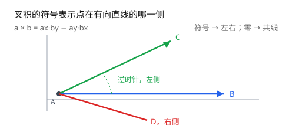
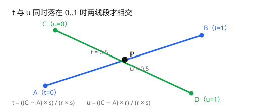
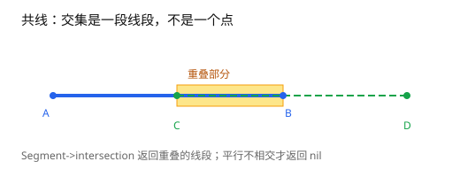
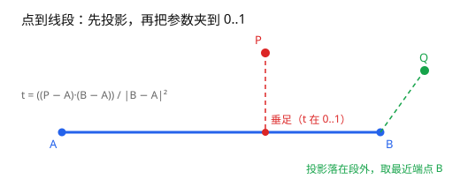
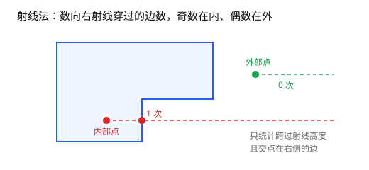

# 第 2 章 直线、线段与方向判定

[返回目录](README.md) ｜ [上一章：坐标、容差与网格](01-tolerance-and-grid.md) ｜ [下一章：规范点与键](03-canonical-points-and-keys.md)



*图 2.1 叉积的符号表示点在有向直线的哪一侧。*

**本章目标**：用叉积判断点在有向直线的哪一侧，用参数方程求线段交点，用射线法判断点是否在多边形内；学完能读懂布尔流水线里的方向与包含判断。

**上一章留下**：比较坐标要带容差，`?eps` 默认 `1e-9`；网格解决「近似相等但不相等」。

**这一章要用**：第 1 章的相对容差——叉积的共线判据就是把它按两条边的长度归一。

**教学函数与库接口**

| 教学函数 | 库里的等价接口 | 差别 |
| --- | --- | --- |
| `_Cross2` | 无公开的方向判定接口 | 教学版只返回符号；库内方向判定服务于布尔与包含判断 |
| `_SegCross` | `Segment->intersection` | 库返回 `Point` / 重叠 `Segment` / `nil`，并处理端点与共线 |
| `_PointSegDist` | `Segment->distanceTo` | 语义相同 |
| `_RayInside` | `Polygon->contains`（`?boundary`） | 库额外处理边界点、顶点命中与退化边 |

## 2.1 三个基本问题

几乎所有平面几何算法最终都归结为三个判断：

1. 点在有向线段的左侧、右侧，还是线上？
2. 两条线段是否相交，交点在哪？
3. 一个点是否在多边形内部？

第一个问题用叉积，第二个用参数方程，第三个用射线法。三者都很短，但都有必须讲清的边界。

## 2.2 叉积与方向

把点看成从原点出发的向量。两个二维向量 `a = (ax, ay)`、`b = (bx, by)` 的叉积是标量：

```text
a × b = ax * by - ay * bx
```

它的绝对值等于两向量张成的平行四边形面积，符号表示转向：

| 符号 | 含义 |
| --- | --- |
| 正 | `b` 在 `a` 的逆时针一侧（左侧） |
| 负 | `b` 在 `a` 的顺时针一侧（右侧） |
| 零 | 两向量共线 |

这里的「左」是**从 `a` 的起点沿 `a` 的方向看**：把 `a` 平移到原点，`b` 落在逆时针一侧就是左。判断点 C 时取 `a = B - A`、`b = C - A`，所以说「C 在有向直线 AB 的左侧」。

判断「点 C 在有向直线 AB 的哪一侧」，只需把 A 当作原点：

```lisp
; 可运行
procedure(_Cross2(g_a g_b g_c "ggg")  ; -> float
    ; (b - a) × (c - a)：正数表示 c 在 ab 左侧，负数在右侧，零表示共线
    (g_b->x() - g_a->x()) * (g_c->y() - g_a->y())
        - (g_b->y() - g_a->y()) * (g_c->x() - g_a->x())
)

a = ycGeom::Point(0:0)
b = ycGeom::Point(10:0)

_Cross2(a b ycGeom::Point(5:5))    ; => 50.0，左侧
_Cross2(a b ycGeom::Point(5:-5))   ; => -50.0，右侧
_Cross2(a b ycGeom::Point(5:0))    ; => 0.0，线上
```

**共线判断要带容差。** 叉积的量级和边长有关：同样偏离 `1e-9`，短边的叉积很小，长边的叉积很大。正确做法是把叉积除以两个向量长度的乘积（等价于比较夹角的正弦）：

```text
|cross| <= eps * |AB| * |AC|
```

这正是第 1 章 `|a - b| <= max(eps, rel)` 的写法：把「偏离直线的距离」除以两条边长，换算成角度，再和 `?eps` 比。

直接写 `cross == 0.0` 只能判断「刚好落在线上」，实际输入几乎不会出现。

## 2.3 线段相交：参数方程

两条线段：

```text
P(t) = A + t * r,  r = B - A,  0 <= t <= 1
Q(u) = C + u * s,  s = D - C,  0 <= u <= 1
```

令 `P(t) = Q(u)`，两边叉乘 `s`（消去 u）和 `r`（消去 t）：

```text
t = ((C - A) × s) / (r × s)
u = ((C - A) × r) / (r × s)
```

分母 `r × s` 就是两方向向量的叉积：

- 为 0：两线段平行或共线，需要单独处理；
- 不为 0：算出 t、u，同时落在 `[0, 1]` 才有交点。

```lisp
; 可运行
procedure(_SegCross(g_a g_b g_c g_d "gggg")  ; -> list[float] | nil
    let((rx ry sx sy qx qy den tt u)
        rx = g_b->x() - g_a->x()
        ry = g_b->y() - g_a->y()
        sx = g_d->x() - g_c->x()
        sy = g_d->y() - g_c->y()
        qx = g_c->x() - g_a->x()
        qy = g_c->y() - g_a->y()
        den = rx * sy - ry * sx
        ; 方向叉积为 0 表示平行或共线，这里按平行处理
        unless(abs(den) <= 1e-12 * sqrt((rx * rx + ry * ry) * (sx * sx + sy * sy))
            tt = (qx * sy - qy * sx) / den   ; 交点在 AB 上的参数
            u = (qx * ry - qy * rx) / den    ; 交点在 CD 上的参数
            ; 两个参数都落在 [0, 1] 才是线段相交，而不是延长线相交
            when(tt >= 0.0 && tt <= 1.0 && u >= 0.0 && u <= 1.0
                list(tt u)
            )
        )
    )
)
```

三组例子：相交、交点不在第一段上、平行。

```lisp
; 可运行
_SegCross(a b ycGeom::Point(5:-5) ycGeom::Point(5:5))   ; => (0.5 0.5)
_SegCross(a b ycGeom::Point(5:2) ycGeom::Point(5:8))    ; => nil，交点不在第一段上
_SegCross(a b ycGeom::Point(0:1) ycGeom::Point(10:1))   ; => nil，平行
```



*图 2.2 参数 t 与 u 同时落在 0..1 时两线段才相交。*

**共线是麻烦的一种。** 分母为 0 且 `(C - A) × r = 0` 时，两条线段在同一直线上，交集可能是一个点、一段线段，或者空。

*图 2.3 共线重叠时返回的是一段线段。*

库里的 `Segment->intersection` 会返回：

| 情况 | 返回 |
| --- | --- |
| 唯一交点 | `Point` |
| 共线重叠 | 重叠部分的 `Segment` |
| 平行、无交 | `nil` |

`?as 'Line` 把传入的两点数组按无限直线解释，默认按线段；对象输入不需要它，数组输入有歧义时用它指定类型。

```lisp
; 可运行
s1 = ycGeom::Segment(list(0:0 10:0))
s1->intersection(ycGeom::Segment(list(5:-5 5:5)))->toSkill()   ; => (5.0 0.0)
s1->intersection(ycGeom::Segment(list(5:0 15:0)))->toSkill()   ; => ((5.0 0.0) (10.0 0.0))
s1->intersection(ycGeom::Segment(list(0:1 10:1)))              ; => nil
```

## 2.4 点到线段的距离

先把点投影到线段所在直线上，参数为：

```text
t = ((P - A) · (B - A)) / |B - A|^2
```

再把 t 夹到 `[0, 1]`（投影落在线段外时取最近的端点），最后算欧氏距离：

```lisp
; 可运行
procedure(_PointSegDist(g_p g_a g_b "ggg")  ; -> float
    let((dx dy len2 tt px py)
        dx = g_b->x() - g_a->x()
        dy = g_b->y() - g_a->y()
        len2 = dx * dx + dy * dy
        ; 投影参数；夹到 [0, 1] 后，投影落在线段外时取最近端点
        tt = if(len2 == 0.0
            0.0
            max(0.0 min(1.0
                ((g_p->x() - g_a->x()) * dx
                    + (g_p->y() - g_a->y()) * dy) / len2))
        )
        px = g_a->x() + tt * dx
        py = g_a->y() + tt * dy
        ; 投影点到待测点的欧氏距离
        sqrt((g_p->x() - px) * (g_p->x() - px)
            + (g_p->y() - py) * (g_p->y() - py))
    )
)
```

三组：投影落在段内、落在线段外两侧（图 2.4）。

```lisp
; 可运行
_PointSegDist(ycGeom::Point(5:3) a b)     ; => 3.0
_PointSegDist(ycGeom::Point(-5:0) a b)    ; => 5.0，投影落在线段外，取端点 A
_PointSegDist(ycGeom::Point(15:0) a b)    ; => 5.0，取端点 B
```



*图 2.4 投影落在段内取垂足，落在段外取最近端点。*

库里的 `Segment->distanceTo(Point)` 做的是同一件事：

```lisp
; 可运行
ycGeom::Segment(list(0:0 10:0))->distanceTo(ycGeom::Point(5:3))   ; => 3.0
```

## 2.5 射线法：点是否在多边形内

从待测点向 `+x` 方向发一条水平射线，数它穿过多边形边的次数：奇数次在内部，偶数次在外部。这就是**奇偶规则**。

实现时有两个细节：

1. 只统计「跨过射线高度」的边：`(y1 > y) != (y2 > y)`。这一步同时排除了水平边（两端同高）。
2. 计算边与射线所在水平线的交点 x，只有交点在待测点右侧才计数。

```lisp
; 可运行
procedure(_RayInside(l_ring g_p "lg")  ; -> t | nil
    let((x y n inside)
        x = g_p->x()
        y = g_p->y()
        n = length(l_ring)
        for(i 0 n - 1
            let((p1 p2 j)
                p1 = nth(i l_ring)
                j = if(i == n - 1 0 i + 1)
                p2 = nth(j l_ring)
                when((p1->y() > y) != (p2->y() > y)   ; 这条边跨过射线高度
                    when(x < (p2->x() - p1->x()) * (y - p1->y())
                            / (p2->y() - p1->y()) + p1->x()
                        inside = !inside            ; 交点在右侧，计一次穿越
                    )
                )
            )
        )
        inside
    )
)
```

用一个正方形验证（图 2.5）：

```lisp
; 可运行
ring = list(ycGeom::Point(0:0) ycGeom::Point(4:0)
    ycGeom::Point(4:4) ycGeom::Point(0:4))

_RayInside(ring ycGeom::Point(2:2))   ; => t
_RayInside(ring ycGeom::Point(5:2))   ; => nil
```



*图 2.5 向右射线穿过奇数条边在内部，偶数条在外部。*

这个版本对「射线正好穿过顶点」和「点在边界上」都不做特殊处理：穿过顶点会数成 0 次或 2 次，结果仍然正确（这是奇偶规则的巧合之一）；边界点则可能被判内也可能被判外。生产实现必须把边界单独处理。

`ycGeom` 的 `Polygon->contains` 提供 `?boundary` 选项：

```lisp
; 可运行
poly = ycGeom::Polygon('((0 0) (4 0) (4 4) (0 4)))
poly->contains(ycGeom::Point(2:2))                        ; => t
poly->contains(ycGeom::Point(0:2))                        ; => t
poly->contains(ycGeom::Point(0:2) ?boundary "outside")    ; => nil
```

## 2.6 本章未展开的部分

| 省略内容 | 为什么省略 | 想深挖 |
| --- | --- | --- |
| 共线重叠的完整求交（端点裁剪、零长度线段） | 分支多，库内已封装 | [Segment 手册](../README.md#ycgeomsegment-function-class) |
| 射线法在自交多边形上的行为 | 自交输入先要拆分 | [第 4 章](04-polygon-normalization.md) |
| 大坐标下的方向判定误差 | 已由相对容差吸收 | [第 1 章](01-tolerance-and-grid.md) |

## 2.7 边界与常见误解

- **平行与共线要分开处理。** 分母为 0 只说明方向平行；是否共线还要看 `(C - A) × r` 是否为 0。共线时的交集是线段，不是一个点。
- **端点相交。** t 或 u 恰好等于 0 或 1 时算相交；用容差比较时注意不要漏掉端点。
- **坐标轴方向。** 本章默认 y 轴向上（数学惯例），叉积为正在左侧。屏幕坐标 y 轴向下时，左右会互换，算法本身不变。
- **射线法的前提是简单多边形。** 边自交时奇偶规则的结果没有直观意义，需要先拆分。

## 小结

- 叉积定方向，符号看左右，近似零看共线（要按长度归一）。
- 线段相交用参数方程，先算分母，再检查 t、u 是否在 `[0, 1]`。
- 点到线段距离 = 投影 + 夹紧 + 欧氏距离。
- 射线法用奇偶规则，跨界条件 `(y1 > y) != (y2 > y)` 是关键。

下一章解决一个更隐蔽的问题：两个「相等」的点，为什么不能直接当 table 的键。

## 自检

1. 叉积为 0 能说明两条线段平行吗？能说明共线吗？
2. 射线法为什么可以不单独处理「射线正好穿过顶点」？

<details><summary>参考答案</summary>

1. 只能说明方向平行；是否共线还要看 `(C - A) × r` 是否为 0。
2. 奇偶规则下，穿过顶点会数成 0 次或 2 次，奇偶性不变；但边界点仍要单独处理。

</details>

[返回目录](README.md) ｜ [下一章](03-canonical-points-and-keys.md)
