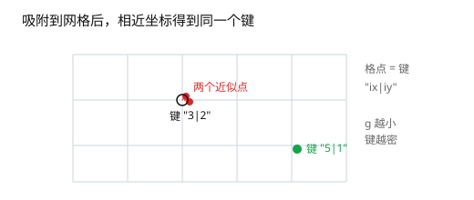

# 第 3 章 规范点与键

[返回目录](README.md) ｜ [上一章：直线、线段与方向判定](02-lines-and-orientation.md) ｜ [下一章：多边形规范化与 keyhole](04-polygon-normalization.md)



## 3.1 问题：相等不等于可作键

上一章解决的是「两个点算不算同一个点」。但几何算法里还有另一类需求：**把点放进 table、去重、配对**。这类操作依赖的是「键相等」，不是容差判断。

先看一个反例。用坐标文本直接作键：

```lisp
; 可运行
key1 = lsprintf("%.17g|%.17g" 0.1 + 0.2 0.0)
key2 = lsprintf("%.17g|%.17g" 0.3 0.0)
key1 == key2    ; => nil
```

数学上两点相同，键却不同。反过来，如果键只保留少量有效位，两个真正不同的点又会撞成同一个键。**容差判断和键相等是两套语义，不能混用。**

一个可用的键必须满足：

1. **稳定**：同一位置无论经过什么运算，键都相同；
2. **可重复**：同一输入两次算出的键一致；
3. **方向无关**（针对边、环）：`A→B` 与 `B→A` 应得到同一个键；
4. **碰撞可控**：真不同的几何对象不应轻易撞键。

## 3.2 点键：先把坐标变成整数

最常用的做法是在吸附后的网格上取整：

```text
key(P) = "%d|%d" % (round(P.x / g), round(P.y / g))
```

```lisp
; 可运行
procedure(_PointKey(g_p n_grid "gn")  ; -> str
    lsprintf("%d|%d" round(g_p->x() / n_grid) round(g_p->y() / n_grid))
)

pts = list(ycGeom::Point(0:0)
    ycGeom::Point(1e-12:0)
    ycGeom::Point(1:0)
    ycGeom::Point(0:0))

tab = makeTable("tutorialPointKey" nil)
foreach(p pts tab[_PointKey(p 1.0)] = t)

keys = nil
foreach(k tab keys = cons(k keys))
length(keys)        ; => 2
keys                ; => 两个键（顺序由 table 决定）
```

四个点里，`(0, 0)` 出现两次、`(1e-12, 0)` 与它落在同一格，去重后只剩两个键。

几个实现细节：

- **取整必须一致。** 半格值（`x / g` 恰好是 `k + 0.5`）怎么取整要和全库统一；否则同一个点在两处会被吸到相邻格。
- **大坐标不要用 fixnum。** `round` 返回整数，超过 32 位范围会截断。坐标很大时改用 `sprintf(nil "%.0f" ...)` 生成整数字符串。
- **负零统一。** `-0.0` 与 `0.0` 应产出同一个键；取整后通常自然一致，但用文本格式化时要显式处理。

## 3.3 边键：无向

边没有方向：`A→B` 与 `B→A` 是同一条边。作键时把两个端点键按字典序排好再拼接：

```lisp
; 可运行
procedure(_UndirEdgeKey(g_a g_b n_grid "ggn")  ; -> str
    let((ka kb)
        ka = _PointKey(g_a n_grid)
        kb = _PointKey(g_b n_grid)
        if(alphalessp(ka kb)
            lsprintf("%s~%s" ka kb)
            lsprintf("%s~%s" kb ka))
    )
)

_UndirEdgeKey(ycGeom::Point(0:0) ycGeom::Point(10:0) 1.0)   ; => "0|0~10|0"
_UndirEdgeKey(ycGeom::Point(10:0) ycGeom::Point(0:0) 1.0)   ; => "0|0~10|0"
```

布尔运算里，这个键用来做两件事：拆分后的边去重；识别「同一条边被两个多边形共用」——后者是共边合并与洞拼接的基础。

## 3.4 环键：旋转与方向归一

一条闭合环可以从任意顶点开始写，也可以顺时针或逆时针写。环键要把这些等价写法归一到同一个：

1. 每个顶点取点键；
2. 从每个位置开始绕一圈拼成字符串（相当于所有旋转）；
3. 正向、反向各算一遍；
4. 取字典序最小的那个作为环键。

```lisp
; 可运行
procedure(_RotText(l_keys n_start n_dir "lxx")  ; -> str
    let((n text j r)
        n = length(l_keys)
        text = ""
        for(j 0 n - 1
            r = if(n_dir > 0 n_start + j n_start - j)
            when(r >= n r = r - n)
            when(r < 0 r = r + n)
            text = strcat(text nth(r l_keys) ";")
        )
        text
    )
)

procedure(_RingKeyText(l_pts n_grid "ln")  ; -> str
    let((keys n best text i)
        foreach(p l_pts keys = tconc(keys _PointKey(p n_grid)))
        keys = car(keys)
        n = length(keys)
        for(i 0 n - 1
            text = _RotText(keys i 1)
            when(best == nil || alphalessp(text best) best = text)
            text = _RotText(keys i -1)
            when(alphalessp(text best) best = text)
        )
        best
    )
)

square = list(ycGeom::Point(0:0) ycGeom::Point(4:0)
    ycGeom::Point(4:4) ycGeom::Point(0:4))
rotated = list(ycGeom::Point(4:0) ycGeom::Point(4:4)
    ycGeom::Point(0:4) ycGeom::Point(0:0))
reversed = list(ycGeom::Point(0:0) ycGeom::Point(0:4)
    ycGeom::Point(4:4) ycGeom::Point(4:0))

_RingKeyText(square 1.0) == _RingKeyText(rotated 1.0)    ; => t
_RingKeyText(square 1.0) == _RingKeyText(reversed 1.0)   ; => t
```

注意这是**精确键**：只要有一个顶点不同，环键就不同。环的「近似相等」仍要用逐点容差比较，环键只负责快速判等与去重。

## 3.5 在 ycGeom 里的位置

- `?grid` 在布尔运算前把坐标吸附到网格，之后的交点、端点都落在格点上；
- 拆分边、去重、追踪环全部用精确键（点键与边键），不再做容差比较；
- 因此布尔运算的输入如果有「几乎重合但不重合」的边，必须给网格，否则键对不上；
- 输出 `Region` 里的多边形已经过规范化，同一环不会以旋转或反向的等价形式重复出现。

```lisp
; 可运行
polyA = ycGeom::Polygon('((0 0) (4 0) (4 4) (0 4)))
polyB = ycGeom::Polygon('((2 2) (6 2) (6 6) (2 6)))
union = ycGeom::Region(list(polyA))->or(ycGeom::Region(list(polyB)))
length(union->polygons())   ; => 1
```

## 3.6 边界与常见误解

- **键不可逆。** 从键回不到精确坐标；需要坐标时保留原始点，键只用于比较与索引。
- **网格越粗，碰撞越多。** 两个不同顶点被吸进同一格时，键相同，几何信息就被合并了。网格间距必须远小于最小特征尺寸。
- **键相等不代表几何相等。** 两个环键相同只能说明顶点序列一致，形状是否等价还要看坐标与方向。
- **不要用浮点文本作键。** `%.17g` 会把运算顺序的差异原样暴露；`%g` 又会丢掉有效位。先吸附，再取整。

## 小结

- 容差判断回答「像不像同一点」，键相等回答「是不是同一个索引」。
- 点键 = 网格整数坐标；边键 = 端点键排序；环键 = 旋转与方向归一后取字典序最小。
- 键是精确比较，所以必须先用网格把近似变成精确。
- 布尔运算的稳定性，很大程度上取决于键与网格是否配套。

下一章开始处理面：多边形怎么表示、怎么规范化，以及如何用一个环表示带洞的形状。

[返回目录](README.md) ｜ [下一章](04-polygon-normalization.md)
