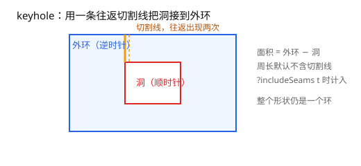
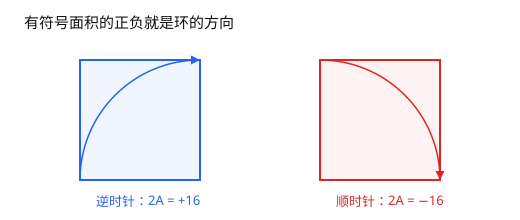
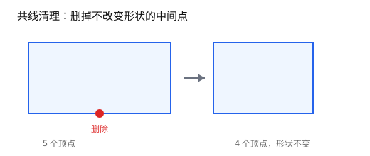

# 第 4 章 多边形规范化与 keyhole

[返回目录](README.md) ｜ [上一章：规范点与键](03-canonical-points-and-keys.md) ｜ [下一章：区域布尔流水线](05-boolean-pipeline.md)



*图 4.1 keyhole 多边形：外环、洞，以及把洞接入外环的切割线。*

**本章目标**：把同一个形状的多种点列写法归一到一种规范形，并理解 keyhole 为什么用一条切割线表示洞。

**上一章留下**：相等不等于可作键；键必须建立在吸附后的精确坐标上。

**这一章要用**：第 3 章的键与网格——规范化后的环要能稳定去重、配对。

**教学函数与库接口**

| 教学函数 | 库里的等价接口 | 差别 |
| --- | --- | --- |
| `_SignedArea` | `Polygon->area` | 库版带平移与补偿求和，见第 6 章 |
| `_OrientRing` | `Polygon->isClockwise` / `Polygon->reverse` | 库版在构造时自动规范化 |
| `_Collinear3` | `Polygon->removeCollinear` | 库版循环清理到稳定，并处理首尾相接与最少 3 点 |

## 4.1 问题：多边形的写法太多

同一个形状可以有无数种点列写法：从哪个顶点开始、顺时针还是逆时针、有没有重复点、有没有多余的共线点。布尔运算、描边、面积计算都要求输入是**规范形**，否则同一个形状会被当成不同的东西。

工程上要先约定四件事：

1. **闭合方式**：点列隐式闭合，末尾不重复首点。`points()` 返回四个点表示四边形，不是五个。
2. **方向**：外环逆时针（有符号面积为正），洞顺时针。
3. **顶点**：不重复、不共线、数量至少 3。
4. **洞**：本库用 keyhole 方式并入外环，而不是「外环 + 内环」两级结构。

## 4.2 有符号面积与方向

鞋带公式（第 6 章细讲数值稳定性）：

```text
2A = Σ (x_i * y_{i+1} - x_{i+1} * y_i)
```

结果的正负就是方向：

```lisp
; 可运行
procedure(_SignedArea(l_pts "l")  ; -> float
    ; 逐边累加有向面积；结果为正表示逆时针
    let((sum n)
        sum = 0.0
        n = length(l_pts)
        for(i 0 n - 1
            let((p1 p2 j)
                p1 = nth(i l_pts)
                j = if(i == n - 1 0 i + 1)
                p2 = nth(j l_pts)
                sum = sum + p1->x() * p2->y() - p2->x() * p1->y()
            )
        )
        sum / 2.0
    )
)
```

方向统一只需要看面积的符号（图 4.2）：负数就反转点列。

```lisp
; 可运行
procedure(_OrientRing(l_pts "l")  ; -> list
    if(_SignedArea(l_pts) < 0.0 reverse(l_pts) l_pts)
)
```

用正方形验证一下：

```lisp
; 可运行
square = list(ycGeom::Point(0:0) ycGeom::Point(4:0)
    ycGeom::Point(4:4) ycGeom::Point(0:4))

_SignedArea(square)                        ; => 16.0
_SignedArea(reverse(square))               ; => -16.0
_SignedArea(_OrientRing(reverse(square)))  ; => 16.0
```



*图 4.2 逆时针为正、顺时针为负。*

`ycGeom` 里对应 `isClockwise()` 与 `reverse()`：

```lisp
; 可运行
poly = ycGeom::Polygon('((0 0) (10 0) (10 10) (0 10)))
poly->isClockwise()          ; => nil，逆时针
poly->reverse()->isClockwise()   ; => t
poly->area()                 ; => 100.0
```

## 4.3 共线清理

连续三个点共线时，中间那个点不改变形状（图 4.3），但会增加顶点数、干扰去重与配对。清理规则：对每个顶点检查前一个、当前、后一个组成的叉积，近似为零就删掉当前点。

```lisp
; 可运行
procedure(_Collinear3(g_a g_b g_c n_eps "gggn")  ; -> t | nil
    ; 叉积按两条边长度归一：|ab × bc| <= eps * |ab| * |bc|
    let((abx aby bcx bcy)
        abx = g_b->x() - g_a->x()
        aby = g_b->y() - g_a->y()
        bcx = g_c->x() - g_b->x()
        bcy = g_c->y() - g_b->y()
        abs(abx * bcy - aby * bcx)
            <= n_eps * sqrt(abx * abx + aby * aby)
                * sqrt(bcx * bcx + bcy * bcy)
    )
)

_Collinear3(ycGeom::Point(0:0) ycGeom::Point(5:0) ycGeom::Point(10:0) 1e-9)
; => t
_Collinear3(ycGeom::Point(0:0) ycGeom::Point(5:1) ycGeom::Point(10:0) 1e-9)
; => nil
```



*图 4.3 删掉共线中间点，顶点数变少、形状不变。*

清理就是对每个顶点调用它：命中就删掉当前点，扫完一轮再从头扫，直到没有点被删——删掉一个点后，原本不相邻的三个点可能变成新的共线三点。循环骨架如下：

```text
changed = t
while(changed && length(pts) > 3)
    changed = nil
    for i = 0 .. length(pts) - 1
        if _Collinear3(prev(i), pts[i], next(i))
            remove pts[i]
            changed = t
            break            # 删点后下标会变，重新扫
        end
    end
end
```

真正写起来还要处理首尾相接（`prev` / `next` 取模）、删到只剩 3 个点就停，以及删除后重新计算相邻关系；这些细节库内已经封装。

`ycGeom` 的 `Polygon` 构造时会自动做规范化，`removeCollinear()` 可以显式取出去掉共线点后的结果：

```lisp
; 可运行
p = ycGeom::Polygon('((0 0) (5 0) (10 0) (10 10) (0 10)))
length(p->points())                     ; => 5
length(p->removeCollinear()->points())  ; => 4
```

## 4.4 重复点

**连续重复点是非法的**，构造时直接报错。下面这个块故意报错，所以没有 `; 可运行`，否则会中断整个脚本：

```lisp
ycGeom::Polygon('((0 0) (0 0) (1 0) (1 1)))
; *Error* ycGeom::Polygon: consecutive duplicate point at index 3
```

这条规则是刻意的：完全重复的点没有任何几何意义，静默删掉会掩盖上游错误。**非连续**的近重合顶点（例如环在远处绕回起点附近）会按容差合并到同一代表点。

## 4.5 keyhole：用一个环表示带洞的形状

「外环 + 若干内环」的两级结构在布尔运算里很麻烦：每条边都要判断属于哪个环、洞和外环的包含关系要单独维护。更麻烦的是，布尔运算每切一刀都会产生新环，两级结构要重新判定每个新环挂在哪个父环下；keyhole 把这些关系统统压成一个环的点列问题，思路是把洞「切开」再接到外环上：

```text
外环:  (0,0) → (10,0) → (10,10) → (0,10) → 回到 (0,0)
洞:    (3,3) → (7,3) → (7,7) → (3,7)

keyhole 点列：
(0,0) → (10,0) → (10,10) → (0,10) → (3,0) → (3,3)
      → (7,3) → (7,7) → (3,7) → (3,3) → (3,0) → (0,0)
                        └──── 洞 ────┘   └ 切割线原路返回 ┘
```

切割线在点列里出现两次、方向相反，围出的区域正好是「外环减去洞」。这样整个形状仍然是一个环，布尔运算只需处理一种输入。

`ycGeom` 用 `Region` 的差集生成带洞多边形：

```lisp
; 可运行
outer = ycGeom::Polygon('((0 0) (10 0) (10 10) (0 10)))
hole = ycGeom::Polygon('((3 3) (7 3) (7 7) (3 7)))
holeRing = car(ycGeom::Region(list(outer))->not(ycGeom::Region(list(hole)))->polygons())

holeRing->area()                              ; => 84.0，100 - 16
holeRing->perimeter()                         ; => 56.0，40 + 16，切割线不计
holeRing->perimeter(?includeSeams t)          ; => 62.0，加上切割线往返 2 x 3
length(holeRing->points())                    ; => 11
```

几个约束：

- 切割线必须是**水平或垂直**的，这样它与边的交点、重合段都可以精确处理；
- 切割线不能穿过其他边（否则会额外产生交点与子环）；
- 面积不受切割线影响；周长默认扣除切割线，`?includeSeams t` 时按完整点列计算。

## 4.6 本章未展开的部分

| 省略内容 | 为什么省略 | 想深挖 |
| --- | --- | --- |
| 共线清理的完整循环边界（首尾相接、最少 3 点） | 已给骨架，细节由库封装 | [API 手册](../README.md#ycgeompolygon-function-class) |
| 自交多边形的拆分 | 需要布尔运算 | [第 5 章](05-boolean-pipeline.md) |
| 多洞的切割线选择 | 库内自动选择水平或垂直切割线 | [API 手册](../README.md#keyhole-多边形) |
| 洞的嵌套判定 | 属于布尔流水线 | [5.8](05-boolean-pipeline.md) |

## 4.7 边界与常见误解

- **规范化不改变形状，只改变表示。** 去掉共线点、统一方向、合并近点，面积与周长（按默认口径）都不变。
- **自交多边形不在支持范围内。** 本章的规范化假设输入是简单多边形；自交形状要先拆分或交给布尔运算。
- **keyhole 不是「洞的列表」。** 一个 `Polygon` 只有一个环；多洞形状会有多条切割线。
- **切割线的方向有讲究。** 库内选择与坐标轴对齐且不与其他边相交的切割线；手写点列时不要随意选斜线。

## 小结

- 多边形 = 不重复首点的闭合点列；外环逆时针，洞顺时针。
- 规范化 = 去重复点 + 去共线点 + 统一方向 + 面积非零。
- 有符号面积的符号就是方向，清理共线点要循环到稳定。
- keyhole 用一条往返切割线把洞并入外环，面积不变、周长默认扣除切割线。

下一章把这些规范化后的多边形放进集合运算：并、交、差、对称差。

## 自检

1. 规范化会改变形状吗？面积和周长会变吗？
2. keyhole 的切割线为什么要求水平或垂直？

<details><summary>参考答案</summary>

1. 不改变形状，只改变表示；默认面积不变，周长扣除切割线后也不变。
2. 水平或垂直切割线与边的交点、重合段可以精确处理，避免斜线带来的额外交点与数值问题。

</details>

[返回目录](README.md) ｜ [下一章](05-boolean-pipeline.md)
