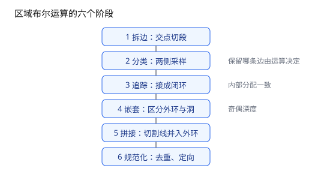
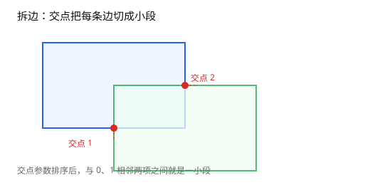
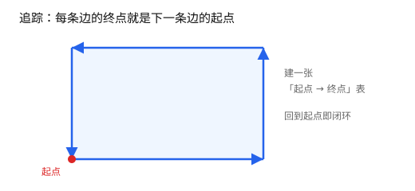
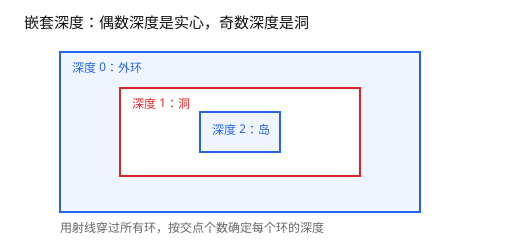

# 第 5 章 区域布尔流水线

[返回目录](README.md) ｜ [上一章：多边形规范化与 keyhole](04-polygon-normalization.md) ｜ [下一章：面积与质心的稳定计算](06-area-and-centroid.md)



*图 5.1 布尔流水线的六个阶段。*

**本章目标**：把两个区域的并、交、差、对称差拆成拆边、分类、追踪、嵌套、拼接、规范化六步；学完能理解布尔结果为什么必须规范化。

**上一章留下**：多边形已被规范化成「不重复点、方向统一、可作环键」的点列。

**这一章要用**：规范形与精确键——键对不上，交点就配不准，后面的追踪会断链。

**教学函数与库接口**

| 教学函数 | 库里的等价接口 | 差别 |
| --- | --- | --- |
| `_CutT` | 无公开接口；`Segment->intersection` 求交点 | 教学版只返回边上的参数 t |
| `_Member` | `Region->or` / `and` / `not` / `xor`、`ycGeom::Boolean` | 库版是完整流水线 |
| `_EdgeInResult` | 同上 | 教学版用固定采样偏移，库内自适应 |
| `_TraceLoop` | 无公开接口 | 教学版假设每个顶点只有一条出边 |

## 5.1 问题：集合运算比想象中难

给定两个区域 A、B，求并、交、差、对称差。直觉上「留下想要的边」就够了，实际要处理：

- 边与边相交，交点把边切成多段；
- 两条边共线重叠，既不能算两个交点，也不能丢掉；
- 一个区域可能有多个连通分量和多个洞；
- 端点接触、退化边、近似重合；
- 输出必须是规范化、互不重叠的多边形集合。

## 5.2 表示：区域是多边形的并集

```text
Region = {P1, P2, ...}，语义是 P1 ∪ P2 ∪ ...
```

集合运算的结果也用同样形式返回，并且已经规范化：成员之间互不重叠、每个成员是规范形。洞用第 4 章的 keyhole 表示，所以「一个多边形」仍然是一个环。

## 5.3 流水线

```text
输入环 A、环 B
   │
   ├─ 1. 拆边：求所有交点，按交点把边切成小段
   ├─ 2. 分类：每段边取左右采样点，判断落在结果内还是外
   ├─ 3. 追踪：把保留下来的有向边接成闭环
   ├─ 4. 嵌套：按包含深度区分外环与洞
   ├─ 5. 拼接：洞用切割线并入外环
   └─ 6. 规范化：去重复、去共线、统一方向
```

下面把前三个阶段各拆出一小段可运行代码，用两个交叠的正方形说明。完整流水线还要处理多分量、多出边、重叠边与洞，这些由库实现。

## 5.4 拆边：先求交点参数

一条边可能被多个交点切开，所以先把所有交点参数收集起来。对边 AB 和边 CD，交点在 AB 上的参数是：

```text
t = ((C - A) × (D - C)) / ((B - A) × (D - C))
```

t 落在 `[0, 1]` 内，交点才在线段 AB 上；同一组参数在 CD 上也必须落在 `[0, 1]` 内，否则只是延长线相交。

```lisp
; 可运行
procedure(_CutT(g_a g_b g_c g_d "gggg")  ; -> float | nil
    ; 返回边 AB 与 CD 的交点在 AB 上的参数 t；不相交返回 nil
    let((rx ry sx sy qx qy den tt uu)
        rx = g_b->x() - g_a->x()
        ry = g_b->y() - g_a->y()
        sx = g_d->x() - g_c->x()
        sy = g_d->y() - g_c->y()
        qx = g_c->x() - g_a->x()
        qy = g_c->y() - g_a->y()
        den = rx * sy - ry * sx                  ; 平行时为 0
        ; 平行判据按两条边的长度归一，与第 2 章一致
        unless(abs(den) <= 1e-12 * sqrt((rx * rx + ry * ry) * (sx * sx + sy * sy))
            tt = (qx * sy - qy * sx) / den       ; 在 AB 上的参数
            uu = (qx * ry - qy * rx) / den       ; 在 CD 上的参数
            when(tt >= 0.0 && tt <= 1.0 && uu >= 0.0 && uu <= 1.0
                tt)
        )
    )
)

_CutT(ycGeom::Point(0:0) ycGeom::Point(4:0)
    ycGeom::Point(2:-2) ycGeom::Point(2:2))
; => 0.5，交点是中点
```

把一条边上的所有 t 排序，加上 0 和 1，相邻两个 t 之间就是一小段（图 5.2）。两个细节：

- **交点要吸附到网格。** 同一点分别从 A 的边和 B 的边算出，浮点结果可能差最后几位；不吸附，后面按端点配对会失败。
- **共线重叠的边要特殊处理。** 重叠区间也要当作切分参数，而不是只算交点。



*图 5.2 交点把边切成小段，每段再单独判断。*

## 5.5 分类：看边的两侧

一条边是否属于结果边界，取决于它两侧的点是否属于结果：

1. 取边中点，沿法线向两侧各偏一点，得到 `left`、`right`；
2. 分别判断这两个点是否在 A、B 内；
3. 按运算决定左右是否属于结果；
4. 两侧归属不同，这条边就是结果边界；把「结果内部」放在左侧，决定边的方向。

```lisp
; 可运行
procedure(_Member(s_op g_inA g_inB "sgg")  ; -> t | nil
    ; 按运算判断一个采样点是否属于结果
    case(s_op
        ('or g_inA || g_inB)
        ('and g_inA && g_inB)
        ('not g_inA && !g_inB)
        ('xor (g_inA && !g_inB) || (!g_inA && g_inB))
        (t error("tutorial member: unknown operation %A" s_op))
    )
)
```

有了归属规则，再取边两侧的采样点（图 5.3）：

```lisp
; 可运行
; 依赖第 2 章的 _RayInside 与第 3 章的 _PointKey
procedure(_EdgeInResult(g_a g_b l_ringA l_ringB s_op "gglls")  ; -> t | nil
    ; 边两侧各取一个采样点；两侧归属不同，这条边就是结果边界
    let((dx dy len mx my nx ny left right inL inR)
        dx = g_b->x() - g_a->x()
        dy = g_b->y() - g_a->y()
        len = sqrt(dx * dx + dy * dy)
        when(len > 0.0
            mx = (g_a->x() + g_b->x()) / 2.0
            my = (g_a->y() + g_b->y()) / 2.0
            nx = -dy / len                       ; 单位法线
            ny = dx / len
            left = ycGeom::Point(list(mx + nx my + ny))
            right = ycGeom::Point(list(mx - nx my - ny))
            inL = _Member(s_op
                _RayInside(l_ringA left) _RayInside(l_ringB left))
            inR = _Member(s_op
                _RayInside(l_ringA right) _RayInside(l_ringB right))
            inL != inR
        )
    )
)
```

用一条并集边界试一下：

```lisp
; 可运行
ringA = list(ycGeom::Point(0:0) ycGeom::Point(4:0)
    ycGeom::Point(4:4) ycGeom::Point(0:4))
ringB = list(ycGeom::Point(2:2) ycGeom::Point(6:2)
    ycGeom::Point(6:6) ycGeom::Point(2:6))

_EdgeInResult(ycGeom::Point(0:0) ycGeom::Point(4:0)
    ringA ringB 'or)
; => t，下方在外、上方在 A 内，是并集的边界
```

采样偏移这里取了 1 个单位，只为看清方向。实际实现不能取固定值：它取「最短边的千分之一」与「最近邻边距离的一半」中较小者，下限是 `100 eps`。太大，采样点会跨过邻近的边；太小，又会被浮点误差淹没。窄缝能正确分开，靠的就是「不超过最近邻边距离的一半」。


*图 5.3 两侧归属不同才是结果边界。*

## 5.6 追踪：把有向边接成环

分类后得到一组有向边，每条边都保证「左侧是结果内部」。从一个端点出发，沿着同起点的下一条边继续走，直到回到起点：

```lisp
; 可运行
procedure(_TraceLoop(l_directed "l")  ; -> list[Point] | nil
    ; 每条有向边按起点建索引，从第一条边出发走回起点
    let((tab start cur next ring)
        tab = makeTable("tutorialTrace" nil)
        foreach(e l_directed
            tab[_PointKey(car(e) 1.0)] = cadr(e)
        )
        start = car(car(l_directed))
        cur = cadr(car(l_directed))
        ring = tconc(nil start)
        while(_PointKey(cur 1.0) != _PointKey(start 1.0)
            ring = tconc(ring cur)
            next = tab[_PointKey(cur 1.0)]
            unless(next error("tutorial trace: open chain"))
            cur = next
        )
        car(ring)
    )
)
```

拿一个正方形试一下：

```lisp
; 可运行
squareEdges = list(
    list(ycGeom::Point(0:0) ycGeom::Point(4:0))
    list(ycGeom::Point(4:0) ycGeom::Point(4:4))
    list(ycGeom::Point(4:4) ycGeom::Point(0:4))
    list(ycGeom::Point(0:4) ycGeom::Point(0:0)))

length(_TraceLoop(squareEdges))            ; => 4
_SignedArea(_TraceLoop(squareEdges))       ; => 16.0
```

一般情况一个顶点可能有多条出边（例如两个洞在同一处接入外环）：沿入边走到顶点后，把所有出边按相对入边反向的方向排序，选转角最小（最靠左）的一条。这样每次转弯都贴着结果内部走，环不会自交，内部分配也一致。本节示例每个顶点只有一条出边，所以直接取 `tab[key]` 即可。



*图 5.4 沿终点找下一条出边，回到起点即闭环。*

## 5.7 库里的完整实现

```lisp
; 可运行
ra = ycGeom::Region(list(ycGeom::Polygon('((0 0) (4 0) (4 4) (0 4)))))
rb = ycGeom::Region(list(ycGeom::Polygon('((2 2) (6 2) (6 6) (2 6)))))

ra->or(rb)->area()     ; => 28.0
ra->and(rb)->area()    ; => 4.0
ra->not(rb)->area()    ; => 12.0
ra->xor(rb)->area()    ; => 24.0
length(ra->or(rb)->polygons())   ; => 1
```

并集面积 `16 + 16 - 4 = 28`，交集 4，两块差集分别是 12 与 24。结果已经是一块规范化的多边形，不会留下重叠碎片。

## 5.8 洞与嵌套

多个环追出来后，要判断谁包含谁：

- 用一条射线穿过所有环，按交点个数得到深度；
- 深度为偶数的环是实心区外环，深度为奇数的环是洞；
- 把每个洞挂到包含它的最近外环上，用切割线拼接（第 4 章）。



*图 5.5 按嵌套深度区分外环与洞。*

这一步决定了「一个顶点多条出边」时必须选最左转：只有保持内部分配一致，追踪出的环才能正确嵌套。

## 5.9 本章未展开的部分

| 省略内容 | 为什么省略 | 想深挖 |
| --- | --- | --- |
| 多分量、多出边、重叠边与洞的完整实现 | 教学片段只保留主干 | [API 手册](../README.md#ycgeomregion-function-class) |
| 共线重叠边的切分 | 需要单独的重叠区间处理 | [API 手册](../README.md#ycgeomregion-function-class) |
| 采样偏移的自适应口径 | 已在 5.5 节给出 | [5.5](05-boolean-pipeline.md) |
| 最左转的完整判定与退化情况 | 已给思路，代码由库封装 | [5.6](05-boolean-pipeline.md) |

## 5.10 边界与常见误解

- **结果一定被规范化。** 输入的多个多边形可能重叠，输出的成员互不重叠。
- **近重合的边由采样距离兜底。** 分类时两侧采样点与边的距离不会超过最近邻边距离的一半，窄缝不会被跨过；缝隙小到与容差同量级时才需要网格。
- **采样偏移不是固定值。** 具体口径见 5.5 节；教学片段固定取 1，只用于看清方向。
- **本节代码是片段。** 多分量、多出边、重叠边与洞都没有展开；库里的实现把这些都做了。

## 小结

- 布尔运算 = 拆边 + 分类 + 追踪 + 嵌套 + 规范化。
- 拆边靠交点参数，分类靠边两侧采样，追踪靠有向边首尾相接。
- 精确键与网格是流水线能跑稳的前提。
- 洞在最后一步用 keyhole 拼进外环。

下一章回到数值：面积和质心怎么算才不会被大坐标毁掉。

## 自检

1. 为什么分类时要在边的两侧各取一个点，而不是只看边本身？
2. 追踪时一个顶点为什么可能有多条出边？这时怎么办？

<details><summary>参考答案</summary>

1. 一条边是否属于结果边界，取决于它两侧是否一边在结果内、一边在结果外；只看边本身无法判断。
2. 两个洞在同一处接入外环、或多个多边形共用一个顶点时会出现多条出边；按转角选最靠左的一条，保证内部分配一致、环不自交。

</details>

[返回目录](README.md) ｜ [下一章](06-area-and-centroid.md)
