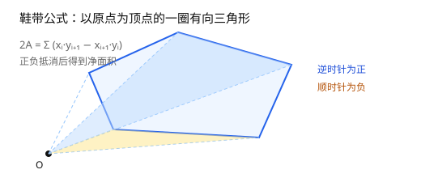

# 第 6 章 面积与质心的稳定计算

[返回目录](README.md) ｜ [上一章：区域布尔流水线](05-boolean-pipeline.md) ｜ [下一章：路径描边](07-path-stroke.md)



## 6.1 问题：公式对，答案错

多边形面积有现成公式，写出来只有几行。但把坐标换成 `1e9` 附近再算，结果可能离谱——不是公式错，是浮点抵消。

先看一个极端例子：底边 1000、高 0.001 的细长三角形，整体平移到 `(1e9, 1e9)`。真实面积是 0.5，下面三种算法给出完全不同的答案。

## 6.2 鞋带公式

把多边形看成以原点为顶点的一圈有向三角形：

```text
2A = Σ (x_i * y_{i+1} - x_{i+1} * y_i)
```

每个三角形带符号，逆时针为正、顺时针为负，正好抵消出多边形的净面积。符号就是方向（第 4 章）。

```lisp
; 可运行
procedure(_ShoelaceRaw(l_pts "l")  ; -> float
    let((sum n)
        sum = 0.0
        n = length(l_pts)
        for(i 0 n - 1
            let((p1 p2 j)
                p1 = nth(i l_pts)
                j = if(i == n - 1 0 i + 1)
                p2 = nth(j l_pts)
                sum = sum + p1->x() * p2->y() - p2->x() * p1->y()
            )
        )
        sum / 2.0
    )
)

thin = list(ycGeom::Point(1e9:1e9)
    ycGeom::Point(1e9 + 1000:1e9)
    ycGeom::Point(1e9:1e9 + 0.001))

_ShoelaceRaw(thin)   ; => 0.0
```

正确答案约 0.5，朴素公式给出 `0.0`。原因：每项乘积约 `1e18`，而最终结果只有 `1e0` 量级；双精度在 `1e18` 处的间隔约 128，正负项抵消后低位全被舍掉，面积直接消失。

## 6.3 第一招：平移参考点

公式对整体平移不变。先把所有坐标减去同一个参考点（通常取第一个顶点），再套公式：

```text
x' = x - x0,  y' = y - y0
2A = Σ (x'_i * y'_{i+1} - x'_{i+1} * y'_i)
```

平移后，乘积的量级从「坐标平方」降到「尺寸平方」，抵消不再发生：

```lisp
; 可运行
procedure(_ShoelaceShifted(l_pts "l")  ; -> float
    let((x0 y0 sum n)
        x0 = car(l_pts)->x()
        y0 = car(l_pts)->y()
        sum = 0.0
        n = length(l_pts)
        for(i 0 n - 1
            let((p1 p2 j)
                p1 = nth(i l_pts)
                j = if(i == n - 1 0 i + 1)
                p2 = nth(j l_pts)
                sum = sum + (p1->x() - x0) * (p2->y() - y0)
                    - (p2->x() - x0) * (p1->y() - y0)
            )
        )
        sum / 2.0
    )
)

_ShoelaceShifted(thin)   ; => 0.5000234
ycGeom::Polygon(thin)->area()   ; => 0.5000234
```

结果与库一致。注意它不是 `0.5`：点 `(1e9, 1e9 + 0.001)` 本身就存不下精确的 `0.001`，输入已经有约 `4.7e-5` 的相对误差。**平移能消除计算误差，消除不了输入表示误差。**

## 6.4 第二招：补偿求和

即使平移了，累加大量同号项仍会丢小数。Kahan–Babuška–Neumaier 求和把每步的舍入误差单独记下来，最后补回去：

```text
t = sum + term
if |sum| >= |term|: comp += (sum - t) + term
else:               comp += (term - t) + sum
sum = t
结果 = sum + comp
```

```lisp
; 可运行
procedure(_ShoelaceComp(l_pts "l")  ; -> float
    let((x0 y0 sum comp n p1 p2 j tt term)
        x0 = car(l_pts)->x()
        y0 = car(l_pts)->y()
        sum = 0.0
        comp = 0.0
        n = length(l_pts)
        for(i 0 n - 1
            p1 = nth(i l_pts)
            j = if(i == n - 1 0 i + 1)
            p2 = nth(j l_pts)
            term = (p1->x() - x0) * (p2->y() - y0)
                - (p2->x() - x0) * (p1->y() - y0)
            tt = sum + term
            if(abs(sum) >= abs(term)
                comp = comp + ((sum - tt) + term)
                comp = comp + ((term - tt) + sum)
            )
            sum = tt
        )
        (sum + comp) / 2.0
    )
)

_ShoelaceComp(thin)   ; => 0.5000234
```

顶点上千、坐标跨度大时，补偿求和的收益才明显；三五个顶点时，平移通常已经够用。

## 6.5 质心

质心公式是面积的加权版：

```text
Cx = (1 / (6A)) * Σ (x_i + x_{i+1}) * cross_i
Cy = (1 / (6A)) * Σ (y_i + y_{i+1}) * cross_i
cross_i = x_i * y_{i+1} - x_{i+1} * y_i
```

同样要平移；`6A = 3 * (2A)`，所以除数是 `3 * a2`：

```lisp
; 可运行
procedure(_CentroidOf(l_pts "l")  ; -> Point
    let((x0 y0 a2 cx cy n a b cross)
        x0 = car(l_pts)->x()
        y0 = car(l_pts)->y()
        n = length(l_pts)
        a2 = 0.0
        cx = 0.0
        cy = 0.0
        for(i 0 n - 1
            a = nth(i l_pts)
            b = nth(if(i == n - 1 0 i + 1) l_pts)
            cross = (a->x() - x0) * (b->y() - y0)
                - (b->x() - x0) * (a->y() - y0)
            a2 = a2 + cross
            cx = cx + ((a->x() - x0) + (b->x() - x0)) * cross
            cy = cy + ((a->y() - y0) + (b->y() - y0)) * cross
        )
        ycGeom::Point(list(
            x0 + cx / (3.0 * a2)
            y0 + cy / (3.0 * a2)))
    )
)

square = list(ycGeom::Point(0:0) ycGeom::Point(4:0)
    ycGeom::Point(4:4) ycGeom::Point(0:4))
_CentroidOf(square)->toSkill()    ; => (2.0 2.0)

bigSquare = list(ycGeom::Point(1000000:1000000)
    ycGeom::Point(1000010.5:1000000)
    ycGeom::Point(1000010.5:1000010.5)
    ycGeom::Point(1000000:1000010.5))
c = _CentroidOf(bigSquare)
sprintf(nil "%.17g" c->x())       ; => "1000005.25"
sprintf(nil "%.17g" c->y())       ; => "1000005.25"
```

**打印陷阱**：`%A` 对浮点数只保留有限有效位，直接 `printf("%A" c->x())` 会显示成 `1000005.0`，看起来像算错了。核验大坐标结果时用 `%.17g`。

```lisp
; 可运行
printf("%A\n" 1000005.25)                 ; 显示 1000005.0
sprintf(nil "%.17g" 1000005.25)           ; => "1000005.25"
```

## 6.6 面积与周长的口径

keyhole 多边形的切割线在点列里出现两次、方向相反：

- **面积**：两次贡献符号相反，正好抵消，所以公式不用特殊处理；
- **周长**：默认扣除切割线（真实边界才有意义），`?includeSeams t` 时按完整点列计算。

```lisp
; 可运行
outer = ycGeom::Polygon('((0 0) (10 0) (10 10) (0 10)))
hole = ycGeom::Polygon('((3 3) (7 3) (7 7) (3 7)))
holeRing = car(ycGeom::Region(list(outer))->not(ycGeom::Region(list(hole)))->polygons())

holeRing->area()                       ; => 84.0
holeRing->perimeter()                  ; => 56.0
holeRing->perimeter(?includeSeams t)   ; => 62.0
```

## 6.7 边界与常见误解

- **零面积。** 质心公式要除以面积；退化多边形没有质心，库会以 `error()` 中断。
- **补偿求和不是万能药。** 它只处理求和误差；输入表示误差、乘积本身的大数抵消要靠平移解决。
- **参考点怎么选。** 取第一个顶点最简单；取包围盒中心有时更稳。两者都不改变结果，只影响误差。
- **比较面积也要带容差。** 两个形状面积「相等」通常意味着相对误差足够小，不是逐位相等。

## 小结

- 鞋带公式的符号就是方向，面积要平移参考点再算。
- 补偿求和把每步舍入误差留下来，最后补回。
- 质心公式与面积共享同一套 `cross`，除数是 `3 * a2`。
- 大坐标结果用 `%.17g` 打印，别被 `%A` 的显示精度误导。

下一章把线加粗：给定中心线和宽度，构造出描边区域，再从区域逆推回路径。

[返回目录](README.md) ｜ [下一章](07-path-stroke.md)
