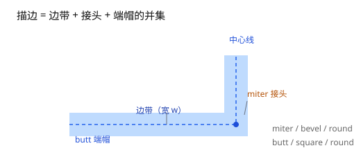
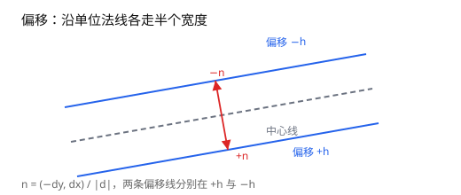
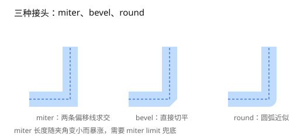
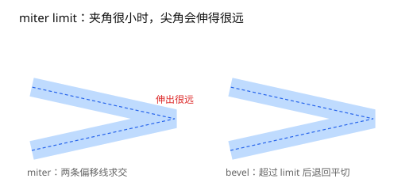
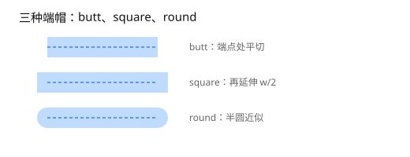
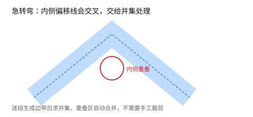
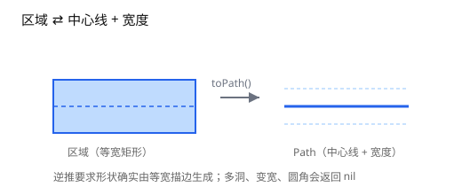

# 第 7 章 路径描边

[返回目录](README.md) ｜ [上一章：面积与质心的稳定计算](06-area-and-centroid.md) ｜ [下一章：综合案例](08-end-to-end.md)



*图 7.1 描边的组成：边带、接头与端帽。*

**本章目标**：把中心线加粗成区域，理解偏移、接头、端帽与自交的处理；学完能用 `Path->toRegion` 生成描边，并知道 `Polygon->toPath` 能还原什么、不能还原什么。

**上一章留下**：面积与质心的稳定算法，以及 keyhole 切割线的面积抵消。

**这一章要用**：第 5 章的布尔并集——描边的边带、接头、端帽最后都丢进并集。

**教学函数与库接口**

| 教学函数 | 库里的等价接口 | 差别 |
| --- | --- | --- |
| `_OffsetLine` | 无公开的单边偏移接口；`Polygon->size` 是另一种涨缩 | 教学版只偏移一条边 |
| `_MiterPoint` | `Path->toRegion`（`?join 'miter` / `?miterLimit`） | 库版超过限制自动退回 bevel |
| 端帽与接头 | `Path->toRegion`（`?cap` / `?join` / `?roundSegments`） | 语义相同 |
| 逆推 | `Polygon->toPath`（`?orient`） | 库版做候选枚举与重合校验 |

## 7.1 问题：把线加粗成面

给定一条中心线（折线或闭合环）和一个总宽度 `w`，求「距离中心线不超过 `w / 2` 的点集」。这就是描边。严格的距离集对应 round 端帽与 round 接头；butt 端帽会在端点平切，miter 接头会伸出 `w / 2` 之外，都是工程变体。听起来只是把线往两边平移，实际有四个难点：

1. **接头**：折线转弯处，两条偏移线不相交，需要补一个角。
2. **端帽**：开放路径的起点和终点要封口，否则区域不闭合。
3. **自交**：急转弯或短边会让偏移线互相穿插，必须求并集，不能逐段拼。
4. **逆推**：给一个区域，判断它是不是等宽描边、中心线在哪。

## 7.2 偏移：沿法线走半个宽度

对方向向量 `d = (dx, dy)`，单位法线是：

```text
n = (-dy, dx) / |d|
```

中心线两侧的偏移点就是 `P ± n * (w / 2)`：

```lisp
; 可运行
procedure(_OffsetLine(g_a g_b n_dist "ggn")  ; -> list[Point]
    ; 单位法线 = 方向向量逆时针旋转 90 度
    let((dx dy len nx ny)
        dx = g_b->x() - g_a->x()
        dy = g_b->y() - g_a->y()
        len = sqrt(dx * dx + dy * dy)
        nx = -dy / len
        ny = dx / len
        list(
            ycGeom::Point(list(
                g_a->x() + nx * n_dist
                g_a->y() + ny * n_dist))
            ycGeom::Point(list(
                g_b->x() + nx * n_dist
                g_b->y() + ny * n_dist)))
    )
)

offset = _OffsetLine(ycGeom::Point(0:0) ycGeom::Point(10:0) 1.0)
length(offset)                                      ; => 2
mapcar(lambda((p) p->y()) offset)                   ; => (1.0 1.0)
```



*图 7.2 两条偏移线分别位于法线的正负方向。*

一条边带就是「原边 + 两条偏移线」围成的矩形；整条路径的区域是所有边带、接头、端帽的并集。

## 7.3 接头：miter、bevel、round

在拐点 B 处，前一段的方向是 `d1`，后一段是 `d2`，两条外侧偏移线的交点是 miter 角：

```text
p = (A + n1 * h) + t * d1
t = ((B + n2 * h) - (A + n1 * h)) × d2 / (d1 × d2)
```

```lisp
; 可运行
procedure(_MiterPoint(g_a g_b g_c n_half "gggn")  ; -> Point | nil
    ; 两条同侧偏移线求交；toLine 与 ?as 'Line 把两边都当无限直线
    ycGeom::Segment(_OffsetLine(g_a g_b n_half))->toLine()->intersection(
        _OffsetLine(g_b g_c n_half) ?as 'Line)
)

A = ycGeom::Point(0:0)
B = ycGeom::Point(10:0)
C = ycGeom::Point(10:-10)   ; 右转：左法线落在弯道外侧

_MiterPoint(A B C 1.0)->toSkill()   ; => (11.0 1.0)，外侧尖角
```

示例取右转，`_OffsetLine` 的左法线正好在弯道外侧；左转时左法线在内侧，求外侧尖角要换另一侧法线，库内会按转向选择。

三种接头风格（图 7.3）：

| 风格 | 做法 | 特点 |
| --- | --- | --- |
| `'miter` | 取两条偏移线的交点 | 尖锐；转角很小时 miter 长度会爆炸 |
| `'bevel` | 直接用直线连接两个外角点 | 平切，面积略小 |
| `'round` | 以拐点为圆心画圆弧（多边形近似） | 圆滑，面积介于两者之间 |



*图 7.3 miter 最尖、bevel 切平、round 圆弧。*

θ 是两段中心线在拐点处的夹角（内角）。从拐点到外侧尖角的距离是 `(w / 2) / sin(θ/2)`：直角时约 `0.707w`。内外尖角之间的 miter 长度是 `w / sin(θ/2)`；`?miterLimit` 限制的是「拐点到尖角的距离 / 半宽」，也就是 `1 / sin(θ/2)`。超过阈值就退回 bevel，否则尖角会伸出去很远。



*图 7.4 夹角越小 miter 越长，超过 limit 就退回 bevel。*

## 7.4 端帽：butt、square、round

开放路径的两端（图 7.5）：

| 风格 | 做法 | 面积增量 |
| --- | --- | --- |
| `'butt` | 在端点处平切 | 0 |
| `'square`（方帽） | 沿方向再延伸 `w / 2` | 每端 `w² / 2` |
| `'round` | 半圆（多边形近似） | 每端约 `π * w² / 8` |



*图 7.5 butt 平切、square 延伸、round 半圆。*

闭合路径没有端帽，接头环绕一整圈。

## 7.5 自交：交给并集

急转弯时，前一段的边带和后一段的边带会重叠；短边的偏移线甚至会互相交叉（图 7.6）。手工裁剪这些自交非常容易出错，正确做法是：

1. 每条边生成一条独立边带；
2. 每个接头、每个端帽生成独立多边形；
3. 全部丢进区域并集，重叠部分自动合并。



*图 7.6 内侧偏移线交叉处由并集自动合并。*

`ycGeom` 的 `Path->toRegion` 就是这么做的，所以它能处理任意折线而不会产生重叠碎片。

## 7.6 跑一遍

```lisp
; 可运行
openPath = ycGeom::Path(list(0:0 10:0) ?width 2)

openPath->toRegion()->area()          ; => 20.0，10 x 2
openPath->toRegion()->bBox()          ; => ((0.0 -1.0) (10.0 1.0))
openPath->toRegion(?cap 'round)->area()    ; => 23.12145
openPath->toRegion(?cap 'square)->area()   ; => 24.0
```

圆帽比平帽多出两个半圆，理论增量约 `π ≈ 3.14`；库用多边形近似圆，得到 `23.12`。

L 形折线比较三种接头：

```lisp
; 可运行
bentPath = ycGeom::Path(list(0:0 10:0 10:10) ?width 2)

bentPath->toRegion()->area()                    ; => 40.0，miter
bentPath->toRegion(?join 'bevel)->area()        ; => 39.5
bentPath->toRegion(?join 'round)->area()        ; => 39.78036
```

闭合路径没有端帽，面积等于「中心线长度 × 宽度」：

```lisp
; 可运行
closedPath = ycGeom::Path(list(0:0 10:0 10:10 0:10 0:0) ?width 2)

closedPath->isClosed()                ; => t
closedPath->toRegion()->area()        ; => 80.0，40 x 2
```

## 7.7 逆推：从区域恢复路径

给定一个区域，判断它是否是等宽描边。下面是启发式流程，不保证对所有形状都有解：

1. 找到一对平行且等距的边，推测中心线与宽度；
2. 用推测的中心线重新生成描边；
3. 与输入区域比对，重合才接受；
4. 候选不唯一，或存在无法用等宽中心线表示的洞、变宽、圆角时返回 `nil`。

```lisp
; 可运行
bar = ycGeom::Polygon(list(0:0 10:0 10:4 0:4))
back = bar->toPath()

back->route()->toSkill()   ; => ((0.0 2.0) (10.0 2.0))
back->width()              ; => 4.0
```

带洞不一定失败：宽度均匀的方环本身就是闭合描边；宽度不均匀时，单条中心线才表达不了。先看失败的情形：

```lisp
; 可运行
plate = ycGeom::Polygon('((0 0) (10 0) (10 10) (0 10)))
hole = ycGeom::Polygon('((2 2) (5 2) (5 5) (2 5)))
donut = ycGeom::Region(list(plate))->not(ycGeom::Region(list(hole)))
car(donut->polygons())->toPath()    ; => nil
```

把洞改成居中的 `4 x 4`，方环恰好是宽度 `3` 的闭合描边，`toPath()` 就能成功：

```lisp
; 可运行
uniform = ycGeom::Polygon('((0 0) (10 0) (10 10) (0 10)))
uniformHole = ycGeom::Polygon('((3 3) (7 3) (7 7) (3 7)))
uniformRing = car(ycGeom::Region(list(uniform))->not(
    ycGeom::Region(list(uniformHole)))->polygons())
uniformRing->toPath()->width()    ; => 3.0
```



*图 7.7 区域与 Path 的互转：宽度由形状推断。*

闭合方形描边也能还原，只是中心线的起点和方向可能与原路径不同：

```lisp
; 可运行
outline = car(closedPath->toRegion()->polygons())->toPath()
outline->width()                  ; => 2.0
outline->isClosed()               ; => t
```

**逆推不是有损压缩。** 它只在形状确实由等宽描边生成时成功；多洞、变宽、圆角或 bevel 描边都会返回 `nil`，因为「中心线 + 宽度」表达不了这些形状。

## 7.8 本章未展开的部分

| 省略内容 | 为什么省略 | 想深挖 |
| --- | --- | --- |
| 圆弧离散误差与 `?roundSegments` 的取舍 | 库已封装，参数表有说明 | [API 手册](../README.md#ycgeompath-function-class) |
| 自交裁剪与并集的差别 | 统一交给并集 | [7.5](07-path-stroke.md) |
| 逆推的候选枚举与失败条件 | 启发式，细节在实现里 | [API 手册](../README.md#ycgeompolygon-function-class) |
| 变宽 / 非等宽描边 | 「中心线 + 宽度」表达不了 | [API 手册](../README.md#ycgeompolygon-function-class) |

## 7.9 边界与常见误解

- **圆角是多边形。** `'round` 用若干段直线近似圆弧，`?roundSegments` 控制段数；段数越多越圆，但顶点也越多。
- **宽度太小会被网格吃掉。** 描边区域经过布尔并集，特征尺寸小于布尔采样距离时可能退化；必要时给 `?grid`。
- **miter limit 必须有。** 没有上限的 miter 在极小夹角下会伸出极远，既不好看也会拖慢布尔运算。
- **闭合路径的首点。** 首点重复只表示闭合，不会产生额外的零长度边；`isClosed()` 会识别。

## 小结

- 描边 = 边带 + 接头 + 端帽的并集。
- 偏移沿单位法线走半个宽度；miter 是两条偏移线的交点，靠 miter limit 兜底。
- 自交不要手工裁剪，交给区域并集。
- 逆推靠「等宽 + 重合验证」，表达不了的形状返回 `nil`。

至此，从坐标、方向、键、面、布尔到描边的完整链路就讲完了。下一章把这些接口串成一个完整案例。回到 [API 手册](../README.md) 可以查到每个接口的完整参数与边界。

## 自检

1. 为什么描边不能逐段拼接，而要整体求并集？
2. miter limit 解决什么问题？
3. 逆推为什么对某些带洞区域返回 nil，而另一些带洞区域能成功？

<details><summary>参考答案</summary>

1. 急转弯或短边会让偏移线互相穿插，逐段拼接会产生重叠碎片；整体并集会自动合并。
2. 限制极小夹角下 miter 长度爆炸；超过阈值就退回 bevel。
3. 判据是「能否用一条等宽中心线表示」：宽度均匀的方环本身就是闭合描边，可以还原；宽度不均匀的洞无法用单条中心线表达。

</details>

[返回目录](README.md) ｜ [下一章](08-end-to-end.md)
