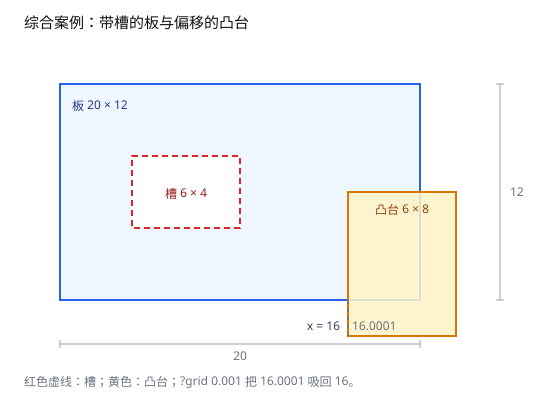

# 第 8 章 综合案例：从版图多边形到最终结果

[返回目录](README.md) ｜ [上一章：路径描边](07-path-stroke.md)



*图 8.1 综合案例：带槽的板与偏移的凸台，网格吸附后合并。*

**本章目标**：把前七章的接口串成一条链——构造带洞区域、布尔求并、算面积 / 周长 / 质心 / 包围盒，最后输出点列。学完能独立完成一个真实的几何处理流程。

**上一章留下**：描边由边带、接头与端帽求并集得到；逆推只在能用等宽中心线表示时成功。

**这一章要用**：构造器（第 4 章）、布尔（第 5 章）、面积与质心（第 6 章）、`?grid`（第 1 章）。本章只用库接口，不定义教学函数，可以独立运行。

| 接口 | 前面哪一章 | 本章用来做什么 |
| --- | --- | --- |
| `ycGeom::Polygon` | [第 4 章](04-polygon-normalization.md) | 构造板、槽与凸台 |
| `Region->not` | [第 5 章](05-boolean-pipeline.md) | 从板上挖掉槽 |
| `Region->or` | [第 5 章](05-boolean-pipeline.md) | 把凸台并到板上 |
| `?grid` | [第 1 章](01-tolerance-and-grid.md) | 把 `16.0001` 吸回 `16` |
| `area` / `perimeter` / `centroid` / `bBox` | [第 6 章](06-area-and-centroid.md) | 汇总最终结果 |

本章不引入新概念，故不设「本章未展开的部分」；新增的只有把前面接口串起来的流程。

## 8.1 场景

上游给了一块 `20 x 12` 的板，板上有一个 `6 x 4` 的槽；另外有一个 `6 x 8` 的凸台要焊在板边（图 8.1）。凸台的左边界从 `x = 16.0001` 开始——这是上游坐标的舍入噪声，实际应该在 `x = 16`。

目标：

1. 用差集把槽从板里挖掉；
2. 用并集把凸台和板合并，并用 `?grid 0.001` 把 `16.0001` 吸回 `16`；
3. 输出最终面积、周长、质心、包围盒与点列长度。

## 8.2 先挖槽

```lisp
; 可运行
plate = ycGeom::Polygon(list(0:0 20:0 20:12 0:12))
slot = ycGeom::Polygon(list(4:4 10:4 10:8 4:8))

holed = ycGeom::Region(list(plate))->not(ycGeom::Region(list(slot)))

length(holed->polygons())          ; => 1
holed->area()                      ; => 216.0，20 x 12 - 6 x 4
holed->perimeter()                 ; => 84.0，64 + 20
holed->perimeter(?includeSeams t)  ; => 104.0，加上切割线往返
length(car(holed->polygons())->points())   ; => 11
```

`not` 返回的是一块带 keyhole 切割线的多边形：面积只算真实区域，周长默认扣除切割线。

## 8.3 合并凸台

```lisp
; 可运行
tab = ycGeom::Polygon('((16.0001 -2) (22 -2) (22 6) (16.0001 6)))

plain = holed->or(ycGeom::Region(list(tab)))
sprintf(nil "%.17g" plain->area())    ; => "239.99979999999999"，凸台整体偏了 0.0001
length(plain->polygons())             ; => 1

joined = holed->or(ycGeom::Region(list(tab)) ?grid 0.001)
sprintf(nil "%.17g" joined->area())   ; => "240"，吸附后 16.0001 变成 16
length(joined->polygons())            ; => 1
```

不吸附时，凸台比目标窄 `0.0001`，并集面积少 `0.0002`；`?grid 0.001` 把它吸回整格，面积回到 `240.0`。

## 8.4 汇总结果

```lisp
; 可运行
joined->bBox()                       ; => ((0.0 -2.0) (22.0 12.0))
joined->centroid()->toSkill()        ; => (11.3 5.5)
car(joined->polygons())->toPath()    ; => nil，带洞且宽度不均匀时无法还原
length(car(joined->polygons())->points())   ; => 15
```

质心可以用面积加权验算：板减去槽后的质心是 `(10.3333, 6)`，凸台是 `(19, 2)`，重叠部分是 `(18, 3)`；三项按面积加权后正好是 `(11.3, 5.5)`。

## 8.5 输出给下一步

```lisp
; 可运行
sprintf(nil "area=%.17g" joined->area())              ; => "area=240"
sprintf(nil "perimeter=%.17g" joined->perimeter())    ; => "perimeter=92"
length(joined->toSkill())    ; => 1，一个 Region 仍只有一个成员
```

`toSkill()` 输出只含 list 与 float 的原生数据，可以直接交给下游脚本或写回版图文件。

## 边界与常见误解

- **`?grid` 不是越大越好。** 网格过粗会把不同特征吸到同一点；先找最小特征尺寸，再取比它小一个量级的值。
- **`toPath()` 不是压缩。** 它只在形状确实由等宽描边生成时成功；带洞且宽度不均匀、变宽、圆角或 bevel 都会返回 `nil`。

## 小结

- 构造 → 差集 → 并集 → 查询，是几何处理最常见的链。
- 上游坐标有噪声时，先找最小特征尺寸，再决定 `?grid` 的间距。
- 带洞区域能算面积、周长、质心与包围盒；能否逆推成单条中心线，取决于宽度是否均匀。
- 输出用 `toSkill()` 保持数据类型简单。

## 自检

1. 为什么 8.3 节不吸附时面积是 `239.9998`，而不是 `240.0`？
2. 如果把 `?grid` 改成 `0.1`，可能发生什么？

<details><summary>参考答案</summary>

1. 凸台左边界偏了 `0.0001`，整体宽度少了 `0.0001`；凸台自身面积少约 `0.0008`，其中大部分落在板内被并集吸收，净少 `0.0002`，所以是 `239.9998`。
2. 网格过粗，`16.0001` 仍会被吸到 `16`，但其他更靠近的特征也可能被吸到同一格，导致小特征被抹平或碰撞。

</details>

[返回目录](README.md)
