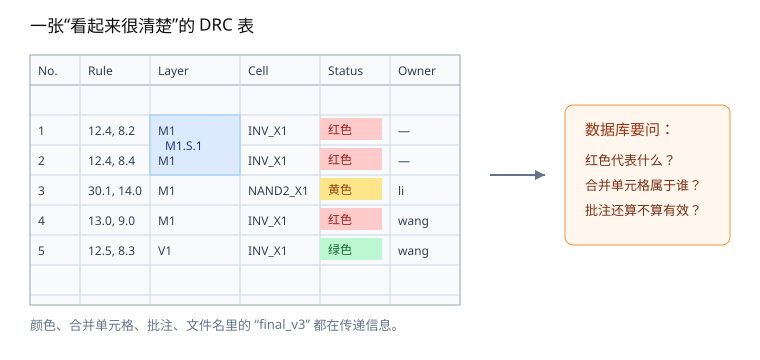

# 第 0 章 导读

[返回目录](README.md) ｜ [下一章：从 Excel 到数据库](01-from-excel-to-database.md)



*图 0.1 一张“看起来很清楚的” DRC 表，换一个人来读就要猜。*

**本章目标**：建好教程数据库，知道示例怎么执行、怎么重置，并理解 SQL 是“说想要什么”，不是“写每一步怎么做”。

## 0.1 这本教程要解决什么问题

版图工程师每天都在看表：DRC 结果、LVS 结果、天线检查、EM 检查、waiver 记录、signoff 状态。最常见的载体是 Excel。

Excel 上手快，但信息经常藏在格式里：

- 红色表示 open，绿色表示 fixed，黄色表示 waived；
- 同一个规则名只写在合并单元格的第一行；
- 批注里写着 waiver 的原因和有效期；
- 文件名带 `final`、`final_v2`、`final_v3_真的最终版`；
- 同一份数据复制给三个人，各自改一版。

人少的时候还能靠记忆和口头约定。数据一多，问题就来了：换个人看不懂颜色，排序后合并单元格错位，批注没人维护，两个文件不知道哪个是真的。

数据库做的事情很朴素：**把原来藏在格式里的信息，变成每一行都能直接读到的列。**

## 0.2 数据库、表、行、列

先用 Excel 的词汇建立第一层印象：

| Excel | 数据库 | 说明 |
| --- | --- | --- |
| 一个 `.xlsx` 文件 | 一个数据库文件，例如 `drc.db` | 一个文件里可以有很多张表 |
| 一张工作表 sheet | 一张表 table | 例如 `violations`、`rules` |
| 一行 | 一行 row | 一条记录，例如一条 DRC 违例 |
| 一列 | 一列 column | 一个字段，例如 `cell`、`x`、`status` |
| 单元格 | 值 value | 某一行的某一列 |
| 第一行的标题 | 列名 column name | 建表时定好，之后按名字访问 |
| 行号 | 主键 primary key | 行号会变，主键不会 |

这只是入门对照。数据库不是“另一个 Excel”，第 3 章会主动打破这个类比：Excel 的一张表可以随便塞，数据库要求你先说清楚实体、属性和关系。

## 0.3 教程里的四个数据库

教程做四个库，分别对应四类常见问题。

**`drc.db`**：主线。先把一张扁平的 DRC Excel 表原样搬进来，再拆成 `layers`、`rules`、`runs`、`violations`、`waivers` 五张表。它回答：一条违例属于哪条规则、哪次运行、哪个图层？谁负责？有没有豁免？豁免过期了吗？

**`signoff.db`**：副线。用 `blocks`、`checks`、`block_checks` 三张表讲多对多：一个 block 要做很多检查，一个检查也适用于很多 block。它回答：哪些 block 还没签？哪些检查组合漏了？

**`sch.db`**：连接快照。用 `instances`、`nets`、`terminals` 三张表记录一个反相器链：哪个 pin 连到哪条网络？哪个 pin 悬空？一条网络有几个端子？

**`layout.db`**：版图图形快照。用一张 `shapes` 表记录矩形、多边形、路径和 via，练习按层统计、包围盒、矩形面积和窗口预筛。它不替代 OA，也不做精确几何运算。

四个库都放在 `./sqlite-tutorial/`：

```text
./sqlite-tutorial/
    drc.db
    signoff.db
    sch.db
    layout.db
```

这个目录可以随时删掉重建，不会影响 `oa` 库。

## 0.4 准备教程数据库

先确认 CIW 当前目录下有 `skill-oo` 软链接。下面的 `load("skill-oo/...")` 都从这个位置开始找文件；如果报找不到文件，先检查这一点。

在 CIW 里执行：

```lisp
load("skill-oo/docs/sqlite/tutorial/setup.il")
```

这条命令只定义教程辅助函数，不会立刻建库。接着建第 1、2 章要用的扁平库：

```lisp
ycSQLiteTutorialSetup(?stage 'flat)
; => ("sqlite-tutorial/drc.db" "sqlite-tutorial/signoff.db")
```

`?stage 'flat` 表示只建到第 2 章的状态：`layers` 加上一张扁平的 `violations`。`signoff.db` 也会一起建好，第 4 章直接用。

第 3 章做完拆表后，从第 4 章开始用完整状态：

```lisp
ycSQLiteTutorialSetup(?stage 'full)
; => ("sqlite-tutorial/drc.db" "sqlite-tutorial/signoff.db")
```

`?stage 'full` 会重建 `drc.db`，包含拆表后的五张表和样例豁免记录。每次执行都会先删掉本次要重建的教程库，所以不用担心重复执行。

第 9、10 章分别用 `?stage 'sch` 和 `?stage 'layout` 单独建连接库和版图库；想一次建好四个库，用 `?stage 'all`。

只想清空、不想建库时：

```lisp
load("skill-oo/docs/sqlite/tutorial/reset.il")
; 输出 tutorial reset: removed databases under ./sqlite-tutorial
```

## 0.5 第一个检查点

建完 `flat` 库后，打开它看看：

```lisp
db = ycSQLite::Open("./sqlite-tutorial/drc.db")
db->tables()
; => ("layers" "violations")
```

`Open` 打开一个数据库文件。文件不存在时它会创建；这里文件已经由 `setup` 建好。

查一下表里的行数：

```lisp
car(db->query("select count(*) from violations;")->rows())->get(0)
; => 12
```

如果这两条都得到上面的结果，环境就准备好了。`db` 这个变量后面还会用；换章时如果重新执行了 `setup`，要重新 `Open`。

## 0.6 SQL 是声明式

SQL 和 SKILL、C 这类语言不一样。你不需要写“先读第 1 行，再判断，再放到结果里”。你只需要说清楚想要什么：

```sql
select cell, x, y
from violations
where status = 'open'
order by x, y;
```

这句话的意思是：

1. 从 `violations` 表取数据；
2. 只要 `status` 等于 `'open'` 的行；
3. 取 `cell`、`x`、`y` 三列；
4. 按 `x`、`y` 排序。

数据库自己决定怎么扫描、怎么排序、用不用索引。你描述结果，它负责执行。

## 0.7 四个必须记住的约定

**第一，字符串用单引号。** `'M1'` 是字符串，`M1` 是列名。写错引号，数据库会以为你在找一列叫 `M1` 的列。

**第二，`NULL` 不是 0。** `NULL` 表示“没有值”。没填 owner 和 owner 写了空字符串，是两件事。判断 `NULL` 要用 `is null`，不能写 `= null`。

**第三，语句用分号结束。** 最后一条可以省略，但教程统一写。多条语句之间必须用分号隔开。

**第四，表名和列名尽量用英文。** 数据库本身支持中文，但工具链、日志和别人的脚本处理英文更稳。教程统一用英文名。

## 0.8 教程辅助函数

`setup.il` 定义了三个辅助函数：

| 函数 | 用途 |
| --- | --- |
| `ycSQLiteTutorialSetup` | 重建教程数据库 |
| `ycSQLiteTutorialReset` | 删除教程数据库 |
| `ycSQLiteTutorialShow` | 把查询结果打印成文本表格 |

例如：

```lisp
ycSQLiteTutorialShow(db->query("select layer_id, name from layers order by layer_id;"))
; => layer_id  name
;    --------  ----
;    1         M1
;    2         V1
;    3         PO
```

`ycSQLiteTutorialShow` 只是把 `Result` 里的列名和行取出来，交给表格库排版。它不是 `ycSQLite` 的 API，正式脚本里可以直接用 `->toList()` 或 `->rows()`。

看完这一节就可以先关闭会话：

```lisp
db->close()
```

## 0.9 客户端不可用时

正常情况下，`ycSQLite` 会调用模块自带的 `sqlite3.sh`。这个脚本会先清理 Cadence 注入的库路径，再执行 `sqlite3`。

如果 CIW 报客户端验证失败，先确认测试机上有 `sqlite3`：

```lisp
ycSQLite::ProbeClient()->isValid()
; => t 或 nil
```

`nil` 时看诊断：

```lisp
ycSQLite::ProbeClient()->diagnostics()
; => 具体的失败原因
```

确认 `sqlite3` 可用后，配置一次即可：

```lisp
ycSQLite::Configure(?executable "sqlite3" ?unsetEnv list("LD_LIBRARY_PATH"))
```

也可以用环境变量 `YC_SKILL_OO_SQLITE_CLIENT` 指定客户端。配置一次后，后续 `Open` 都复用，不需要每次再指定。

## 0.10 本章检查点

1. `ycSQLiteTutorialSetup(?stage 'flat)` 返回两个数据库路径；
2. `db->tables()` 返回 `("layers" "violations")`；
3. `select count(*) from violations` 返回 `12`；
4. 知道 `NULL`、单引号和分号的区别。

四项都通过，继续读第 1 章。

## 0.11 常见误解

- **“数据库就是高级 Excel。”** 不是。Excel 以单元格为中心，数据库以表和关系为中心；第 3 章会看到差别。
- **“数据库能替代 OA。”** 不能。OA 是设计数据的事实来源；数据库适合保存检查结果、waiver、运行记录这类可以重建的数据。不要把 `drc.db` 当成版图库。
- **“`NULL` 就是空字符串。”** 不是。空字符串是一个值，`NULL` 是“没有值”。
- **“SQL 写得越长越厉害。”** 不是。能清楚表达结果、能被人读懂的 SQL 更好。

[返回目录](README.md) ｜ [下一章：从 Excel 到数据库](01-from-excel-to-database.md)
