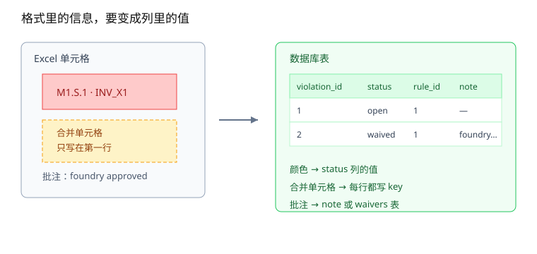

# 第 1 章 从 Excel 到数据库

[返回目录](README.md) ｜ [上一章：导读](00-how-to-read.md) ｜ [下一章：一张表能走多远](02-one-table.md)



*图 1.1 数据库不反对颜色，但它要求颜色代表的意思也能用列里的值读出来。*

**本章目标**：建立第一张表，理解表、行、列、主键、唯一约束和 `NULL`。学完能自己写出 `create table` 和最简单的 `insert`。

**本章从**：第 0 章的 `flat` 教程库开始。如果还没建，先执行：

```lisp
load("skill-oo/docs/sqlite/tutorial/setup.il")
ycSQLiteTutorialSetup(?stage 'flat)
```

## 1.1 一张真实的 DRC 表

假设昨晚的 DRC 结果导出成这样一张 Excel 表：

| No. | Rule | Layer | Cell | X | Y | Status | Owner |
| --- | --- | --- | --- | --- | --- | --- | --- |
| 1 | M1.S.1 | M1 | INV_X1 | 12.4 | 8.2 | 红色 |  |
| 2 |  | M1 | INV_X1 | 12.4 | 8.4 | 红色 |  |
| 3 |  | M1 | NAND2_X1 | 30.1 | 14.0 | 黄色 | li |
| 4 | M1.W.1 | M1 | INV_X1 | 13.0 | 9.0 | 红色 | wang |

这张表里，人能看懂，但数据库看不懂三件事：

1. 第二行的 `Rule` 是空的，因为它和第一行合并了；数据库需要每一行自己带 `M1.S.1`。
2. 红色、黄色是格式；数据库需要一列明确写 `open`、`waived` 或 `fixed`。
3. `No.` 是 Excel 行号；插入一行后它会变。数据库需要一个不会变的标识。

第 1 章先解决第三件事，顺便建立第一张表。

## 1.2 数据库文件不是工作表

一个数据库文件可以放很多张表。教程的 `drc.db` 最终会有五张表：

```text
drc.db
    layers
    rules
    runs
    violations
    waivers
```

不要把它想成“一个 sheet 变成一张表”这么简单。数据库的重点是表与表之间用键连起来；第 3 章会讲。

先看最小的表：`layers`。它只做一件事，把版图图层的缩写翻译成人能读的用途。

| layer_id | name | purpose |
| --- | --- | --- |
| 1 | M1 | metal 1 routing |
| 2 | V1 | via between M1 and M2 |
| 3 | PO | poly gate |

`layer_id` 是主键，`name` 是图层名，`purpose` 是说明。后面的 `violations` 表只存 `layer_id`，需要看图层名时再连过来。

## 1.3 建第一张表

先在内存里做，不碰教程文件：

```lisp
mem = ycSQLite::Open(":memory:")

mem->executeScript(strcat(
    "create table layers("
    "  layer_id integer primary key,"
    "  name     text not null unique,"
    "  purpose  text"
    ");"
    "insert into layers(name, purpose) values"
    "  ('M1', 'metal 1 routing'),"
    "  ('V1', 'via between M1 and M2'),"
    "  ('PO', 'poly gate');"
))
```

`":memory:"` 是 SQLite 的特殊路径，表示只在当前会话里存在的内存数据库。关闭 `mem` 后，里面的表和数据全部消失。它适合练习和临时计算。

逐句拆开看：

```sql
create table layers(
    layer_id integer primary key,
    name     text not null unique,
    purpose  text
);
```

- `create table layers`：建一张叫 `layers` 的表；
- `layer_id integer primary key`：整数主键；
- `name text not null unique`：文本，不能为空，不能重复；
- `purpose text`：文本，可以为空；
- 逗号分隔列定义，最后一行不加逗号。

`insert into` 写数据：

```sql
insert into layers(name, purpose) values
    ('M1', 'metal 1 routing'),
    ('V1', 'via between M1 and M2'),
    ('PO', 'poly gate');
```

`layer_id` 没写，因为它是 `integer primary key`，SQLite 会自动分配 1、2、3。

## 1.4 主键：不会变的行标识

查一下：

```lisp
mem->query("select layer_id, name, purpose from layers order by layer_id;")->toList()
; => ((1 "M1" "metal 1 routing")
;     (2 "V1" "via between M1 and M2")
;     (3 "PO" "poly gate"))
```

每一行是一个列表，顺序和 `select` 里的列一致。

主键的作用是给每一行一个稳定标识。Excel 的行号会因为你插入、删除、排序而变化；主键不会。后面的 `violations` 表会用 `layer_id` 指向 `layers`，而不是把 `'M1'` 反复写进每一行。

再插入一个图层：

```lisp
mem->execute("insert into layers(name, purpose) values ('M2', 'metal 2 routing');")->lastInsertRowid()
; => 4
```

`lastInsertRowid()` 返回刚才插入的新行 id。第 6 章会详细讲 `execute` 的返回值。

## 1.5 唯一约束：数据库自己拒绝重复

`name` 上写了 `unique`，所以再插一个 `M1` 会被拒绝：

```lisp
errset(mem->execute("insert into layers(name, purpose) values ('M1', 'duplicate');") nil)
; => nil
```

`errset` 捕获了错误，返回 `nil`。CIW 里会看到类似 `ycSQLite::Database->execute: Error: near line N: column name is not unique` 的诊断：前缀 `ycSQLite::Database->execute:` 是模块加的，`near line` 是会话内的输入行号（`N` 会随前面的语句数变化），不是文件行号，后面才是客户端原文。关键是插入没有成功。

教程的期望输出基于 SQLite 3.7.17：唯一约束的原文是 `column name is not unique`；较新的客户端会写成 `UNIQUE constraint failed: layers.name`。两种写法含义相同。

唯一约束的价值是：不依赖某个人记得“图层名不能重复”。数据库自己守住这条规则。

`not null` 守的是另一条规则：`name` 不能为空。`purpose` 没有 `not null`，所以可以留空；留空时值是 `NULL`，不是空字符串。

`NULL` 的判断要用 `is null`：

```lisp
mem->query("select name from layers where purpose is null;")->toList()
; => nil
```

现在没有 `purpose` 为空的图层，所以返回空列表。后面导入真实数据时，`owner` 会有很多 `NULL`。

## 1.6 看看真实的教程库

关掉内存库，打开教程库：

```lisp
mem->close()

db = ycSQLite::Open("./sqlite-tutorial/drc.db")
db->tables()
; => ("layers" "violations")
```

`tables()` 只返回用户表，不包含 SQLite 内部表。现在有两张：第 1 章的 `layers`，第 2 章要用的扁平 `violations`。

看 `layers` 的列定义：

```lisp
ycSQLiteTutorialShow(db->columns("layers"))
; => cid  name      type     notnull  dflt_value  pk
;    ---  --------  -------  -------  ----------  --
;    0    layer_id  integer  0                    1
;    1    name      text     1                    0
;    2    purpose   text     0                    0
```

`cid` 是列序号，`notnull` 是“不能为空”，`pk` 是“主键”。`dflt_value` 是默认值，这里三列都没有默认值。

教程的期望输出基于 SQLite 3.7.17：`type` 显示为建表时的小写；较新的客户端会显示 `INTEGER`、`TEXT`。两种都表示同一类型。

再看建表语句：

```lisp
printf("%s\n" db->schema(?table "layers"))
; => CREATE TABLE layers(
;        layer_id integer primary key,
;        name     text not null unique,
;        purpose  text
;    )
```

`schema` 返回数据库里保存的原始建表文本。注意它不会帮你美化，也不会补上分号；格式就是你当初写的样子。

上面的 `;` 和它后面的对齐空格是文档标记，不是输出；`schema()` 返回的第二行开头就是 4 个空格。

查数据：

```lisp
db->query("select layer_id, name, purpose from layers order by layer_id;")->toList()
; => ((1 "M1" "metal 1 routing")
;     (2 "V1" "via between M1 and M2")
;     (3 "PO" "poly gate"))
```

这三行和教程数据文件 `data/01_layers.sql` 一致。想改样例数据，改文件后重新执行 `ycSQLiteTutorialSetup(?stage 'flat)`。

## 1.7 常用类型

教程只用到四种类型：

| 类型 | 用途 | 例子 |
| --- | --- | --- |
| `integer` | 整数、id、数量 | `layer_id`、`violation_id` |
| `real` | 浮点数、坐标 | `x`、`y` |
| `text` | 字符串、日期文本 | `cell`、`status`、`started_at` |
| `blob` | 二进制 | 教程不用 |

SQLite 的类型比较宽松。例如你把 `'12.4'` 存进 `real` 列，它会尽量转成数字；把 `12.4` 存进 `text` 列，它会存成文本。宽松不等于可以乱来：列类型是给读代码的人看的契约，也是排序、比较和后续工具处理的依据。

日期没有单独的 `date` 类型。教程把日期存成 `text`，格式统一用 `YYYY-MM-DD` 或 `YYYY-MM-DDTHH:MM:SS`。这样字符串排序就是时间排序。

## 1.8 数据库不是 OA

版图数据的事实来源是 OA。`lib`、`cell`、`view`、`dbId`、`instance`、`via`、`shape` 这些对象在 OA 里有明确的生命周期和版本管理。

`drc.db` 不存版图，也不替代 OA。它存的是“检查结果”和“人对结果的处理”：

- 哪次运行、哪条规则、哪个 cell、哪个坐标；
- 谁负责、当前状态、有没有 waiver；
- waiver 的原因、批准人、有效期。

这些数据可以从 DRC 结果重新导入，也可以随时删掉重建。把它们放进 OA 反而不合适：OA 管的是设计数据，不是检查流水账。

## 1.9 本章检查点

```lisp
db->tables()
; => ("layers" "violations")

car(db->query("select count(*) from layers;")->rows())->get(0)
; => 3
```

再回答三个问题：

1. `layer_id` 和 Excel 行号有什么区别？
2. `name` 上的 `unique` 拦住了什么？
3. `purpose` 为空时，值是 `NULL` 还是空字符串？

答案：主键不会随插入、删除、排序变化；拦住重复图层名；是 `NULL`。

## 1.10 常见错误

- **把 Excel 行号当主键。** 排序一次就变了。用独立的 `id` 列。
- **用颜色代替状态列。** 颜色可以辅助阅读，但状态必须有一列明确的值。
- **用空字符串表示“没有”。** 没有 owner 就写 `NULL`，不要写 `''`。
- **把数字存成文本再排序。** `'10'` 会排在 `'9'` 前面；该用 `real` 或 `integer` 就用。
- **以为什么都能往一张表塞。** 第 2 章先塞一次，第 3 章会看到代价。

## 1.11 练习

1. 在 `mem` 里再插入一个图层 `M2`，查 `select layer_id, name from layers order by layer_id;`。
2. 故意插入两个同名图层，观察错误。
3. 把 `purpose` 改成 `not null` 后重建表，想想为什么旧数据可能插不进去。

本章的数据库会话到这里关闭；下一章会重新打开。

```lisp
db->close()
```

[返回目录](README.md) ｜ [上一章：导读](00-how-to-read.md) ｜ [下一章：一张表能走多远](02-one-table.md)
