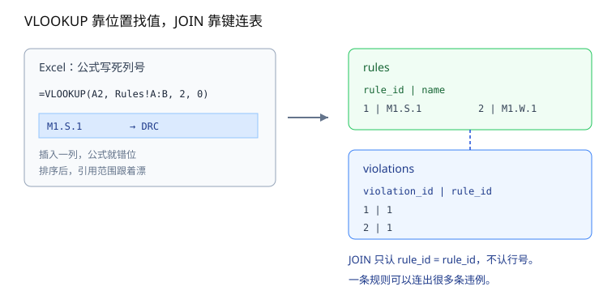

# 第 3 章 拆表

[返回目录](README.md) ｜ [上一章：一张表能走多远](02-one-table.md) ｜ [下一章：多对多](04-many-to-many.md)



*图 3.1 VLOOKUP 把关系写在公式里，JOIN 把关系写在键上。*

**本章目标**：理解实体、属性和关系，学会 1:N、主键/外键和 `JOIN`。学完能把一张扁平表拆成多张表，并用键把它们连起来。

**本章从**：`flat` 教程库。上一章没有改数据的话可以直接用；改过就重建：

```lisp
load("skill-oo/docs/sqlite/tutorial/setup.il")
ycSQLiteTutorialSetup(?stage 'flat)
db = ycSQLite::Open("./sqlite-tutorial/drc.db")
```

## 3.1 扁平表的三个毛病

先数一下每条规则出现多少次：

```lisp
ycSQLiteTutorialShow(db->query(strcat(
    "select rule_name, count(*) as n "
    "from violations "
    "group by rule_name "
    "order by rule_name;"
)))
; => rule_name  n
;    ---------  -
;    M1.S.1     6
;    M1.W.1     2
;    PO.R.1     1
;    V1.E.1     3
```

规则名重复了 6 次、2 次、1 次、3 次。现在想给 `M1.S.1` 加一个“严重级别 = error”的属性，只有两种做法：

1. 在每一行后面加一列，重复写 6 次；
2. 再开一张表，但每次查询都要自己记住怎么对应。

第一种做法的问题是改一处漏一处。第二种做法如果只靠人记，迟早会写错。数据库的标准做法是：**把规则抽成单独的表，让违例用一个键指向它。**

## 3.2 实体、属性和关系

把 DRC 数据拆成四类东西：

| 实体 | 属性 | 例子 |
| --- | --- | --- |
| 规则 rule | 名字、类别、严重级别 | `M1.S.1`、`DRC`、`error` |
| 运行 run | 批次名、开始时间、deck 版本 | `2026-11-10-nightly` |
| 图层 layer | 名字、用途 | `M1`、`metal 1 routing` |
| 违例 violation | 坐标、cell、view、状态、owner | `12.4, 8.2`、`INV_X1` |

关系是：

- 一条规则对应多条违例：1:N；
- 一次运行对应多条违例：1:N；
- 一个图层对应多条违例：1:N；
- 一条违例只属于一条规则、一次运行、一个图层。

1:N 的“1”那边放主键，“N”那边放外键。`violations` 是 N 这边，所以要存 `rule_id`、`run_id`、`layer_id`。

## 3.3 VLOOKUP 和 JOIN 的区别

Excel 里常用 VLOOKUP 把规则表里的严重级别拉到违例表：

```text
=VLOOKUP(A2, Rules!A:B, 2, FALSE)
```

它有三个隐患：

1. 公式写死了列号，规则表插一列就错位；
2. 只返回第一个匹配，重复规则会被悄悄忽略；
3. 排序、插行、复制到别的文件后，引用范围会漂。

SQL 的 `JOIN` 不靠列号，靠键：

```sql
select v.violation_id, ru.name as rule, ru.severity
from violations v
join rules ru on ru.rule_id = v.rule_id;
```

`on ru.rule_id = v.rule_id` 是连接条件。只要两边的 `rule_id` 相等，就把这一行拼起来。列的顺序、行号、插入顺序都不影响结果。

## 3.4 拆表：先建规则和运行

教程把迁移 SQL 放在 `data/03_relational.sql`。先看关键部分。

建规则表：

```sql
create table rules(
    rule_id     integer primary key,
    name        text not null unique,
    category    text not null,
    severity    text not null,
    description text
);
```

插入四条规则。这里显式写 `rule_id`，是为了让教程后续的 `rule_layers`、练习和查询有稳定的 id：

```sql
insert into rules(rule_id, name, category, severity, description) values
    (1, 'M1.S.1', 'DRC', 'error',   null),
    (2, 'M1.W.1', 'DRC', 'error',   null),
    (3, 'PO.R.1', 'DFM', 'warning', null),
    (4, 'V1.E.1', 'DRC', 'error',   null);
```

建运行表：

```sql
create table runs(
    run_id       integer primary key,
    label        text not null unique,
    started_at   text not null,
    deck         text not null,
    tool_version text
);

insert into runs(run_id, label, started_at, deck, tool_version) values
    (1, '2026-11-10-nightly', '2026-11-10T22:00:00', 'drc_deck_v3.2', '2026.1'),
    (2, '2026-11-11-nightly', '2026-11-11T22:00:00', 'drc_deck_v3.2', '2026.1');
```

## 3.5 建新的违例表

新表不再存规则名、运行名、图层名，只存 id：

```sql
create table violations_new(
    violation_id integer primary key,
    run_id       integer not null references runs(run_id),
    rule_id      integer not null references rules(rule_id),
    layer_id     integer not null references layers(layer_id),
    cell         text not null,
    view         text not null,
    x            real not null,
    y            real not null,
    status       text not null default 'open'
                  check(status in ('open', 'waived', 'fixed')),
    owner        text,
    note         text
);
```

`references` 就是外键。它告诉数据库：

- `run_id` 必须是 `runs.run_id` 里存在的值；
- `rule_id` 必须是 `rules.rule_id` 里存在的值；
- `layer_id` 必须是 `layers.layer_id` 里存在的值。

`Open` 默认开启外键检查；不需要在每个脚本里写 `pragma foreign_keys = on`。

## 3.6 把老数据搬过去

搬数据用 `insert into ... select`：

```sql
insert into violations_new(
    violation_id, run_id, rule_id, layer_id, cell, view,
    x, y, status, owner, note
)
select
    v.violation_id,
    r.run_id,
    ru.rule_id,
    l.layer_id,
    v.cell,
    v.view,
    v.x,
    v.y,
    v.status,
    v.owner,
    v.note
from violations v
join runs r on r.label = v.run_label
join rules ru on ru.name = v.rule_name
join layers l on l.name = v.layer;
```

这段 `select` 做了三次翻译：

- `v.run_label` 的文本换成 `runs.run_id`；
- `v.rule_name` 的文本换成 `rules.rule_id`；
- `v.layer` 的文本换成 `layers.layer_id`。

最后删掉旧表，把新表改名：

```sql
drop table violations;
alter table violations_new rename to violations;
```

完整文件在 `data/03_relational.sql`。执行：

```lisp
db->executeScript(ycPathLib::Path("skill-oo/docs/sqlite/tutorial/data/03_relational.sql")->readText())
```

`ycPathLib::Path(...)->readText()` 只是把文件内容读成字符串，再交给 `executeScript`。`ycPathLib` 随库一起加载，不需要单独配置。

`03_relational.sql` 只能对第 2 章的扁平库执行一次：它会新建表、迁移数据，然后 `drop` 旧表并改名。重复执行会报 `table rules already exists`。要重来，先跑 `ycSQLiteTutorialSetup(?stage 'flat)`，再执行这个文件。

## 3.7 拆完以后长什么样

```lisp
db->tables()
; => ("layers" "rules" "runs" "violations")
```

规则表：

```lisp
ycSQLiteTutorialShow(db->query("select rule_id, name, category, severity from rules order by rule_id;"))
; => rule_id  name    category  severity
;    -------  ------  --------  --------
;    1        M1.S.1  DRC       error
;    2        M1.W.1  DRC       error
;    3        PO.R.1  DFM       warning
;    4        V1.E.1  DRC       error
```

运行表：

```lisp
ycSQLiteTutorialShow(db->query("select run_id, label, deck from runs order by run_id;"))
; => run_id  label               deck
;    ------  ------------------  -------------
;    1       2026-11-10-nightly  drc_deck_v3.2
;    2       2026-11-11-nightly  drc_deck_v3.2
```

## 3.8 JOIN：把名字拼回来

现在查违例，默认只有 id，不方便读。用 `JOIN` 把名字拼回来：

```lisp
ycSQLiteTutorialShow(db->query(strcat(
    "select v.violation_id, ru.name as rule, r.label as run, "
    "       l.name as layer, v.cell, v.status "
    "from violations v "
    "join rules ru on ru.rule_id = v.rule_id "
    "join runs r on r.run_id = v.run_id "
    "join layers l on l.layer_id = v.layer_id "
    "where v.status = 'open' "
    "order by v.violation_id "
    "limit 5;"
)))
; => violation_id  rule    run                 layer  cell      status
;    ------------  ------  ------------------  -----  --------  ------
;    1             M1.S.1  2026-11-10-nightly  M1     INV_X1    open
;    2             M1.S.1  2026-11-10-nightly  M1     INV_X1    open
;    4             M1.W.1  2026-11-10-nightly  M1     INV_X1    open
;    6             V1.E.1  2026-11-10-nightly  V1     NAND2_X1  open
;    7             PO.R.1  2026-11-10-nightly  PO     INV_X1    open
```

读法：

- `from violations v`：主表是 `violations`，别名 `v`；
- `join rules ru on ...`：把 `rules` 接进来，别名 `ru`；
- `select` 里用 `ru.name`、`r.label`、`l.name` 取名字；
- `as rule`、`as run` 给结果列起短名。

`join` 默认是内连接：两边都有匹配才保留。如果一条违例的 `rule_id` 指向不存在的规则，它不会出现在结果里。正常情况下外键会阻止这种数据。

`left join` 会保留左表所有行，右表没有匹配时填 `NULL`。第 4 章找“缺失的检查”会用到。

## 3.9 外键到底拦住了什么

用一个内存库演示：

```lisp
mem = ycSQLite::Open(":memory:")
mem->executeScript(strcat(
    "create table parent(id integer primary key);"
    "create table child(pid integer references parent(id));"
))

errset(mem->execute("insert into child(pid) values (99);") nil)
; => nil
```

`child.pid` 指向 `parent.id`，但 `parent` 里没有 99。外键拒绝这条插入，`errset` 返回 `nil`。CIW 里会看到类似 `foreign key constraint failed` 的诊断。

这正是扁平表做不到的：Excel 不会阻止你在规则列里写一个不存在的规则名。

## 3.10 本章检查点

```lisp
car(db->query("select count(*) from rules;")->rows())->get(0)
; => 4

car(db->query("select count(*) from runs;")->rows())->get(0)
; => 2

car(db->query("select count(*) from violations;")->rows())->get(0)
; => 12
```

再跑一遍 3.8 的 JOIN：去掉 `limit 5` 后是 **8** 行（仍然只统计 open 违例）；再去掉 `where v.status = 'open'` 后是 **12** 行（全部违例）。如果后者少于 12，说明有违例的 `rule_id`、`run_id` 或 `layer_id` 没匹配上。

## 3.11 常见错误

- **忘记写连接条件。** `from a, b` 不写 `where`/`on` 会得到笛卡尔积，行数是两表行数相乘。
- **用名字连接。** `on r.name = v.rule_name` 能跑，但名字一改就断；用 id。
- **把 `join` 当成 `left join`。** 内连接会丢掉没有匹配的行。
- **删除还有子记录的父行。** 外键会拒绝；先处理子记录，或者设计 `on delete cascade`。
- **`NULL` 参与连接。** `NULL = NULL` 不成立；外键列应尽量 `not null`。

## 3.12 练习

1. 给 `rules` 插入一条 `M2.S.1`，再给 `violations` 插入一条引用它的违例。
2. 查每条规则有多少条 open 违例。
3. 把 3.8 的 `join` 改成 `left join`，观察结果行数有没有变化。
4. 想想为什么 `violations` 里存 `rule_id` 比存 `rule_name` 更好。

关闭本章的内存库和教程库：

```lisp
mem->close()
db->close()
```

[返回目录](README.md) ｜ [上一章：一张表能走多远](02-one-table.md) ｜ [下一章：多对多](04-many-to-many.md)
