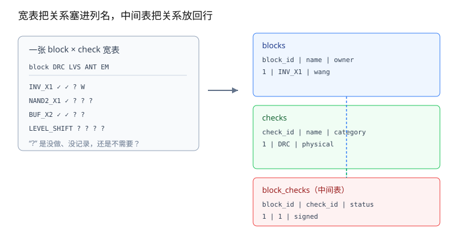

# 第 4 章 多对多

[返回目录](README.md) ｜ [上一章：拆表](03-split-tables.md) ｜ [下一章：汇总与透视](05-grouping-and-pivot.md)



*图 4.1 宽表里的空白既可能是“没做”，也可能是“不需要”；中间表让每个组合都有一行。*

**本章目标**：理解多对多关系，学会用中间表表达“一个 block 要做很多检查，一个检查也适用于很多 block”。学完能找出缺失的检查组合。

**本章从**：`full` 教程库。`signoff.db` 在 `flat` 和 `full` 两个阶段都会建好。

```lisp
load("skill-oo/docs/sqlite/tutorial/setup.il")
ycSQLiteTutorialSetup(?stage 'full)
db = ycSQLite::Open("./sqlite-tutorial/drc.db")
sdb = ycSQLite::Open("./sqlite-tutorial/signoff.db")
```

## 4.1 宽表长什么样

假设 signoff 用 Excel 管理，常见写法是这样：

| block | DRC | LVS | ANT | EM |
| --- | --- | --- | --- | --- |
| INV_X1 | signed | signed |  | waived |
| NAND2_X1 | signed |  |  |  |
| BUF_X2 | signed | signed |  |  |
| LEVEL_SHIFT |  |  |  |  |

四个 block、四个检查，看起来只有 16 个格子。问题是：

- 空白表示“还没做”还是“这个 block 不需要做”？
- 新增一个检查 `ESD`，要加一列，还要改所有公式和脚本；
- 想查“哪些 block 没做 ANT”，要在四列里分别判断；
- 想记录每个检查的签字时间，列会变成 `DRC_signed_at`、`LVS_signed_at`……越来越多。

宽表把“关系”塞进了列名。数据库的做法是把关系放回行：一张 `block_checks` 中间表，一行表示一个 block 做了一项检查。

## 4.2 三张表

`signoff.db` 有三张表：

```text
blocks          每个 block 一行
checks          每种检查一行
block_checks    block 和 check 的组合，一行一个组合
```

`blocks`：

| block_id | name | owner | revision |
| --- | --- | --- | --- |
| 1 | INV_X1 | wang | r3 |
| 2 | NAND2_X1 | li | r2 |
| 3 | BUF_X2 | wang | r1 |
| 4 | LEVEL_SHIFT | chen | r5 |

`checks`：

| check_id | name | category |
| --- | --- | --- |
| 1 | DRC | physical |
| 2 | LVS | physical |
| 3 | ANT | reliability |
| 4 | EM | reliability |

`block_checks`：

| block_id | check_id | status | signed_at |
| --- | --- | --- | --- |
| 1 | 1 | signed | 2026-11-10T18:00:00 |
| 1 | 2 | signed | 2026-11-10T18:05:00 |
| 1 | 3 | open |  |
| 1 | 4 | waived | 2026-11-09T10:00:00 |
| 2 | 1 | signed | 2026-11-11T09:00:00 |
| 2 | 2 | open |  |
| 2 | 4 | open |  |
| 3 | 1 | signed | 2026-11-11T11:00:00 |
| 3 | 2 | signed | 2026-11-11T11:10:00 |
| 4 | 1 | open |  |

这张表的主键是 `(block_id, check_id)`，也就是两列一起做主键。同一个 block 不能对同一个 check 出现两行；插入重复组合会被拒绝。

`status` 放在关系上，而不是放在 `blocks` 或 `checks` 上。因为“签没签”是某个 block 对某个 check 的状态；同一个 block 的 DRC 可能 signed，LVS 可能 open。

## 4.3 每个 block 签了几项

```lisp
ycSQLiteTutorialShow(sdb->query(strcat(
    "select b.name as block, count(bc.check_id) as signed_n "
    "from blocks b "
    "left join block_checks bc "
    "  on bc.block_id = b.block_id and bc.status = 'signed' "
    "group by b.block_id, b.name "
    "order by b.name;"
)))
; => block        signed_n
;    -----------  --------
;    BUF_X2       2
;    INV_X1       2
;    LEVEL_SHIFT  0
;    NAND2_X1     1
```

两个细节：

1. 用 `left join`，因为 `LEVEL_SHIFT` 一项都没签，也要出现在结果里。
2. `bc.status = 'signed'` 写在 `on` 里，不写在 `where` 里。写在 `where` 会把 `LEVEL_SHIFT` 这种没有匹配的行过滤掉，`left join` 就退化成内连接了。

`count(bc.check_id)` 只数匹配到的行；`LEVEL_SHIFT` 没有匹配，得到 0。

## 4.4 哪些组合漏了

宽表最难回答的问题：4 个 block × 4 个检查 = 16 个组合，实际只记了 10 个；漏了哪 6 个？

```lisp
ycSQLiteTutorialShow(sdb->query(strcat(
    "select b.name as block, c.name as missing_check "
    "from blocks b "
    "cross join checks c "
    "left join block_checks bc "
    "  on bc.block_id = b.block_id and bc.check_id = c.check_id "
    "where bc.block_id is null "
    "order by b.name, c.name;"
)))
; => block        missing_check
;    -----------  -------------
;    BUF_X2       ANT
;    BUF_X2       EM
;    LEVEL_SHIFT  ANT
;    LEVEL_SHIFT  EM
;    LEVEL_SHIFT  LVS
;    NAND2_X1     ANT
```

`cross join` 先造出所有 16 个组合。`left join` 再去 `block_checks` 里找有没有对应记录。找不到时，右表列是 `NULL`，所以 `where bc.block_id is null` 正好筛出缺失组合。

这比在 Excel 里一行一行看空白可靠得多。空白不再有歧义：有记录就是做过，没记录就是没做；不需要做的检查可以不建记录。

## 4.5 每项检查覆盖了多少 block

反过来查：

```lisp
ycSQLiteTutorialShow(sdb->query(strcat(
    "select c.name as check_name, count(bc.block_id) as applied_n "
    "from checks c "
    "left join block_checks bc on bc.check_id = c.check_id "
    "group by c.check_id, c.name "
    "order by c.name;"
)))
; => check_name  applied_n
;    ----------  ---------
;    ANT         1
;    DRC         4
;    EM          2
;    LVS         3
```

`DRC` 覆盖 4 个 block，`LVS` 3 个，`EM` 2 个，`ANT` 1 个。结果和 4.4 的缺失列表对得上：`ANT` 缺 3 个，`EM` 缺 2 个，`LVS` 缺 1 个。

## 4.6 复合主键拦住重复

试着给 `INV_X1` 的 `DRC` 再插一行：

```lisp
errset(sdb->execute(
    "insert into block_checks(block_id, check_id, status) values (1, 1, 'open');"
) nil)
; => nil
```

`(1, 1)` 已经存在，复合主键拒绝。CIW 里会看到类似 `columns block_id, check_id are not unique` 的诊断。

如果主键只有 `block_id`，一个 block 只能有一条检查记录；如果只有 `check_id`，一个检查只能属于一个 block。两列一起做主键，才能表达多对多。

## 4.7 再练一次：rule_layers

DRC 规则也有多对多。一条 spacing 规则可能同时涉及两层，例如 `V1.E.1` 涉及 `V1` 和 `M1`；同一条规则在不同层上扮演不同角色。

在 `drc.db` 里建中间表：

```lisp
db->executeScript(strcat(
    "create table rule_layers("
    "  rule_id  integer not null references rules(rule_id),"
    "  layer_id integer not null references layers(layer_id),"
    "  role     text not null,"
    "  primary key(rule_id, layer_id, role)"
    ");"
    "insert into rule_layers(rule_id, layer_id, role) values"
    "  (1, 1, 'subject'),"
    "  (1, 1, 'neighbor'),"
    "  (2, 1, 'subject'),"
    "  (3, 3, 'subject'),"
    "  (4, 2, 'subject'),"
    "  (4, 1, 'neighbor');"
))
```

查出来：

```lisp
ycSQLiteTutorialShow(db->query(strcat(
    "select ru.name as rule, l.name as layer, rl.role "
    "from rule_layers rl "
    "join rules ru on ru.rule_id = rl.rule_id "
    "join layers l on l.layer_id = rl.layer_id "
    "order by ru.name, rl.role, l.name;"
)))
; => rule    layer  role
;    ------  -----  --------
;    M1.S.1  M1     neighbor
;    M1.S.1  M1     subject
;    M1.W.1  M1     subject
;    PO.R.1  PO     subject
;    V1.E.1  M1     neighbor
;    V1.E.1  V1     subject
```

主键是 `(rule_id, layer_id, role)`，不是 `(rule_id, layer_id)`。因为 `M1.S.1` 和 `M1` 同时有 `subject` 和 `neighbor` 两个角色；只按两列做主键，第二行就插不进去。

## 4.8 本章检查点

```lisp
car(sdb->query("select count(*) from blocks;")->rows())->get(0)
; => 4

car(sdb->query("select count(*) from checks;")->rows())->get(0)
; => 4

car(sdb->query("select count(*) from block_checks;")->rows())->get(0)
; => 10
```

16 个可能组合，记了 10 个，缺 6 个。4.4 的查询应该正好返回 6 行。

## 4.9 常见错误

- **把多个 check 写成逗号分隔的一列。** `'DRC,LVS,ANT'` 无法用 SQL 按 check 筛选，也无法加唯一约束。
- **用空白表示“没做”。** 空白和“不需要做”分不清；用有没有记录区分。
- **新增检查就加列。** 加列要改表结构、公式和脚本；中间表只加一行 `checks`。
- **把状态放在 block 上。** 一个 block 的不同检查状态不同，状态属于关系。
- **复合主键只写一半。** 多对多关系要两边的键一起做主键。

## 4.10 练习

1. 新增一个 block `AOI21_X1`，给它签 `DRC` 和 `LVS`。
2. 查 `AOI21_X1` 还缺哪些检查。
3. 给 `rule_layers` 插入一条 `M1.W.1` 对 `M1` 的 `subject`，观察复合主键是否允许。
4. 想想 `block_checks` 里要不要加 `note` 列；加在哪里比较合适。

关闭两个会话：

```lisp
db->close()
sdb->close()
```

[返回目录](README.md) ｜ [上一章：拆表](03-split-tables.md) ｜ [下一章：汇总与透视](05-grouping-and-pivot.md)
