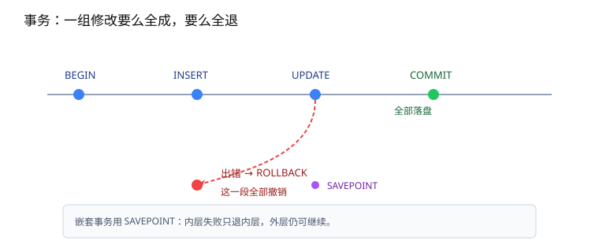

# 第 6 章 改数据不出事故

[返回目录](README.md) ｜ [上一章：汇总与透视](05-grouping-and-pivot.md) ｜ [下一章：约束、索引与 VIEW](07-constraints-index-view.md)



*图 6.1 事务把多条修改包成一个整体；出错时整段撤销。*

**本章目标**：学会 `INSERT`、`UPDATE`、`DELETE`，理解自动提交、事务、回滚和保存点。学完能在改数据前先做安全演练。

**本章从**：`full` 教程库，12 条违例、2 次运行。

```lisp
load("skill-oo/docs/sqlite/tutorial/setup.il")
ycSQLiteTutorialSetup(?stage 'full)
db = ycSQLite::Open("./sqlite-tutorial/drc.db")
```

## 6.1 最危险的 SQL 是没有 `where` 的 `update` 和 `delete`

```sql
update violations set owner = 'oops';
```

这条语句会把**所有**违例的 owner 改成 `oops`。

```sql
delete from violations;
```

这条语句会清空整张表。

两条都语法正确，数据库不会问你“确定吗”。所以改数据前要养成三个习惯：

1. 先用 `select` 看要改哪些行；
2. 把同样的 `where` 用到 `update`/`delete`；
3. 大批量修改放进事务，出错能整体回滚。

## 6.2 插入：`insert`

先插一次运行：

```lisp
res = db->execute(strcat(
    "insert into runs(label, started_at, deck, tool_version) values "
    "('2026-11-12-nightly', '2026-11-12T22:00:00', 'drc_deck_v3.3', '2026.1');"
))
res->changes()
; => 1
res->lastInsertRowid()
; => 3
```

`changes()` 是这次调用改动的数据行数；`lastInsertRowid()` 是最近一次插入生成的主键。`runs` 里已经有 1、2，所以新行是 3。

再插一条违例，用 `?` 占位符：

```lisp
res = db->execute(
    strcat(
        "insert into violations(run_id, rule_id, layer_id, cell, view, x, y, status) "
        "values (?, ?, ?, ?, ?, ?, ?, ?);"
    )
    ?params list(3, 1, 1, "INV_X1", "layout", 12.4, 8.2, "open")
)
res->changes()
; => 1
res->lastInsertRowid()
; => 13
```

`?` 按顺序对应 `?params` 列表里的值。不要用字符串拼接把值拼进 SQL；参数会安全转义，也能避免引号问题。

## 6.3 修改和删除：先看再改

改一行：

```lisp
db->execute("update violations set owner = 'chen' where violation_id = 1;")->changes()
; => 1
```

改所有行：

```lisp
db->execute("update violations set owner = 'chen';")->changes()
; => 13
```

13 行都改了。这个数字本身不是错，但它提醒你：`where` 漏了。

把测试改动改回去：

```lisp
db->execute("update violations set owner = null where owner = 'chen';")
db->execute("update violations set owner = null where violation_id = 1;")
```

删除也一样。先 `select`：

```lisp
db->query("select violation_id, cell from violations where violation_id = 13;")->toList()
; => ((13 "INV_X1"))
```

确认是这一行，再删：

```lisp
db->execute("delete from violations where violation_id = 13;")->changes()
; => 1
```

但本章后面的演练还要用 13，先把它插回来：

```lisp
db->execute(
    strcat(
        "insert into violations(run_id, rule_id, layer_id, cell, view, x, y, status) "
        "values (?, ?, ?, ?, ?, ?, ?, ?);"
    )
    ?params list(3, 1, 1, "INV_X1", "layout", 12.4, 8.2, "open")
)
```

## 6.4 事务：一组修改当成一个整体

`Database->transaction` 接收一个回调。回调正常返回，事务提交；回调报错，事务回滚。

```lisp
db->transaction(lambda((d)
    d->execute("insert into runs(label, started_at, deck) values ('2026-11-13-nightly', '2026-11-13T22:00:00', 'drc_deck_v3.2');")
    d->execute("insert into violations(run_id, rule_id, layer_id, cell, view, x, y, status) values (4, 1, 1, 'ATOMIC_DEMO', 'layout', 0, 0, 'open');")
))
```

两条插入要么都成功，要么都不发生。回调的返回值就是 `transaction` 的返回值：

```lisp
db->transaction(lambda((d) 42))
; => 42
```

## 6.5 灾难演练：删全表再回滚

先数一下：

```lisp
car(db->query("select count(*) from violations;")->rows())->get(0)
; => 14
```

现在有 14 条（12 条原始 + 6.2 的 13 + 6.4 的 `ATOMIC_DEMO`）。

在事务里删全表，然后故意报错：

```lisp
errset(db->transaction(lambda((d)
    d->execute("delete from violations;")
    error("drill: rollback")
)) nil)
; => nil
```

回调里的 `error` 让事务回滚。再数：

```lisp
car(db->query("select count(*) from violations;")->rows())->get(0)
; => 14
```

一条都没少。`errset` 捕获了 `transaction` 重新抛出的错误，返回 `nil`；CIW 里会看到 `drill: rollback` 的诊断。

这就是事务的价值：你可以先做危险动作，确认不对再整体撤销。真实脚本里，错误可能来自外键、约束、文件读取或你自己的检查。

## 6.6 保存点：嵌套事务

`transaction` 里再调用 `transaction`，内层用保存点。内层失败只撤销内层，外层可以继续。

```lisp
db->transaction(lambda((d)
    d->execute("insert into runs(label, started_at, deck) values ('2026-11-14-nightly', '2026-11-14T22:00:00', 'drc_deck_v3.2');")
    errset(d->transaction(lambda((d2)
        d2->execute("insert into violations(run_id, rule_id, layer_id, cell, view, x, y, status) values (5, 1, 1, 'SAVEPOINT_DEMO', 'layout', 0, 0, 'open');")
        error("inner rollback")
    )) nil)
    d->execute("insert into violations(run_id, rule_id, layer_id, cell, view, x, y, status) values (5, 2, 1, 'OUTER_COMMIT', 'layout', 0, 0, 'open');")
))
```

内层插入 `SAVEPOINT_DEMO` 后报错，保存点回滚；外层继续插入 `OUTER_COMMIT`，最后提交。

```lisp
db->query("select violation_id, run_id, cell from violations where cell in ('SAVEPOINT_DEMO', 'OUTER_COMMIT') order by violation_id;")->toList()
; => ((15 5 "OUTER_COMMIT"))
```

只有 `OUTER_COMMIT` 留下来，`SAVEPOINT_DEMO` 没有。`run_id = 5` 是外层插入的运行。

## 6.7 清理演练数据

把本章新增的运行和违例删掉，回到 12 条：

```lisp
db->execute("delete from violations where run_id in (3, 4, 5); delete from runs where run_id in (3, 4, 5);")
car(db->query("select count(*) from violations;")->rows())->get(0)
; => 12
```

顺序很重要：先删子表 `violations`，再删父表 `runs`。反过来会被外键拒绝。

## 6.8 会话用完要关闭

`Open` 启动一个长驻客户端进程。用完要 `close()`。也可以用 `ycWith`，离开作用域自动关闭：

```lisp
ycWith(tmp ycSQLite::Open("./sqlite-tutorial/drc.db")
    tmp->query("select count(*) from violations;")->toList()
)
```

正常退出和体内报错都会关闭。详细行为见 API 手册的 `ycWith` 示例。

## 6.9 本章检查点

清理后：

```lisp
car(db->query("select count(*) from violations;")->rows())->get(0)
; => 12

car(db->query("select count(*) from runs;")->rows())->get(0)
; => 2
```

再回答：

1. `update` 漏写 `where` 会怎样？
2. `transaction` 的回调报错时，已经执行的语句会怎样？
3. 嵌套 `transaction` 的内层失败，外层还能不能继续？

答案：改所有行；整体回滚；能，内层用保存点撤销。

## 6.10 常见错误

- **改数据前不 `select`。** 先确认要改哪些行。
- **`update`/`delete` 漏 `where`。** 这是最常见的事故。
- **一条一条自动提交。** 中途失败会留下半套数据；用事务。
- **事务里做很慢的操作。** 事务会占锁；把文件读写、网络请求放到事务外。
- **先删父表再删子表。** 外键会拒绝；先子后父。
- **以为 `changes` 是最终落盘行数。** 事务回滚后它也计数；它表示执行过的 DML 行数。

## 6.11 练习

1. 插入一次新运行和两条违例，用事务包起来。
2. 在事务里故意插入一个不存在的 `rule_id`，观察回滚。
3. 用 `savepoint` 做内层回滚，外层提交。
4. 写一段清理 SQL，把练习数据删干净。

本章结束，关闭会话：

```lisp
db->close()
```

[返回目录](README.md) ｜ [上一章：汇总与透视](05-grouping-and-pivot.md) ｜ [下一章：约束、索引与 VIEW](07-constraints-index-view.md)
