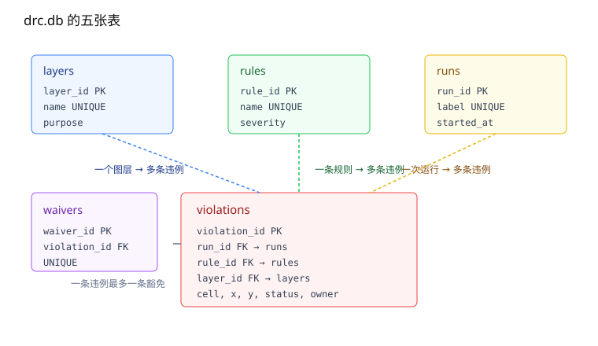

# 第 8 章 综合实战：一次 nightly 导入

[返回目录](README.md) ｜ [上一章：约束、索引与 VIEW](07-constraints-index-view.md)



*图 8.1 `drc.db` 的主线：规则、运行、图层各自一对多到违例，违例最多一条豁免。*

**本章目标**：把前面所有东西串起来，完成一次可重复的 nightly 导入，并查出负责人真正关心的几个数字。

**本章从**：干净的 `full` 教程库。

```lisp
load("skill-oo/docs/sqlite/tutorial/setup.il")
ycSQLiteTutorialSetup(?stage 'full)
db = ycSQLite::Open("./sqlite-tutorial/drc.db")
```

## 8.1 场景

昨晚的 DRC 跑完了。结果文件里有两条新违例：

- `INV_X1` 的 `M1.S.1`，坐标 `(12.4, 8.2)`，没有 owner；
- `NAND2_X1` 的 `V1.E.1`，坐标 `(31.0, 15.0)`，owner 是 `li`。

这次运行叫 `2026-11-12-nightly`，deck 是 `drc_deck_v3.3`。

目标：

1. 把运行和两条违例原子地写进 `drc.db`；
2. 查每条规则还有多少 open、多少 waived；
3. 查 open 最多的 cell；
4. 查没有 owner 的 open 违例；
5. 查 waiver 的有效期；
6. 知道数据库文件该怎么放、怎么备份。

## 8.2 原子导入

```lisp
db->transaction(lambda((d)
    d->execute(strcat(
        "insert into runs(label, started_at, deck, tool_version) values "
        "('2026-11-12-nightly', '2026-11-12T22:00:00', 'drc_deck_v3.3', '2026.1');"
    ))
    d->execute(strcat(
        "insert into violations(run_id, rule_id, layer_id, cell, view, x, y, status, owner) "
        "values (3, 1, 1, 'INV_X1', 'layout', 12.4, 8.2, 'open', null);"
    ))
    d->execute(strcat(
        "insert into violations(run_id, rule_id, layer_id, cell, view, x, y, status, owner) "
        "values (3, 4, 2, 'NAND2_X1', 'layout', 31.0, 15.0, 'open', 'li');"
    ))
))
```

`runs` 的 `run_id` 由自增主键分配，前两条是 1、2，所以这次是 3。

`rule_id = 1` 是 `M1.S.1`，`rule_id = 4` 是 `V1.E.1`；`layer_id = 1` 是 `M1`，`layer_id = 2` 是 `V1`。

三条语句在同一个事务里。任何一条失败，三条都不发生。

数一下：

```lisp
car(db->query("select count(*) from violations;")->rows())->get(0)
; => 14

car(db->query("select count(*) from runs;")->rows())->get(0)
; => 3
```

12 条原始违例 + 2 条新违例 = 14；运行从 2 次变成 3 次。

## 8.3 导入失败会怎样

假设 deck 文件读到一半失败，脚本决定中止：

```lisp
errset(db->transaction(lambda((d)
    d->execute(strcat(
        "insert into runs(label, started_at, deck) values "
        "('2026-11-12-bad', '2026-11-12T22:00:00', 'drc_deck_v3.3');"
    ))
    error("drill: bad import")
)) nil)
; => nil
```

事务回滚，`2026-11-12-bad` 不会留下：

```lisp
car(db->query("select count(*) from runs where label = '2026-11-12-bad';")->rows())->get(0)
; => 0
```

真实脚本里，错误可能来自文件不存在、格式不对、外键不匹配或你自己的校验。只要在 `transaction` 回调里 `error()`，这一段都会撤销。

## 8.4 看板一：按规则统计

```lisp
ycSQLiteTutorialShow(db->query(strcat(
    "select ru.name as rule, ru.severity as severity, "
    "       sum(case when v.status = 'open' then 1 else 0 end) as open_n, "
    "       sum(case when v.status = 'waived' then 1 else 0 end) as waived_n "
    "from violations v "
    "join rules ru on ru.rule_id = v.rule_id "
    "group by ru.rule_id, ru.name, ru.severity "
    "order by open_n desc, ru.name;"
)))
; => rule    severity  open_n  waived_n
;    ------  --------  ------  --------
;    M1.S.1  error     4       1
;    V1.E.1  error     3       0
;    M1.W.1  error     2       0
;    PO.R.1  warning   1       0
```

这张表回答“哪条规则最需要处理”。`M1.S.1` 有 4 条 open，1 条 waived；`V1.E.1` 有 3 条 open。

## 8.5 看板二：open 最多的 cell

```lisp
ycSQLiteTutorialShow(db->query(strcat(
    "select cell, count(*) as open_n "
    "from violations "
    "where status = 'open' "
    "group by cell "
    "order by open_n desc, cell "
    "limit 3;"
)))
; => cell      open_n
;    --------  ------
;    INV_X1    6
;    NAND2_X1  4
```

`INV_X1` 有 6 条 open，`NAND2_X1` 有 4 条。`INV_X1` 是被这次运行新增了一条，从 5 变成 6。

## 8.6 看板三：没有 owner 的 open 违例

```lisp
ycSQLiteTutorialShow(db->query(strcat(
    "select violation_id, cell, rule_id "
    "from violations "
    "where status = 'open' and owner is null "
    "order by violation_id;"
)))
; => violation_id  cell      rule_id
;    ------------  --------  -------
;    1             INV_X1    1
;    2             INV_X1    1
;    6             NAND2_X1  4
;    11            NAND2_X1  2
;    13            INV_X1    1
```

五条 open 没有 owner。`rule_id` 是数字，想给人看可以再 `join rules`。

## 8.7 看板四：waiver 有效期

```lisp
ycSQLiteTutorialShow(db->query(strcat(
    "select w.waiver_id, v.violation_id, ru.name as rule, "
    "       w.owner, w.expires_on "
    "from waivers w "
    "join violations v on v.violation_id = w.violation_id "
    "join rules ru on ru.rule_id = v.rule_id "
    "order by w.expires_on;"
)))
; => waiver_id  violation_id  rule    owner  expires_on
;    ---------  ------------  ------  -----  ----------
;    2          7             PO.R.1  li     2026-10-31
;    1          3             M1.S.1  li     2026-12-31
```

`2026-10-31` 已经过期（教程把今天固定为 `2026-11-16`），`2026-12-31` 还有效。真实脚本可以用 `date('now')` 比较。

## 8.8 数据库文件放在哪里

`drc.db` 是工作数据，不是设计数据。建议放在项目的工作目录或团队约定的结果目录，不要放进 OA 库的 `lib`/`cell` 路径。

备份很简单：关闭数据库后，复制文件。

```text
cp ./sqlite-tutorial/drc.db ./sqlite-tutorial/drc.db.bak
```

不要在数据库还开着的时候直接复制，也不要在多个 CIW 会话里同时写同一个文件。SQLite 支持多读单写；最稳的做法是一个写入者，写完关闭，再备份。

## 8.9 本章检查点

```lisp
car(db->query("select count(*) from violations;")->rows())->get(0)
; => 14

car(db->query("select count(*) from runs;")->rows())->get(0)
; => 3

car(db->query("select count(*) from rules;")->rows())->get(0)
; => 4
```

再看三个数字：

- `M1.S.1` open 4，waived 1；
- `INV_X1` open 6，`NAND2_X1` open 4；
- 没有 owner 的 open 违例 5 条。

全对上，说明你已经能从建库走到看板。

## 8.10 常见错误

- **把数据库放进 OA 库。** 数据库是工作数据，不是设计数据；放工作目录。
- **多个会话同时写。** 容易锁库或互相覆盖；一个写入者。
- **边写边备份。** 先关闭，再复制文件。
- **导入不走事务。** 中途失败会留下半套运行记录。
- **把数据库当几何引擎。** 查坐标、算包围盒可以；真正的图形运算仍用 OA 或几何库。

## 8.11 练习

1. 再加一条 `M2.S.1` 规则，导入一条新违例，重跑看板。
2. 把 8.4 的查询加上 `fixed_n` 列。
3. 用 `ycSQLiteTutorialShow` 输出每条运行的 open 数。
4. 写一个清理脚本：删除 `2026-11-12-nightly` 这次运行和它的违例。

清理示例：

```lisp
db->executeScript(strcat(
    "delete from violations where run_id = 3;"
    "delete from runs where run_id = 3;"
))
```

顺序仍然是先子后父。

## 8.12 结语

你现在有一套能重复的流程：

1. `setup` 建库；
2. 导入运行和违例；
3. 用 `JOIN`、`GROUP BY`、`CASE` 做看板；
4. 用事务、约束、索引和视图守住数据质量；
5. 关闭、备份、必要时重建。

数据库不是 OA 的替代品。它只是把“检查结果”和“人的处理”变成可查询、可校验、可重复的数据。对版图工程师来说，这已经能省掉大量翻 Excel、对颜色、找批注的时间。

关闭会话：

```lisp
db->close()
```

[返回目录](README.md) ｜ [上一章：约束、索引与 VIEW](07-constraints-index-view.md)
