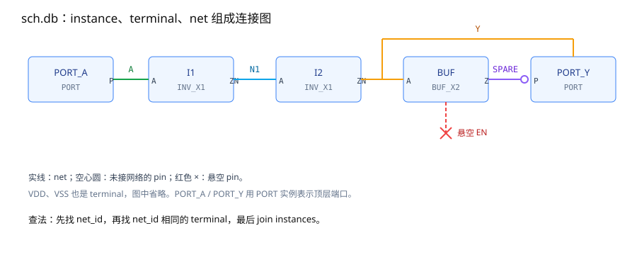

# 第 9 章 连接快照

[返回目录](README.md) ｜ [上一章：综合实战](08-capstone-drc.md) ｜ [下一章：版图图形快照](10-layout-shapes.md)



*图 9.1 一条网络把多个 instance 的 pin 连在一起；没有 net 的 pin 就是悬空 pin。*

**本章目标**：把原理图的连接关系存进 `sch.db`，用三张表回答“这条网络上有谁”“哪个 pin 没接”“哪些网络只有一端”。学完能看懂 instance、terminal、net 之间的关系，并能做一跳追踪。

**本章从**：`sch` 教程库。

```lisp
load("skill-oo/docs/sqlite/tutorial/setup.il")
ycSQLiteTutorialSetup(?stage 'sch)
sch = ycSQLite::Open("./sqlite-tutorial/sch.db")
```

## 9.1 连接不是一张宽表

假设用 Excel 记录一个反相器链。常见的写法是每个 instance 一行，pin 名做列：

| instance | cell | A | ZN | VDD | VSS | EN |
| --- | --- | --- | --- | --- | --- | --- |
| I1 | INV_X1 | A | N1 | VDD | VSS |  |
| I2 | INV_X1 | N1 | Y | VDD | VSS |  |
| BUF | BUF_X2 | Y | SPARE | VDD | VSS |  |

这张表能看，但不好查：

- 想知道 `Y` 网络上有哪些 pin，要在所有 pin 列里找 `Y`；
- 不同 cell 的 pin 名不一样，列会越来越多；
- 一个 net 连了几个 pin，要横着数；
- 想区分“输入、输出、电源、地”，只能靠列名或颜色；
- 想找“没有接网络的 pin”，空白既可能是没接，也可能是这一列不适用。

连接本质上是图：instance 是节点，net 是连线，pin 是节点上的连接点。数据库把图拆成三张表，而不是塞进一张宽表。

## 9.2 三张表

`sch.db` 有三张表：

```text
instances    每个 instance 一行
nets         每条网络一行
terminals    每个 pin 一行，用 net_id 指向网络
```

`instances`：

| instance_id | name | cell | x | y |
| --- | --- | --- | --- | --- |
| 1 | PORT_A | PORT | 0 | 0 |
| 2 | I1 | INV_X1 | 2 | 0 |
| 3 | I2 | INV_X1 | 4 | 0 |
| 4 | BUF | BUF_X2 | 6 | 0 |
| 5 | PORT_Y | PORT | 8 | 0 |

`x`、`y` 是摆放锚点，只用于画图或排序；连接关系不看坐标。`PORT_A`、`PORT_Y` 是把顶层端口当成 `PORT` 实例，这样三张表就能表达完整连接。真实 OA 里端口是单独对象，不需要照搬这个做法。

`nets`：

| net_id | name | kind |
| --- | --- | --- |
| 1 | A | signal |
| 2 | N1 | signal |
| 3 | Y | signal |
| 4 | SPARE | signal |
| 5 | VDD | power |
| 6 | VSS | ground |

`kind` 区分信号、电源和地。它描述网络的性质，不描述 pin 的方向。

`terminals` 是关键表：

```sql
create table terminals(
    terminal_id integer primary key,
    instance_id integer not null references instances(instance_id),
    pin         text not null,
    direction   text not null
                check(direction in ('input', 'output', 'inout', 'power', 'ground')),
    net_id      integer references nets(net_id),
    unique(instance_id, pin)
);
```

先只看信号 pin（电源和地的 6 个 terminal 省略）：

| instance | pin | direction | net |
| --- | --- | --- | --- |
| PORT_A | P | inout | A |
| I1 | A | input | A |
| I1 | ZN | output | N1 |
| I2 | A | input | N1 |
| I2 | ZN | output | Y |
| BUF | A | input | Y |
| BUF | Z | output | SPARE |
| BUF | EN | input |  |
| PORT_Y | P | inout | Y |

每一行是一个 pin 的“出现”，不是 cell 的 pin 定义。`I1.A` 和 `I2.A` 都叫 `A`，但它们是两个不同的 terminal，因为属于不同 instance。

`unique(instance_id, pin)` 保证同一个 instance 不会出现两个同名 pin。`net_id` 可以为空：空表示这个 pin 没有接到任何网络。`BUF.EN` 就是这种情况。

## 9.3 查一条网络上有谁

查 `Y` 网络的全部 terminal：

```lisp
ycSQLiteTutorialShow(sch->query(strcat(
    "select i.name as instance, t.pin, t.direction "
    "from terminals t "
    "join instances i on i.instance_id = t.instance_id "
    "where t.net_id = (select net_id from nets where name = 'Y') "
    "order by i.instance_id;"
)))
; => instance  pin  direction
;    --------  ---  ---------
;    I2        ZN   output
;    BUF       A    input
;    PORT_Y    P    inout
```

读法：

- 先在 `nets` 里找到 `Y` 的 `net_id`；
- 再到 `terminals` 里找 `net_id` 相同的行；
- 用 `join instances` 把 instance 名字拼回来。

`Y` 上有 3 个 terminal：一个输出、一个输入、一个端口。输出 `I2.ZN` 驱动这条网络，`BUF.A` 接收，`PORT_Y.P` 把网络引到顶层。

## 9.4 找悬空 pin

没有接网络的 terminal，`net_id` 是 `NULL`：

```lisp
ycSQLiteTutorialShow(sch->query(strcat(
    "select i.name as instance, t.pin, t.direction "
    "from terminals t "
    "join instances i on i.instance_id = t.instance_id "
    "where t.net_id is null "
    "order by i.instance_id, t.pin;"
)))
; => instance  pin  direction
;    --------  ---  ---------
;    BUF       EN   input
```

`BUF.EN` 是一个使能输入，但没有接任何网络。数据库能直接把它找出来，不需要人去图上看。

判断空值必须用 `is null`，不能写 `= null`。`NULL` 表示“没有值”，和空字符串 `''` 不是一回事。

## 9.5 找只有一端连接的网络

一条内部信号网络通常至少连两个 pin。只有一个 terminal 的信号网络可能是备用输出，也可能是漏接。先按网络分组，再筛数量：

```lisp
ycSQLiteTutorialShow(sch->query(strcat(
    "select n.name as net, count(*) as terminals "
    "from terminals t "
    "join nets n on n.net_id = t.net_id "
    "where n.kind = 'signal' "
    "group by n.net_id, n.name "
    "having count(*) = 1 "
    "order by n.name;"
)))
; => net    terminals
;    -----  ---------
;    SPARE  1
```

`SPARE` 只连了 `BUF.Z`。它是不是问题，要看设计意图：备用输出可以只有一端；如果是信号链中间的网，就要检查是不是漏了接收端。

`VDD`、`VSS` 被 `where n.kind = 'signal'` 排除。电源和地通常连很多 pin，不应该用“只有一端”的规则判断。

## 9.6 数每条网络有几个端子

把信号网络的 terminal 数量都列出来：

```lisp
ycSQLiteTutorialShow(sch->query(strcat(
    "select n.name as net, count(t.terminal_id) as terminals "
    "from nets n "
    "left join terminals t on t.net_id = n.net_id "
    "where n.kind = 'signal' "
    "group by n.net_id, n.name "
    "order by terminals desc, n.name;"
)))
; => net    terminals
;    -----  ---------
;    Y      3
;    A      2
;    N1     2
;    SPARE  1
```

这里用 `left join`，因为即使某条网络一个 terminal 都没有，也应该出现在结果里，数量为 0。当前数据里没有这种网络，但写查询时要把这种情况考虑进去。

`count(t.terminal_id)` 只数匹配到的 terminal；`count(*)` 会把没有匹配的 `NULL` 行也数成 1，所以这里用前者更准确。

## 9.7 追踪一跳

从 `A` 出发，经过 `I1`，应该到达 `N1`：

```lisp
ycSQLiteTutorialShow(sch->query(strcat(
    "select distinct n2.name as next_net "
    "from terminals t1 "
    "join instances i on i.instance_id = t1.instance_id "
    "join terminals t2 on t2.instance_id = i.instance_id "
    "  and t2.terminal_id != t1.terminal_id "
    "join nets n2 on n2.net_id = t2.net_id "
    "where t1.net_id = (select net_id from nets where name = 'A') "
    "  and i.cell = 'INV_X1' "
    "  and t1.direction = 'input' "
    "  and t2.direction = 'output';"
)))
; => next_net
;    --------
;    N1
```

这段查询的意思是：

1. `t1` 是起点网络 `A` 上的一个输入 pin；
2. `i` 是这个 pin 所属的 instance；
3. `t2` 是同一个 instance 上的另一个 pin；
4. `n2` 是 `t2` 连接的网络；
5. 只保留 `t1` 是输入、`t2` 是输出的组合。

把起点换成 `N1`，就会得到 `Y`：

```lisp
ycSQLiteTutorialShow(sch->query(strcat(
    "select distinct n2.name as next_net "
    "from terminals t1 "
    "join instances i on i.instance_id = t1.instance_id "
    "join terminals t2 on t2.instance_id = i.instance_id "
    "  and t2.terminal_id != t1.terminal_id "
    "join nets n2 on n2.net_id = t2.net_id "
    "where t1.net_id = (select net_id from nets where name = 'N1') "
    "  and i.cell = 'INV_X1' "
    "  and t1.direction = 'input' "
    "  and t2.direction = 'output';"
)))
; => next_net
;    --------
;    Y
```

两次查询连起来，就是 `A → N1 → Y` 的一小段路径。多跳追踪可以重复执行“把上一步的结果当起点”，也可以在程序里循环。当前客户端不支持递归查询，所以教程不写成一条递归 SQL。

方向过滤很重要。如果去掉 `t1.direction = 'input'` 和 `t2.direction = 'output'`，查询会沿着网络反向走，也会把电源、地的 pin 混进来。

## 9.8 每个 instance 有几个 pin

```lisp
ycSQLiteTutorialShow(sch->query(strcat(
    "select i.name as instance, count(t.terminal_id) as pins "
    "from instances i "
    "left join terminals t on t.instance_id = i.instance_id "
    "group by i.instance_id, i.name "
    "order by i.instance_id;"
)))
; => instance  pins
;    --------  ----
;    PORT_A    1
;    I1        4
;    I2        4
;    BUF       5
;    PORT_Y    1
```

`I1` 和 `I2` 都是 4 个 pin：`A`、`ZN`、`VDD`、`VSS`。`BUF` 多一个 `EN`，一共 5 个；其中 `EN` 是悬空的。

用 `left join` 是为了让没有 pin 的 instance 也能出现。当前每个 instance 至少有一个 pin，但查询写法仍然要保留这个习惯。

## 9.9 本章检查点

```lisp
car(sch->query("select count(*) from instances;")->rows())->get(0)
; => 5

car(sch->query("select count(*) from nets;")->rows())->get(0)
; => 6

car(sch->query("select count(*) from terminals;")->rows())->get(0)
; => 15
```

再确认悬空 pin 只有 `BUF.EN`，只有一端连接的信号网络只有 `SPARE`。如果数字对不上，先查 `terminals` 的 `net_id` 是否有拼错的网络。

## 9.10 常见错误

- **把 pin 名做成列。** 不同 cell 的 pin 不一样，列会越来越多；用 terminal 行表达更稳。
- **用空字符串表示未连接。** `''` 是一个值，不会被 `is null` 找到；未连接必须用 `NULL`。
- **连接条件只看 instance 名。** 同一个 instance 有多个 pin，必须同时约束 pin 或 terminal。
- **追踪时不过滤方向。** 不加 `input` / `output` 会反向走，也会穿过电源、地。
- **把 `x`、`y` 当成连接信息。** 坐标只用于摆放；两个 pin 坐标相同不代表连在一起。
- **认为一端网络一定是错误。** 备用输出、顶层端口都可能只有一端；要结合设计意图判断。

## 9.11 练习

1. 给 `N1` 再挂一个 output pin，查同一网络上有几个 driver，思考数据库能不能直接判断“多驱动冲突”。
2. 查出 `BUF` 的全部 pin 和它们连接的网络，包括电源、地。
3. 把 9.7 的查询反过来，从 `Y` 往回追到 `N1`。
4. 如果要把顶层端口从 `PORT` 实例改成单独的表，`terminals` 需要加什么列？先画表结构，不急着写 SQL。

关闭会话：

```lisp
sch->close()
```

[返回目录](README.md) ｜ [上一章：综合实战](08-capstone-drc.md) ｜ [下一章：版图图形快照](10-layout-shapes.md)
