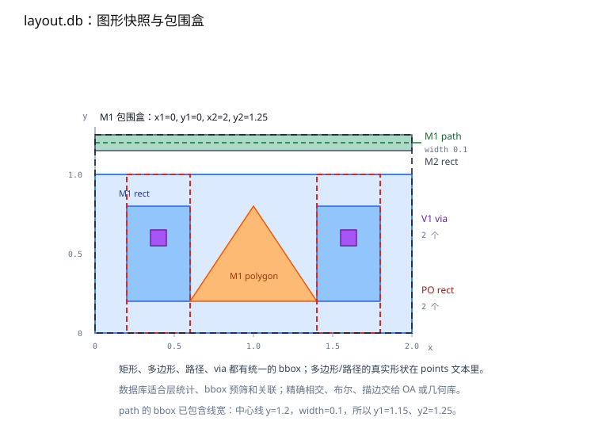

# 第 10 章 版图图形快照

[返回目录](README.md) ｜ [上一章：连接快照](09-connectivity.md) ｜ [选做：项目库](appendix-projects.md)



*图 10.1 `layout.db` 存的是图形目录和包围盒；多边形的真实形状仍在 `points` 文本里，精确几何运算交给 OA 或几何库。*

**本章目标**：把一小组版图图形存进 `layout.db`，用一张表做层统计、包围盒、矩形面积和 via 计数；同时明确数据库不是几何引擎，也不是 OA 的替代品。

**本章从**：`layout` 教程库。

```lisp
load("skill-oo/docs/sqlite/tutorial/setup.il")
ycSQLiteTutorialSetup(?stage 'layout)
lay = ycSQLite::Open("./sqlite-tutorial/layout.db")
```

## 10.1 数据库能做什么，不能做什么

版图数据首先是几何数据：矩形、多边形、路径、via，以及它们的层、目的、坐标和相互关系。

数据库适合做这些事：

- 按层、按 cell 统计图形数量；
- 算包围盒，做窗口预筛；
- 统计 via 类型和数量；
- 把图形和 DRC/LVS 结果、检查记录、waiver 关联起来；
- 保存某个时间点的图形清单，供后续对比。

数据库不适合直接做这些事：

- 精确判断两个多边形是否相交；
- 多边形布尔、描边、扩边、DRC；
- 维护 `dbId`、cellview 生命周期和 OA 编辑事务；
- 把 `points` 文本当成真正的几何对象。

精确几何运算交给 OA 或几何库；数据库保存“有哪些图形、在哪里、属于哪一层”，以及运算结果。这样分工，数据库才能保持简单、可查询、可校验。

## 10.2 一张 `shapes` 表

`layout.db` 只有一张表：

```sql
create table shapes(
    shape_id   integer primary key,
    cell       text not null,
    view       text not null default 'layout',
    layer      text not null,
    purpose    text not null default 'drawing',
    shape_type text not null
               check(shape_type in ('rect', 'polygon', 'path', 'via')),
    x1         real,
    y1         real,
    x2         real,
    y2         real,
    points     text,
    width      real,
    via        text,
    check(shape_type != 'path' or width is not null),
    check(shape_type != 'via' or via is not null)
);
```

`shape_type` 决定后面几列怎么读：

| shape_type | bbox `x1,y1,x2,y2` | `points` | `width` | `via` |
| --- | --- | --- | --- | --- |
| rect | 矩形本身 | 空 | 空 | 空 |
| polygon | 多边形包围盒 | 顶点文本 | 空 | 空 |
| path | 包含线宽的包围盒 | 中心线文本 | 线宽 | 空 |
| via | via 切割包围盒 | 空 | 空 | via 名 |

当前快照的 10 个图形：

| shape_id | layer | shape_type | bbox | 补充 |
| --- | --- | --- | --- | --- |
| 1 | M1 | rect | (0,0)-(2,1) | |
| 2 | M1 | rect | (0.2,0.2)-(0.6,0.8) | |
| 3 | M1 | rect | (1.4,0.2)-(1.8,0.8) | |
| 4 | M1 | polygon | (0.6,0.2)-(1.4,0.8) | points `0.6,0.2 1.4,0.2 1.0,0.8` |
| 5 | M1 | path | (0,1.15)-(2,1.25) | points `0,1.2 2,1.2`，width 0.1 |
| 6 | V1 | via | (0.35,0.45)-(0.45,0.55) | via `V1` |
| 7 | V1 | via | (1.55,0.45)-(1.65,0.55) | via `V1` |
| 8 | PO | rect | (0.2,0)-(0.6,1) | |
| 9 | PO | rect | (1.4,0)-(1.8,1) | |
| 10 | M2 | rect | (0,1.15)-(2,1.25) | |

`bbox` 是 `x1,y1` 到 `x2,y2` 的简写。矩形、多边形、路径、via 都有包围盒，所以窗口查询可以先统一用这四列做粗筛。

path 的 bbox 已经把线宽算进去：中心线在 `y = 1.2`，线宽 `0.1`，所以 `y1 = 1.15`、`y2 = 1.25`。如果只按中心线算包围盒，会漏掉半个线宽。

## 10.3 按层和图形类型统计

```lisp
ycSQLiteTutorialShow(lay->query(strcat(
    "select layer, shape_type, count(*) as n "
    "from shapes "
    "group by layer, shape_type "
    "order by layer, shape_type;"
)))
; => layer  shape_type  n
;    -----  ----------  -
;    M1     path        1
;    M1     polygon     1
;    M1     rect        3
;    M2     rect        1
;    PO     rect        2
;    V1     via         2
```

这是版图统计里最常用的一张表：每一层有多少个矩形、多边形、路径、via。`group by` 的两个列就是统计口径；换一个口径，就换一组 `group by`。

## 10.4 每层的包围盒

```lisp
ycSQLiteTutorialShow(lay->query(strcat(
    "select layer, "
    "       min(x1) as min_x, min(y1) as min_y, "
    "       max(x2) as max_x, max(y2) as max_y "
    "from shapes "
    "group by layer "
    "order by layer;"
)))
; => layer  min_x  min_y  max_x  max_y
;    -----  -----  -----  -----  -----
;    M1     0      0      2      1.25
;    M2     0      1.15   2      1.25
;    PO     0.2    0      1.8    1
;    V1     0.35   0.45   1.65   0.55
```

`min` / `max` 只做数值比较，不理解图形。对矩形、 多边形、路径、via 都适用，因为每一行都有统一的 `x1,y1,x2,y2`。

M1 的 `max_y` 是 1.25，不是 1.0：路径的线宽把中心线 `y = 1.2` 向上下各扩了 0.05，所以 bbox 到 1.25；M2 恰好也占 1.15–1.25。包围盒是“所有图形的外框”，不是“最大矩形”。

## 10.5 矩形面积

只对矩形算面积：

```lisp
ycSQLiteTutorialShow(lay->query(strcat(
    "select layer, sum((x2 - x1) * (y2 - y1)) as rect_area "
    "from shapes "
    "where shape_type = 'rect' "
    "group by layer "
    "order by layer;"
)))
; => layer  rect_area
;    -----  ---------
;    M1     2.48
;    M2     0.2
;    PO     0.8
```

矩形面积可以直接用 bbox 算，因为矩形的 bbox 就是它本身。多边形和路径不能这样算：

- 多边形要用顶点做鞋带公式；
- 路径要用中心线和线宽描边，可能有圆头、方头、斜接；
- via 的面积要单独按 via 定义算，不是 bbox 面积。

所以这条查询加了 `where shape_type = 'rect'`。如果去掉，`sum` 会把不同图形的 bbox 面积混在一起，结果没有物理意义。

## 10.6 统计 via

```lisp
ycSQLiteTutorialShow(lay->query(strcat(
    "select via, count(*) as n "
    "from shapes "
    "where shape_type = 'via' "
    "group by via "
    "order by via;"
)))
; => via  n
;    ---  -
;    V1   2
```

via 的 `via` 列保存 via 名，`bbox` 保存切割包围盒。这样既能按 via 类型计数，也能用 bbox 做窗口查询。

## 10.7 用包围盒做窗口预筛

查一个窗口 `(0.3,0.3)` 到 `(0.7,0.7)` 里可能出现的图形：

```lisp
ycSQLiteTutorialShow(lay->query(strcat(
    "select shape_id, layer, shape_type "
    "from shapes "
    "where x2 >= 0.3 and x1 <= 0.7 "
    "  and y2 >= 0.3 and y1 <= 0.7 "
    "order by shape_id;"
)))
; => shape_id  layer  shape_type
;    --------  -----  ----------
;    1         M1     rect
;    2         M1     rect
;    4         M1     polygon
;    6         V1     via
;    8         PO     rect
```

这四个条件的意思是“bbox 和窗口有重叠”：

- `x2 >= 0.3`：图形右边不小于窗口左边；
- `x1 <= 0.7`：图形左边不大于窗口右边；
- `y` 方向同理。

这是**预筛**，不是精确相交。多边形的 bbox 可能和窗口重叠，但多边形本身可能没有覆盖窗口；要得到精确结果，还要把候选图形交给几何库做真正的相交判断。

## 10.8 多边形和路径的文本几何

`points` 是文本，不是 SQLite 的几何类型：

```lisp
ycSQLiteTutorialShow(lay->query(strcat(
    "select shape_id, shape_type, points, width "
    "from shapes "
    "where shape_type in ('polygon', 'path') "
    "order by shape_id;"
)))
; => shape_id  shape_type  points                   width
;    --------  ----------  -----------------------  -----
;    4         polygon     0.6,0.2 1.4,0.2 1.0,0.8
;    5         path        0,1.2 2,1.2              0.1
```

SQLite 只能把 `points` 当字符串处理：可以判断非空、取长度、做 `LIKE`，但不能直接算面积、判断相交或描边。要解析顶点，应该在 SKILL 里按空格和逗号拆分，或交给几何库。

这也是为什么表里同时存了 bbox：窗口查询、层统计、包围盒都可以用普通的数值列完成，不需要每行都解析 `points`。

## 10.9 本章检查点

```lisp
car(lay->query("select count(*) from shapes;")->rows())->get(0)
; => 10

car(lay->query("select count(distinct layer) from shapes;")->rows())->get(0)
; => 4

car(lay->query("select count(*) from shapes where shape_type = 'via';")->rows())->get(0)
; => 2
```

再确认 M1 的包围盒是 `(0,0)-(2,1.25)`，via 只有 `V1` 两个。如果数字对不上，先查 `shape_type` 和 bbox 列是否填完整。

## 10.10 常见错误

- **把 `points` 当几何类型。** 它只是文本；面积、相交、描边都要在程序或几何库里做。
- **用 bbox 当精确结果。** bbox 只适合预筛；窗口重叠不代表图形真的相交。
- **path 的 bbox 不含线宽。** 只按中心线算会漏掉半个线宽。
- **把不同 shape_type 的面积混在一起。** 矩形、多边形、路径、via 的面积定义不同，不能共用一条公式。
- **把 `layout.db` 当 OA。** 它没有 `dbId`、cellview 生命周期、编辑事务，也没有 OA 的几何约束；OA 仍然是设计数据的源头。
- **忘记 `cell` / `view`。** 一个库会存很多 cell，没有这两列就无法区分同名图形。

## 10.11 练习

1. 给 `NAND2_X1` 增加两条 M1 矩形，按 cell 和 layer 重新统计数量。
2. 查 bbox 完全落在 M1 大矩形 `(0,0)-(2,1)` 内的图形。
3. 增加一个 `V2` via，比较 `V1` 和 `V2` 的数量。
4. 设计一张 `drc_hits` 表，用 `shape_id` 指向 `shapes`，讨论外键和删除策略；先画表结构，不急着写 SQL。

关闭会话：

```lisp
lay->close()
```

数据库保存的是“图形目录”和“可查询的摘要”，不是几何引擎。把精确几何留给 OA 或几何库，数据库就能专注于统计、关联和追踪。

[返回目录](README.md) ｜ [上一章：连接快照](09-connectivity.md) ｜ [选做：项目库](appendix-projects.md)
